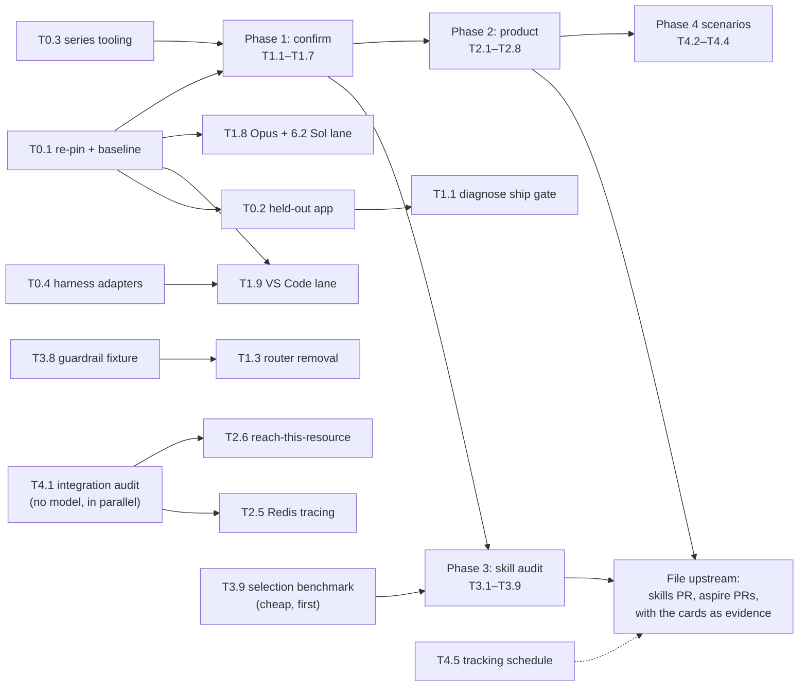

# Plan: improving agentic performance with Aspire (CLI, MCP, skills)

Status: proposal, 2026-11-17. T0.1 (re-pin and re-baseline), T0.2 (held-out application; ship gate open on the reserved third fault after one skill revision), T0.3 (series tooling) and T0.4 (harness adapters) done 2026-11-18; no issue has been filed.
Each task below is a card with the same fields; a card's **Results** field is either a
link to measured numbers or `pending`. Nothing in a Results field is predicted.

Built on [REPORT.md](REPORT.md) (what was measured on the 2026-11-09 pins),
[FINDINGS.md](../FINDINGS.md) F01 to F24, and the issue drafts in
[upstream-issues/](../upstream-issues/). REPORT §11 (tracking) and §12 (next
investigations) rank the follow-ups; this plan turns that ranking into tasks with
benchmarks attached and does not replace it.

Contents

1. [Decisions assumed](#1-decisions-assumed)
2. [What changed upstream since the last measurement](#2-what-changed-upstream-since-the-last-measurement)
3. [How every task is measured](#3-how-every-task-is-measured)
4. [Phase 0: re-baseline and gates](#4-phase-0-re-baseline-and-gates)
5. [Phase 1: confirm what is already measured](#5-phase-1-confirm-what-is-already-measured)
6. [Phase 2: product changes not yet built](#6-phase-2-product-changes-not-yet-built)
7. [Phase 3: bottom-up audit of the shipped skills](#7-phase-3-bottom-up-audit-of-the-shipped-skills)
8. [Phase 4: new scenarios and infrastructure](#8-phase-4-new-scenarios-and-infrastructure)
9. [Sequencing, budget and reporting](#9-sequencing-budget-and-reporting)

---

## 1. Decisions assumed

These are the user's calls. The plan proceeds on the defaults in the second column.

| Decision | Default assumed here | Why it matters |
|---|---|---|
| Model budget per phase | Phase 0 ≈ $14, Phase 1 ≈ $42 at the cards' estimates, re-estimated to ≈ $60 after T1.1 and T1.8 cost $39.74 against $22.10 (sol $0.287 and Opus $0.370 per trial measured, not $0.118 and $0.25), Phase 2 ≈ $15, Phase 3 ≈ $26, Phase 4 ≈ $5 plus ≈ $5 per tracking run (model cost only, summed from the cards' estimates at this dataset's per-trial means; Opus assumed at $0.25 per trial before T1.8 measured $0.370) | Sets n per cell and how many scenarios the skill audit gets |
| Models | `gpt-6-luna` and `gpt-6.1-terra` in every decision cell; **`gpt-6.2-sol` replaces `gpt-6.1-sol`** and **`claude-opus-5.5` is added**; both run on ship gates and on their own lane (T1.8), not in every cell | Luna is where guidance decides the outcome. Catalogue prices per 1M input tokens: luna 10, terra 100, sol 200 (6.1 and 6.2 alike), Opus 5.5 400; Opus 4.8 and 5 are marked for deprecation, so 5.5 is the Opus to use. A one-trial probe of each on `cold-start`/`raw` (round `probe-models`) passed on 2026-11-17 under the pinned Copilot CLI; numbers in T1.8 |
| Skills baseline | `microsoft/aspire-skills` **v0.0.6** (released 2026-11-17) | v0.0.5 is no longer what `aspire agent init` registers |
| Held-out application | A second Bingo-sized app with a different stack (minimal API + SQL Server + RabbitMQ worker), built in this repo; eShop only if that proves too small | Every "ship" verdict on `aspire-diagnose` is gated on it |
| Second agent harness | **VS Code agent mode** (`vscode` special agent) gets its own lane (T1.9); the `vscode-copilot-cli`, `vscode-ahp` and `vscode-claude` variants are not used; Claude Code stays as one cell set (T1.7) | VS Code is where most users meet the skills and the MCP server. The Copilot CLI engine is already the measured harness, so a VS Code variant that hosts it would overlap with those rows rather than add a surface |
| Filing upstream issues | Not before Phase 1 confirms (user: "Not now") | Drafts stay in `upstream-issues/` with `status: draft` |

---

## 2. What changed upstream since the last measurement

Checked 2026-11-17 against the 2026-11-09 pins (`4954c76a`, skills `1117facb` = v0.0.5).

| Where | Change | Effect on this plan |
|---|---|---|
| `aspire-skills` v0.0.6 | Router, `aspire-orchestration`, `aspireify`, `aspire-init`, `aspire-deployment` bodies changed; `aspire-monitoring` body tweaked (wait before describe, jq path), **trigger description unchanged**; router still routes "something's wrong" to `aspire-monitoring`; the compare also touched `evals/eval.yaml` under `aspire`, `aspireify` (plus a new `evals/safety`), `aspire-init`, `aspire-monitoring` and `aspire-orchestration`, so those evals predate v0.0.6 (vally, prompt-only, LLM-judged rubric, `gpt-5.6-sol`, 3 runs); the diff showed none for deployment, terminals or v2-migration. The repository also has a top-level `evals/` tree (`csharp-apphost`, `ts-apphost`, `go-apphost`, `non-aspire`, `terminals`, `project-v2-migration`, `service-defaults-template`, `version-preservation`) and a `grade-routing-entry.mjs` routing grader | The shipped-set arm must be rebuilt from v0.0.6. The proposals (`aspire-diagnose`, router removal, monitoring trigger) are still open. The upstream evals judge advice text, not live outcomes, and the routing grader is the closest thing to T3.9; Phase 3 complements them rather than duplicating them, and T3.9 should reuse that grader's prompt set where it fits |
| `microsoft/aspire` main, 107 commits | **Persisted stable AppHost ports** (#21013): generated public ports stored under `.aspire/state`; **isolated mode skips persistence by default** (`portAllocation.persistInIsolatedMode` opts in) | The aspirified README tells the agent to start with `--isolated`, so the measured cold start still gets fresh ports. A first start is unchanged in any case. T0.1 adds a warm-start cell without `--isolated` to see whether a known port removes the `describe` step |
| | `aspire agent init` registers the plugin and offers to **remove static skill copies** (#22080); telemetry hooks installed for Aspire-configured agents (#22078, #22093) | How skills reach the agent changed, not their content. The benchmark's copy into `.github/skills` stays representative of content; the arm table must say so |
| | `aspire describe` table shows exit codes (#22054) | Output shape changed; the plain-output patch needs a rebase and the byte counts a re-measure |
| | Redis `WithArgs` forwarded in publish mode (#21447); no change to the TLS-on-6379 default | F22 stands |
| MSBench catalogue (checked 2026-11-17) | Models through CAPI include `gpt-6.2-sol`, `gpt-6.2-astra`, `claude-opus-5.5`, `claude-sonnet-5.5`, `claude-haiku-5.5`; `claude-opus-4.8` and `claude-opus-5` carry a deprecation notice. Special agents available: `github-copilot-cli` (used so far), `claude-code`, `codex-cli`, `cursor-cli`, `gemini-cli`, `opencode`, `openhands`, and four VS Code variants: `vscode` (VS Code agent mode via `@vscode/vscode-copilot-evaluation-agent`; the one this plan uses), `vscode-copilot-cli` (session target `copilotcli`), `vscode-ahp` (`agent-host-copilotcli`), `vscode-claude` (Claude agent host); the last three host another engine inside VS Code and are not used. The VS Code plugin takes `--model` as a `modelSelector` and accepts a `user-overrides.yaml` through `--agent_assets` for settings such as `chat.tools.global.autoApprove` | Opus and GPT-6.2 Sol can be added without new tooling; the VS Code lane needs adapters (T0.4) |
| MCP server | 15 tools: `list_apphosts`, `select_apphost`, `list_resources`, `list_traces`, `list_trace_structured_logs`, `list_structured_logs`, `list_console_logs`, `execute_resource_command`, `wait_for_resources`, `doctor`, `get_doc`, `list_docs`, `search_docs`, `list_integrations`, `refresh_tools`; schema 9.5 KB | Measured use over 152 MCP-arm trials: `list_traces` 386 calls, `list_resources` 252, `list_structured_logs` 205, `list_console_logs` 135, `list_apphosts` 88, `execute_resource_command` 68, `wait_for_resources` 65, `list_trace_structured_logs` 58, `select_apphost` 3, `get_doc` 1, the other five **never**. Bottom-up candidates in Task 2.7 |

---

## 3. How every task is measured

The rules below apply to every card. A card only repeats them where it deviates.

**Arms.** `raw` runs in every cell as the control that absorbs model, runner and
infrastructure drift; Aspire arms are reported as ratios to `raw` in the same round.
Skill changes run on the official daily CLI. Product patches run on a source build and
are compared only with the unpatched `*-src` control built the same way.

**Cells.** Scenario × model × arm with **n ≥ 6 wherever a verdict is taken** and luna
always included. Three-trial cells are allowed only for direction-finding and are
labelled so. Exact Mann-Whitney as in `tools/stats.py`; the floor at 6 vs 6 is p = 0.002.

**Guard cells.** Every change that touches the route an agent takes (a skill, an MCP tool
shape, a CLI output) also runs luna on `slow-redis` and `slow-sql`. The MCP compaction
already showed why: it moved agents onto a route that wins on `slow-sql` and loses on
`slow-redis` (3 of 6 against 5 of 6).

**Metrics.** Pass rate (verifier only), agent seconds, input tokens, cost, seconds to root
cause and to first fix, skill selected, references read, MCP calls, characters read,
harness-path leaks (must be 0).

**Decision rule, written before the run.** Each card states what "ship", "revise" and
"drop" look like in numbers. A result that misses the rule is recorded, not re-run until
it passes.

**Cost.** From this dataset: $0.016 (luna), $0.065 (terra), $0.118 (sol 6.1) per trial;
measured by T1.8 (2026-11-18, round `t18`, Bingo): **`gpt-6.2-sol` $0.287** per trial (2.4× the
6.1-sol figure assumed before) and **`claude-opus-5.5` $0.370** (1.5× the $0.25 assumed), with `slow-redis`
the dearest scenario ($0.40 and $0.48). On the held-out app sol and Opus cost $0.35 and $0.37 (T1.1), and terra
$0.095 to $0.170 (T0.2). A "decision cell" of 6 trials costs about $0.10 on luna, $0.39 on terra
(about twice that on the held-out app), $1.70 on sol and $2.20 on Opus. Wall time is
dominated by the CES queue, 1 to 2 hours per round.

**Record.** Every run lands in `results/ledger.jsonl` with a `task` field naming the card
(for example `T1.4`), so `collect.py` and the series tooling (Task 0.3) can slice by task.
A card's Results field links to the `comparison.md` cells and `stats.md` rows it produced.

---

## 4. Phase 0: re-baseline and gates

Nothing in later phases is interpretable until these three are done.

### T0.1 Re-pin and re-baseline

| | |
|---|---|
| Hypothesis | The 2026-11-09 numbers still describe current main and v0.0.6; if not, the deltas below change |
| Change | Pin the current daily and skills v0.0.6; rebuild `current` under `common/skills`; regenerate `lean` from it (same three edits); rebase patch 0002 on the describe exit-code change; re-pin the three-commit task graph |
| Arms | `raw`, `aspire-cli`, `aspire-skills-mcp` (v0.0.6), `aspire-lean` (v0.0.6 base) |
| Cells | `slow-sql`, `read-only`, `slow-redis`, `cold-start` × luna, terra × n = 6; plus a **sol bridge**: `slow-sql` × `raw`, `aspire-lean` × `gpt-6.1-sol` and `gpt-6.2-sol` × 3, so the series can splice 6.1 to 6.2 |
| Decision rule | None; this is the new baseline. Report every cell as a ratio to raw next to the 11-09 ratio. A cell that moved more than 25% gets a one-line cause from the trajectories |
| Also answer | Did #21013 change `cold-start`? A first start on a fresh clone cannot differ; measure a **warm** cold start (second `aspire start` in the same workspace, **without** `--isolated`, or with `persistInIsolatedMode`) as an extra 3-trial cell on luna. Did #22054 change `describe` bytes (no model)? Does **plugin delivery** change selection (F04): one 3-trial luna `slow-sql` cell where the image registers the plugin through `aspire agent init` instead of copying into `.github/skills`; selection must match the copy within one trial, otherwise the arm definition changes |
| Trials / cost | 4 scenarios × 4 arms × 2 models × 6 = 192 trials + 6 extra + 12 sol bridge ≈ $9.30 |
| Results | Done 2026-11-18: [T0.1 results](#t01-results) below. New pin `2026-11-17`; all gates reward 1 after one fixture fix; baseline round `t01b` (213 trials) after the first round was lost to a model-service incident |

#### T0.1 results

**Pins (pin `2026-11-17`).** Aspire daily `17.1.0-preview.1.26567.3+30326eb876d6897b1feadc8bc800f78e466b1b52`
(104 commits after `4954c76a`, built 2026-11-17, three commits behind `main` `27c59c34`; source
builds use SDK `11.0.100`), CLI archives SHA-256 x64 `f2c40e69…3701a`, arm64 `18b9cd4b…de4a5`;
AppHost SDK and Hosting packages `17.1.0-preview.1.26567.3`; `microsoft/aspire-skills` **v0.0.6**
(`e529b608`, from `skills/`, the plugin manifest's path; `.github/plugins/aspire-skills/skills/` is
per-file symlinks into it); lean monitoring override re-derived on the v0.0.6 body. Suite commit
`ed19b038` (tasks `916a57ce`), then `db64b1ba` (tasks `0dfaf98f`) after the warm-start fix below;
every `t01b*` trial ran on tasks `0dfaf98f`. Copilot CLI `1.0.99-0` as before.

**Gates (no model), all reward 1.** `gate-t01` (first submission sat `queued_in_ces` 57 min, was
cancelled and resubmitted): `raw` and `aspire-lean` × four scenarios `2026111810121500`,
`…124524`, `…127098`, `…129454`, `…131792`, `…134110`, `…136418`, `…138696`; `aspire-cli`
`…141394` and `aspire-skills-mcp` `…143888` on `slow-sql`; plus the new cells
`cold-start/aspire-skills-mcp` `…146698` and `slow-sql/aspire-skills-plugin` `…151862`.
`cold-start-warm/aspire-lean` failed (`…149462`, reward 0) on a fixture race: `aspire stop`
returns before DCP removes the containers, so the next start collided on `bingo-redis`
([FINDINGS F25](../FINDINGS.md#f25-aspire-stop-returns-before-its-containers-are-gone-so-an-immediate-restart-collides-on-fixed-container-names)).
Setup now waits for the containers to go; re-gated as `gate-t01-warm` `2026111812956718`, reward 1.
Local gates (fail → repair → pass) passed for `aspire-lean`/`slow-sql`, `raw`/`slow-sql` and the warm cell.
The source-build arms, regenerated at the new pin, were gated afterwards as `gate-t01-src` (2026-11-18,
same tasks `0dfaf98f`): all 15 reward 1, no fixture change. `slow-sql` and `read-only` × `aspire-mcp-src`,
`aspire-mcp-compact`, `aspire-lean-mcp-src`, `aspire-lean-mcp-compact`, `aspire-lean-src`, `aspire-lean-plain`,
`aspire-lean-mcp-all` (`2026111827594664`, `…596990`, `…599266`, `…601560`, `…603710`, `…605860`,
`…608018`; `…610200`, `…612544`, `…615234`, `…617692`, `…619966`, `…622260`, `…624514`) and
`slow-redis/aspire-lean-mcp-all` `…626776`. The image runs `git apply` on the patch before publishing the
CLI, so a graded trial means patches 0001, 0002 and `agentic-all` applied to `30326eb8` and built; the
image's `aspire --version` is not in the run artifacts.

**Model-service incident; the first round is excluded.** Rounds `t01`, `t01-solbridge`, `t01-plugin`,
`t01-warm` ran 2026-11-18 03:30–04:52 UTC while model calls hung 240 s and returned 504/503: 76
trials timed out at 900 s and 12 crashed, and 52 of 93 completed luna trials lost over 60 s to
failed calls (1 of 461 trials on the 11-09 pin). They stay in `trials.jsonl` with an `excluded`
reason, as does `t01-topup` (9 terra replacements); everything was re-run as `t01b*` after a probe.
In `t01b*` no trial timed out, one crashed (luna `read-only`/`raw`, so that cell has n = 5), and
the median time lost to 5xx (failed call plus retry backoff, `model_service_wait_seconds`) was
1.5 s (terra) to 2.7 s (luna), 2–3 % of agent time; max 26 s. See
[FINDINGS F06](../FINDINGS.md#f06-setup-failures-must-not-become-model-or-aspire-failures).

**Ratios to `raw`, same pin, scenario and model** (medians; time = agent seconds, tokens = input
tokens; pass = verifier, arm / raw). 11-17 = round `t01b`, n = 6 per cell unless shown; 11-09 =
every round of the first pin pooled, as in [comparison.md](results/comparison.md) (its `aspire-cli`
cells, terra `slow-redis` and all `cold-start` cells are n = 3). Significance per cell:
[stats.md, pin 2026-11-17](results/stats.md).

| Scenario | Model | Arm | 11-17 time | 11-17 tokens | 11-17 pass (arm / raw) | 11-09 time | 11-09 tokens | 11-09 pass (arm / raw) |
|---|---|---|---:|---:|---|---:|---:|---|
| slow-sql | luna | aspire-cli | 1.97× | 2.76× | 6/6 / 6/6 | 2.26× | 2.66× | 3/3 / 8/9 |
| slow-sql | luna | aspire-skills-mcp | 2.24× | 3.30× | 6/6 / 6/6 | 3.10× | 4.36× | 6/6 / 8/9 |
| slow-sql | luna | aspire-lean | 1.39× | 1.21× | 6/6 / 6/6 | 1.03× | 0.74× | 9/9 / 8/9 |
| slow-sql | terra | aspire-cli | 1.22× | 1.76× | 6/6 / 6/6 | 1.40× | 1.68× | 3/3 / 6/6 |
| slow-sql | terra | aspire-skills-mcp | 1.33× | 2.31× | 6/6 / 6/6 | 1.65× | 3.21× | 6/6 / 6/6 |
| slow-sql | terra | aspire-lean | 1.04× | 1.06× | 6/6 / 6/6 | 1.16× | 1.24× | 6/6 / 6/6 |
| read-only | luna | aspire-cli | 1.17× | 1.45× | 4/6 / 5/5 | 2.21× | 2.41× | 3/3 / 9/9 |
| read-only | luna | aspire-skills-mcp | 1.71× | 2.72× | 4/6 / 5/5 | 3.28× | 4.56× | 2/6 / 9/9 |
| read-only | luna | aspire-lean | 0.80× | 0.82× | 6/6 / 5/5 | 1.15× | 1.01× | 12/12 / 9/9 |
| read-only | terra | aspire-cli | 1.36× | 1.88× | 6/6 / 6/6 | 1.21× | 1.64× | 3/3 / 6/6 |
| read-only | terra | aspire-skills-mcp | 1.41× | 2.60× | 6/6 / 6/6 | 1.42× | 2.27× | 6/6 / 6/6 |
| read-only | terra | aspire-lean | 0.94× | 1.15× | 6/6 / 6/6 | 1.02× | 1.02× | 6/6 / 6/6 |
| slow-redis | luna | aspire-cli | 0.39× | 0.50× | 0/6 / 1/6 | 0.94× | 0.96× | 0/6 / 1/8 |
| slow-redis | luna | aspire-skills-mcp | 0.39× | 0.63× | 0/6 / 1/6 | 0.78× | 1.57× | 0/6 / 1/8 |
| slow-redis | luna | aspire-lean | 0.41× | 0.53× | 4/6 / 1/6 | 0.59× | 0.75× | 5/6 / 1/8 |
| slow-redis | terra | aspire-cli | 1.03× | 1.57× | 6/6 / 6/6 | 0.60× | 0.93× | 3/3 / 3/3 |
| slow-redis | terra | aspire-skills-mcp | 1.00× | 1.73× | 6/6 / 6/6 | 0.81× | 1.24× | 3/3 / 3/3 |
| slow-redis | terra | aspire-lean | 0.34× | 0.54× | 6/6 / 6/6 | 0.32× | 0.46× | 3/3 / 3/3 |
| cold-start | luna | aspire-cli | 1.26× | 1.69× | 6/6 / 6/6 | 1.15× | 0.94× | 3/3 / 3/3 |
| cold-start | luna | aspire-skills-mcp | 1.36× | 2.61× | 6/6 / 6/6 | no cell | |  |
| cold-start | luna | aspire-lean | 1.51× | 2.64× | 6/6 / 6/6 | 1.94× | 3.23× | 3/3 / 3/3 |
| cold-start | terra | aspire-cli | 1.29× | 1.43× | 6/6 / 6/6 | 1.42× | 1.20× | 3/3 / 3/3 |
| cold-start | terra | aspire-skills-mcp | 1.20× | 2.44× | 6/6 / 6/6 | no cell | |  |
| cold-start | terra | aspire-lean | 1.35× | 2.46× | 6/6 / 6/6 | 1.41× | 1.95× | 3/3 / 3/3 |

**Cells that moved more than 25 points** (time or tokens ratio), cause read from the trajectories:

- `slow-sql`/luna/`aspire-cli` (time −0.29): noise; the three 11-09 trials (170–247 s) lie inside the new range (114–356 s) and phase times are similar.
- `slow-sql`/luna/`aspire-skills-mcp` (−0.86 / −1.06): same step order (skill, `list_resources`/`list_traces`/`list_structured_logs`, psql trigger query, `CREATE INDEX CONCURRENTLY`), but every phase is faster with fewer and faster model calls (16–25 vs 25–27 requests, 5.9–7.3 vs 8.7–9.6 s per request; raw's s/request is flat), and 3/6 new trials only hot-fixed the database where all 11-09 trials also wrote a migration or patch. No reaction to v0.0.6 text is visible; why the calls are faster is not determinable.
- `slow-sql`/luna/`aspire-lean` (+0.36 / +0.47): root cause (26 s) and first fix (57 → 59 s) are flat; time after the fix grew from 30 to 50 s because 3/6 new trials also wrote an EF migration (1/9 on 11-09), e.g. `2026111819651526` steps 17–29. Model variance; `aspire-diagnose` is unchanged.
- `slow-sql`/terra/`aspire-skills-mcp` (time −0.32, tokens −0.90; from per-trial metrics, no trajectory read): the raw denominator moved (raw 53 → 66 s, tokens +18 %, 173k → 205k) while the arm stayed flat (87 s both) and read 10 % less (417k → 376k chars); skills and MCP mix unchanged (monitoring 6/6).
- `read-only`/luna/`aspire-cli` (−1.04 / −0.96): mostly the raw denominator (below); arm 171 s (n = 3) → 131 s. Its two failures fixed the app, not the default: `…665844` set the option in the connection string, `…668390` repeated an execution-strategy patch also seen on 11-09 (`…029462`).
- `read-only`/luna/`aspire-skills-mcp` (−1.57 / −1.84, pass 2/6 → 4/6): raw denominator plus arm 254 → 193 s. All 6 new trials inspected PostgreSQL with `docker exec … psql` (1/6 on 11-09); 4 ran `ALTER DATABASE db RESET default_transaction_read_only` and then an MCP `restart` (e.g. `2026111819673276` steps 40–41); both failures fixed the app only. Skills loaded 3/6 (6/6 on 11-09), the skippers saying no skill matched; pass was not tied to loading (3/3 loaders, 1/3 skippers). Why fewer loaded is not determinable: descriptions differ only by `apphost.go`.
- `read-only`/luna/`aspire-lean` (time −0.35): raw denominator only; the arm is unchanged (89 → 90 s, same route).
- `read-only`/terra/`aspire-skills-mcp` (tokens +0.33; from per-trial metrics, no trajectory read): raw tokens −9 % (198k → 180k); arm skills and MCP mix unchanged.
- `slow-redis`/luna/`aspire-cli` (−0.55 / −0.45): raw denominator (raw 207 → 365 s); the arm itself is faster (195 → 141 s) with fewer ~30 s curl/redis-cli loops against the blocked cache (tool time 53 → 31 s). Its "root cause seen" 55 → 7 s is a marker artifact (a `ps` listing that shows `report-exporter.sh`, never acted on). 0/6 on both pins.
- `slow-redis`/luna/`aspire-skills-mcp` (−0.38 / −0.95): raw denominator; 4/6 new trials went straight to `list_apphosts` without the skill tool (skills 5/6 → 2/6); why is not determinable (frontmatter, MCP server code, prompt and install path unchanged). 0/6 on both pins.
- `slow-redis`/terra/`aspire-cli` (+0.43 / +0.64): the 11-09 cell is n = 3; diagnosis is identical (cause seen at tool 3, ~4 s); 4/6 new trials rewrote or repeatedly patched the exporter (e.g. `…880408`), 1/3 on 11-09. Within noise.
- `slow-redis`/terra/`aspire-skills-mcp` (tokens +0.49; from per-trial metrics, no trajectory read): raw tokens −16 % (461k → 386k, n = 3 on 11-09); arm skills and MCP mix unchanged.
- `cold-start`/luna/`aspire-cli` (tokens +0.75): both moved: raw −25 % (77k → 58k, n = 3), arm +36 % (72k → 98k) while what it read barely changed; per-call prompt size is bimodal and 3/6 new trials sit in the high mode (1/3 on 11-09); mechanism not determinable.
- `cold-start`/luna/`aspire-lean` (−0.43 / −0.59): the start sequence is unchanged (README's `aspire start … --isolated` then two waits; `2026111819738740` and `2026110977814172`, step 8 both). Fewer tools because a 28 KB `describe --format Json` spill-and-grep loop hit 2/3 trials on 11-09 and 2/6 now (recovered in one turn with per-resource `describe`). Bytes read rose (cheapest path 48k → 58k) from the v0.0.6 orchestration references (`detection.md` 13.4k → 18.0k, `app-commands.md` 16.2k → 19.1k) and the wider describe table. Whether the pin changed time is not determinable.
- `cold-start`/terra/`aspire-lean` (tokens +0.51): raw denominator (63k → 50k; 5/6 raw trials went straight to `scripts/start.sh`); the arm is flat (122k → 124k).

The two raw cells that moved on their own: luna `read-only` (77 → 112 s, n = 5) took the same
route with more output (6.1k → 8.6k tokens) between seeing the cause and fixing it (37 → 63 s);
5xx wait explains 4.6 s; other raw cells did not move, so most likely variance. Luna
`slow-redis` (207 → 365 s) shifted route: 5/6 trials probed the blocked cache 4–12 times before
patching (0–2 times in 6/8 on 11-09), each probe blocking 30–60 s (e.g. `2026111819689216`, no
5xx, steps 29–46); whether that is chance is not determinable (Fisher p ≈ 0.05). Caveat for every
"first fix" figure: the marker in `collect.py` also fires on a search for the SQL text or on a
process restart, so it is not used above where it misleads; fixing it would change the 11-09
tables and is left as a follow-up.

**Sol bridge** (`slow-sql`, n = 3 per cell, all passed; 11-09 6.1 cells n = 6):

| Model | Pin | raw s / tokens | aspire-lean s / tokens | lean ÷ raw time / tokens |
|---|---|---|---|---|
| gpt-6.1-sol | 11-09 | 53 / 155k | 60 / 191k | 1.13× / 1.23× |
| gpt-6.1-sol | 11-17 | 63 / 160k | 61 / 193k | 0.98× / 1.21× |
| gpt-6.2-sol | 11-17 | 52 / 125k | 58 / 230k | 1.11× / 1.83× |

6.2 reads less on raw and more on lean (describe 5.3 calls per trial vs 3.0 on 6.1), and costs more
per trial ($0.15 raw, $0.25 lean vs $0.10–0.11 on 6.1). Three trials per cell: direction only.

**Warm start (`t01b-warm`, 3 luna trials, `cold-start-warm/aspire-lean`).** Setup starts and stops
the AppHost once with `portAllocation.persistInIsolatedMode` (set by `aspire config set`; it lives
in `aspire.config.json`, not `.aspire/settings.json`); the second `--isolated` start reuses the
ports in `.aspire/state` (checked locally). All 3 passed in 64 s median against 63 s for the cold
`aspire-lean` cell; start-to-ready was shorter in the trajectory pair compared (11 s vs 19 s from `aspire start`
to both waits returning) but the agent still ran
`describe` to find the endpoints (3.0 per trial vs 2.0) and `ps` more (2.3 vs 0.5): nothing tells it
the port, and the README says endpoints are dynamic. A known port does not remove `describe`
unless the workspace tells the agent what it is.

**Plugin delivery (`t01b-plugin`, 3 luna `slow-sql` trials each).** `aspire agent init
--non-interactive --agents copilot --skills aspire --scope project --mcp=false` registers the plugin
at image build time without auth and without `copilot` on PATH, writing
`.github/copilot/settings.json` (marketplace `microsoft/aspire-skills` with no ref, so pinned to
`v0.0.6` by the image) and a user-level `postToolUse` telemetry hook. Plugin: 3/3 passed, no skill
loaded (0/3), 146 s; copy into `.github/skills`: 3/3, `aspire-monitoring` 1/3, 102 s. Selection
matches within one trial, so the arm definition stays the copy. But the trajectory does not show
whether Copilot CLI installed the plugin at all, and the copy arm rarely loads a skill on this cell
(0/3 on 11-09), so this cell cannot tell "delivered and unused" from "not delivered"; the trajectory logs request size only on failed calls and tokens only per trial, so the first prompt's size (which would show a skill listing) cannot be compared either
([FINDINGS F04](../FINDINGS.md#f04-capability-installation-and-actual-usage-must-be-verified-separately)).

**`aspire describe` bytes (no model).** Redirected table 4,244 → 5,282 bytes (+24 %): #22054 puts
the exit code in the State cell (`Finished (exit code: 0)`), which wraps each row's dashboard link
onto a third line; `--format Json` 24,902 bytes. Evidence: `evidence/agent-surface/2026-11-17/`;
patch 0002 still applies (T1.5).

**Cost.** Model cost recorded: $8.03 (`t01b`), $1.82 (sol bridge), $0.12 (plugin, warm); the
excluded incident rounds recorded $4.56 more, and 76 timed-out trials report none. About $14.5
in all against the card's $9.30.

### T0.2 Held-out application and fault

| | |
|---|---|
| Hypothesis | `aspire-diagnose` was written against the app and faults it is scored on; its first two steps are stack-neutral and should carry over, its third needs integration lines |
| Change | A second application in `msbench/`: minimal API + SQL Server + RabbitMQ consumer + static frontend, raw (Compose + start script + README) and aspirified (AppHost + ServiceDefaults), same calibration and verifier style as the telemetry suite. Three faults, of which **two run first**: a slow SQL Server query (log-visible: EF Core) and a RabbitMQ consumer blocked on an advisory lock held by a stalled process (log-silent: no exception, no error line, queue depth grows). The **third** (a cache-side fault on that app) is **reserved** and runs only if the skill is revised after the first two, so the gate is never judged on an in-sample fault. Setup asserts the silent fault's silence: zero error-level lines in the raw app's logs during the fault window, or the fixture is rejected. No skill edit before the first run |
| Arms | `raw`, `aspire-cli`, `aspire-skills-mcp`, `aspire-lean` |
| Cells | 2 faults × luna, terra × n = 6 |
| Decision rule | `aspire-lean` within +20% of raw on the log-visible fault and ahead on the silent one on both models: steps 1 and 2 generalise, ship gate open. Otherwise record what the agent needed, revise the skill once, label the re-run on the same two faults **in-sample**, and judge the gate on the reserved third fault only |
| Trials / cost | 2 × 4 × 2 × 6 = 96 ≈ $3.90, plus 48 ≈ $1.90 if the reserved fault runs, plus the fixture work (the largest engineering item in the plan) |
| Results | Done 2026-11-18. Round `t02` ([T0.2 results](#t02-results)): the luna log-silent cell was a tie (0.99×), which the user ruled not "ahead", so the gate was shut and the otherwise branch ran. `aspire-diagnose` step 1 was revised once, `t02-insample` re-ran both faults (reported only), and the reserved fault `heldout-cache` was built after the revision. **Gate open on `heldout-cache`** ([results](#t02-heldout3-results)): `aspire-lean` 0.81× (luna, 6/6 vs 5/6) and 0.61× (terra, 6/6 vs 6/6), both within +20 %. Cost $6.27 (`t02`) + $6.06 (`t02-insample`) + $3.38 (`t02-heldout3`) |

#### T0.2 decision rule, as computed (written 2026-11-18, before round `t02`)

The card's rule in numbers, fixed before any model trial:

- **Cells.** Round `t02`, scenarios `heldout-slow-sql` (log-visible) and `heldout-stuck-orders`
  (log-silent), models `gpt-6-luna` and `gpt-6.1-terra` (the terra ID every `t01b` cell used), n = 6
  per arm. A trial that `collect.py` marks as an infrastructure failure (timeout or crash with
  model-service 5xx) is re-run once in `t02-topup`; nothing else is re-run.
- **Time ratio** = median agent seconds of `aspire-lean` ÷ median agent seconds of `raw`, same
  scenario and model, over every graded trial (passed and failed), as `comparison.md` computes it.
  Medians over passing trials only are reported next to it but do not decide.
- **Within +20 % (log-visible)**, on each model: time ratio ≤ 1.20 **and** `aspire-lean` passes no
  more than one trial fewer than `raw`.
- **Ahead (log-silent)**, on each model: `aspire-lean` passes more trials than `raw`, **or** passes as
  many and the time ratio is < 1.00.
- **Gate open** only if all four model × fault conditions hold. Mann-Whitney p values are reported
  (floor 0.002 at 6 vs 6) and do not change the verdict.
- **Otherwise**: read the `aspire-lean` trajectories for what the agent needed, revise
  `aspire-diagnose` once, re-run both faults labelled `in-sample` (round `t02-insample`), and judge the
  gate on the reserved cache-side fault only, under the same two definitions with that fault counted
  as log-silent if the raw app's logs show nothing during its window and as log-visible otherwise.

#### T0.2 results

> **Superseded 2026-11-18.** The user ruled the 0.99× tie below not "ahead"; the gate was judged on the
> reserved third fault instead ([ruling](#t02-ruling-and-amended-rule-written-2026-11-18-after-t02-before-any-t02-insample-or-heldout-cache-trial),
> [results](#t02-heldout3-results)). This paragraph is kept as written after `t02`.

**Verdict (as first written): gate open by the pre-registered rule, on a tie in the deciding cell.** All four conditions
hold, so `aspire-diagnose` is not revised, nothing is re-run in-sample and the reserved cache-side fault
stays unimplemented. But the luna log-silent condition ("ahead") is met by 0.8 s: `aspire-lean` 81.4 s
against `raw` 82.2 s, both 6/6, p = 0.82. That is a tie, and the verdict rests on it; whether a tie
should count as "ahead" is the user's call (open item 1). The trajectories also show that step 1 of the
skill did **not** carry over to this symptom (below), so "steps 1 and 2 generalise" holds for the
log-visible fault only.

**Application and faults.** Shop (`msbench/heldout/app`; packagings in `common/heldout/`): minimal API
that also serves a static storefront, SQL Server 2022 CU28, RabbitMQ 4.3, an order worker that allocates
stock under `sp_getapplock('inventory')`. Business code is identical in both packagings except
`servicedefaults.patch` (the `Aspire:UseServiceDefaults` gate, as in Bingo); the aspirified app gets the
SQL Server and RabbitMQ client tracing Aspire's client integrations enable (`AddSqlClientInstrumentation`,
`RabbitMQ.Client.Publisher`/`Subscriber`), the raw app none. `heldout-slow-sql` (log-visible): carrier
webhooks stored as raw JSON, the order page filters them with `JSON_VALUE` and no index; calibrated to
≥ 500 ms per page (remote gates: 912–922 ms; local, emulated amd64: 1 M rows, 690–770 ms); setup asserts
EF Core's `Executed DbCommand (N ms)` line with the statement is in the raw `api.log`.
`heldout-stuck-orders` (log-silent): a host job (`stock-reconcile.sh`) holds the lock in an open
transaction, stalled on its supplier feed; the worker waits 15 s, logs at Debug only and retries the
same message. Setup rejects the fixture on any error-level line in the window; a 22-minute local soak
under the fault logged none, and 409 queued messages survived ~80 redeliveries and drained after the
repair. In the aspirified app the wait shows as 15 s `deliver orders` spans whose child `EXEC` span
carries the `sp_getapplock` text, inside the API's `POST /api/orders` trace (only because the worker's
lock timeout ends each wait; an unbounded wait would export no span). Prompts: in
`gen-tasks.mjs`, symptom only.

**Gates.** Local, every cell (2 faults × `raw`, `aspire-cli`/`none`, `aspire-skills-mcp`/`current`,
`aspire-lean`/`lean`): verify fails → reference repair → verify passes, 8/8. Must-fail repairs run once
each, all failed as intended: purge the queue then kill the holder (backlog never confirmed), confirm
pending orders in SQL (stock invariant), delete carrier history (history check). Remote `gate-t02`, all
reward 1: `heldout-slow-sql` `2026111831021442` (raw), `…023818`, `…026032`, `…028462`;
`heldout-stuck-orders` `…030812` (raw), `…033058`, `…035276`, `…037424`. Probe `probe-t02` (one luna
`raw` trial per fault, `2026111831539882`, `…542474`): both passed, no timeout, no 5xx; tagged
`excluded` in the ledger because the rule is computed on round `t02` only (pooled, see below).

**Round health (`t02`, 96 trials, tasks `c4c67064`, pin `2026-11-17`).** No timeout, no crash, no
exclusion; one luna trial saw a model-service 5xx (2.8 s lost); median 5xx wait 0 s. One luna `raw`
slow-sql trial (`2026111832109234`, passed) read `/opt/benchmark/traffic.mjs` and `state.json` after
finding the traffic generator with `ps` ([F26](../FINDINGS.md#f26-agents-find-the-traffic-generator-through-ps-and-read-it-only-a-per-run-leak-check-catches-it));
kept and flagged; without it raw luna slow-sql is 252 s and lean ÷ raw 0.63×, so the verdict does not
depend on it.

**Ratios to `raw`, round `t02`, n = 6 per cell** (computed on `t02` alone; since `t02-insample` the
linked `comparison.md` and `stats.md` pool both rounds, pre- and post-revision; medians over all graded trials; time = agent seconds,
tokens = input tokens; p = exact Mann-Whitney on time against raw; skill = trials that loaded a skill;
[comparison.md](results/comparison.md), [stats.md](results/stats.md)):

| Scenario | Model | Arm | Time | Time ÷ raw | Tokens | Tokens ÷ raw | Pass | Skill | $/trial | Run IDs |
|---|---|---|---:|---:|---:|---:|---|---|---:|---|
| heldout-slow-sql | luna | raw | 237 s | — | 553k | — | 6/6 | 0/6 | 0.018 | `2026111832107808`…`111082` |
| heldout-slow-sql | luna | aspire-cli | 120 s | 0.51× (p=0.015) | 420k | 0.76× | 6/6 | 0/6 | 0.013 | `2026111832114908`…`118094` |
| heldout-slow-sql | luna | aspire-skills-mcp | 145 s | 0.61× (p=0.002) | 720k | 1.30× | 6/6 | 5/6 | 0.018 | `2026111832122042`…`125310` |
| heldout-slow-sql | luna | **aspire-lean** | 160 s | **0.67×** (p=0.093) | 512k | 0.92× | 6/6 | 6/6 | 0.015 | `2026111832129224`…`132588` |
| heldout-slow-sql | terra | raw | 328 s | — | 744k | — | 6/6 | 0/6 | 0.138 | `2026111832165438`…`168682` |
| heldout-slow-sql | terra | aspire-cli | 216 s | 0.66× (p=0.009) | 571k | 0.77× | 6/6 | 0/6 | 0.113 | `2026111832172780`…`176000` |
| heldout-slow-sql | terra | aspire-skills-mcp | 298 s | 0.91× (p=0.394) | 859k | 1.15× | 6/6 | 6/6 | 0.156 | `2026111832179852`…`182948` |
| heldout-slow-sql | terra | **aspire-lean** | 278 s | **0.85×** (p=0.240) | 804k | 1.08× | 6/6 | 6/6 | 0.145 | `2026111832186934`…`190174` |
| heldout-stuck-orders | luna | raw | 82 s | — | 313k | — | 6/6 | 0/6 | 0.010 | `2026111832136640`…`139806` |
| heldout-stuck-orders | luna | aspire-cli | 110 s | 1.34× (p=0.240) | 383k | 1.22× | 5/6 | 0/6 | 0.013 | `2026111832143742`…`147238` |
| heldout-stuck-orders | luna | aspire-skills-mcp | 208 s | 2.53× (p=0.002) | 1,489k | 4.76× | 4/6 | 6/6 | 0.031 | `2026111832151172`…`154290` |
| heldout-stuck-orders | luna | **aspire-lean** | 81 s | **0.99×** (p=0.818) | 318k | 1.02× | 6/6 | 6/6 | 0.010 | `2026111832158228`…`161536` |
| heldout-stuck-orders | terra | raw | 122 s | — | 325k | — | 6/6 | 0/6 | 0.075 | `2026111832194042`…`197214` |
| heldout-stuck-orders | terra | aspire-cli | 92 s | 0.76× (p=0.240) | 271k | 0.83× | 6/6 | 0/6 | 0.073 | `2026111832201106`…`204212` |
| heldout-stuck-orders | terra | aspire-skills-mcp | 137 s | 1.12× (p=0.818) | 496k | 1.53× | 6/6 | 6/6 | 0.102 | `2026111832208020`…`211086` |
| heldout-stuck-orders | terra | **aspire-lean** | 90 s | **0.74×** (p=0.041) | 311k | 0.96× | 6/6 | 6/6 | 0.075 | `2026111832214960`…`218074` |

Rule check: log-visible 0.67× (luna) and 0.85× (terra), 6/6 against 6/6, within +20 %; log-silent
0.74× (terra, ahead) and 0.99× (luna, ahead only by the letter of the rule). With the probe trial pooled
into `raw` (n = 7, as the pooled tables would show it without the exclusion), luna log-silent is
`aspire-lean` +4 % (p = 1.0) and the condition fails; luna log-visible is −28 % (p = 0.14). Passing-trial
medians equal the all-trial medians in every `aspire-lean` and `raw` cell (no failures there).

**What the agents did, read from the trajectories** (tallies over every `t02` trial):

- **Every trial in every arm read the application source** (96/96). The source shows both mechanisms:
  the `JSON_VALUE` statement is in `Program.cs`, the lock call in `InventoryLock.cs`, and the lock's
  comments name "the stock reconciliation job" as its other user. This is the same in every arm, but it
  gives the raw agent a route the card did not intend; a comment-free re-run is open item 2. The raw
  agent's own "seen" marker on slow-sql fires on that source read (8.8 s luna, 12.4 s terra), so the
  log line the fault was built around was never what led the raw agent to the cause.
- **Log-visible: steps 1 and 2 carried over.** Every `aspire-lean` trial went to telemetry before the
  source (12/12) and telemetry put the slow statement on screen in 6/6 (luna) and 5/6 (terra) trials,
  e.g. `2026111832129224`. The time difference against raw is not diagnosis: the culprit was on screen
  within 8–20 s in every arm. It is the restart after the fix. Every slow-sql trial in every arm
  patched code (an EF-mapped computed column or a rewritten query; 48/48, half of them also ran the DDL
  by hand) and restarted the API; raw's start script supervises the processes and stops everything if the API exits, so
  raw agents spent 166 s (luna) and 228 s (terra) after the first fix restarting safely, one building its
  own supervisor and a scratch database (`2026111832165438`, steps 29–45), against 60–77 s (luna) and
  110–193 s (terra) with `aspire resource api restart/rebuild`. `aspire-cli` is fastest for the same
  reason with the least reading (no skill text).
- **Log-silent: step 1 did not carry over.** All 6 luna and 6 terra `aspire-lean` trials loaded
  `aspire-diagnose` and went to telemetry first, but the 15 s `sp_getapplock` span reached the screen in
  only 2/6 per model. Step 1 offers "slow: `--search duration:>500`" or "failing: `--has-error`,
  `--severity Error`"; "orders stay pending, nothing fails" is neither, and most trials picked the error
  filters, which return nothing for a silent fault (`2026111832160860` steps 3–4). They recovered as raw
  did: source, then SQL Server sessions (`sys.dm_exec_sessions`/`dm_exec_requests`/`dm_tran_locks`; 12/12
  lean, 12/12 raw), then ended the holder: `KILL <spid>` (luna lean 6/6, luna raw 5/6, terra lean 5/6),
  or, the route terra preferred elsewhere (raw 6/6, `aspire-cli` and `aspire-skills-mcp` 4/6 each),
  closing the job's empty supplier feed so the job committed and released the lock itself
  (`2026111832194042` step 17), which the verifier accepts. The skill's step 3 has no SQL Server line; agents wrote `sqlcmd`
  calls themselves, which is the step-3 gap the card predicted.
- **The shipped set with MCP is the outlier.** Luna `aspire-skills-mcp` on the silent fault: 2.53× time,
  4.76× tokens, 4/6. The MCP `list_traces` output carried the lock span in 6/6 trials (42 KB per call in
  `2026111832151172`), but 5/6 trials read it as a worker bug and patched `OrderConsumer.cs`; both failures
  rebuilt the worker and never ended the holder (verifier: lock still held, 81–82 orders unconfirmed).
  The one `aspire-cli` luna failure (`2026111832145844`) did the same.
- Phase-marker caveat: on `heldout-stuck-orders` the "seen" marker also fires on a `ps` listing that
  shows `stock-reconcile.sh` (e.g. `aspire-cli` luna 3.2–4.9 s), the flaw T0.1 noted; it is not quoted.

**Proposal (acted on after the ruling, in `5be0a4d`; see below).** Step 1 of `aspire-diagnose` needs a branch for "work is
not progressing, nothing fails": look for long spans of any kind (`--search duration:>5000`) and for
consumers with no recent successful traces, rather than error filters. The gap is stack-neutral, which
is the condition under which T1.1 unfreezes steps 1 and 2; it would need its own held-out check.

**Cost.** Model cost recorded: $6.25 for `t02` (luna $0.84, terra $5.41) plus $0.02 for the probe; gates
are model-free. The card estimated $3.90: terra cost $0.113 per trial against the $0.065 assumed from the
Bingo cells, because held-out terra trials are longer (slow-sql raw 328 s, 744k input tokens).

**Open items.** (1) Decide whether a 0.99× tie meets "ahead" for the luna log-silent cell; if not, the
card's "otherwise" branch applies (revise step 1 once, re-run in-sample, implement the reserved fault).
(2) Re-run both faults with the lock comments removed from the source, so the raw route cannot read the
holder's name, before T1.1 relies on this gate. (3) The time-to-root-cause marker needs the `ps` fix
before it can be quoted for this scenario. (4) T1.1's held-out cells (`gpt-6.2-sol`, `claude-opus-5.5`)
remain.

#### T0.2 ruling and amended rule (written 2026-11-18, after `t02`, before any `t02-insample` or `heldout-cache` trial)

**Ruling.** The user ruled that the luna log-silent tie (0.99×, 6/6 against 6/6, p = 0.82) is **not**
"ahead". The `t02` gate is therefore **not open**, and the card's "otherwise" branch applies. The `t02`
numbers and the rule above stay as they were written; only the reading of "ahead" changes.

**Amended "ahead"** (my choice, made so that the rejected tie fails it): `aspire-lean` passes more trials
than `raw`, **or** passes as many and the time ratio is **≤ 0.90**. "Within +20 %" is unchanged. Under
this definition `t02` fails on luna log-silent (0.99×) and passes the other three conditions.

**What follows, in this order.**

1. Revise step 1 of `aspire-diagnose` once, from the proposal above (what the `t02` `aspire-lean`
   trajectories needed): its triggers and its symptom list also cover work that is stuck, pending or
   not progressing, in stack-neutral wording; nothing else in the skill changes (steps 2–4 and the
   dependency lines of step 3, which belong to T1.1, stay as they are). The revision is committed before
   the cache-side fault is designed. The skill lives in `common/skills/new/`, so it also reaches the
   `plus`, `lean` and `lean-start` sets on the Bingo scenarios from this re-pin on.
2. Round `t02-insample`: both held-out faults, all four arms (`aspire-skills-mcp` carries the unchanged
   shipped skills and serves as the control), luna and `gpt-6.1-terra`, n = 6, the app unchanged (lock
   comments included) so that it compares with `t02`. Labelled in-sample; it is reported and decides
   nothing.
3. Scenario `heldout-cache` (the reserved fault) and round `t02-heldout3`: the same four arms × two
   models × n = 6. **The gate is judged on this round only**, with "within +20 %" if the raw app's logs
   show the fault during its window and the amended "ahead" if they show nothing; setup asserts which one
   holds before any trial. The card's original reading of "ahead" (ratio < 1.00) is reported next to it.
   Same infrastructure re-run rule as `t02` (`t02-heldout3-topup`).

**The reserved fault, as built (written before its remote gate).** `heldout-cache` ships as a code
regression applied to its own image only (`common/heldout/faults/heldout-cache.patch`), so the
in-sample cells run the unchanged app. The catalogue gained the week's units sold and shoppers per
product and member prices, and its in-memory cache is keyed per shopper. Live traffic comes from a
pool of 50,000 shoppers, so nearly every page view ranks the week's orders again. It is log-visible
by construction (EF Core logs the ranking statement with its duration; setup asserts the line), so
**"within +20 %" decides**. The verifier records three checks and the reward needs all three:
- **fast:** median catalogue time under 150 ms for twelve shoppers new to the cache;
- **root cause:** at most 2 reads of `Orders` across those twelve page views, from
  `sys.dm_db_index_usage_stats`;
- **functional:** sales, shopper counts and member prices correct, members kept, order flow and stock
  intact.

**An index alone fails.** A covering index on `Orders (Status, PlacedAt)` cut the page from 523 ms to
422 ms locally, which is still over the limit, and the order history is still read for every new
shopper. A longer cache lifetime (600 s) with a restart also fails, on both checks. Pass counts in the
rule use the reward. The "fast only" rate is reported beside it.

#### T0.2 heldout3 results

**Verdict: ship gate open, judged on the reserved third fault only.** `heldout-cache` is log-visible
(setup asserted EF Core's slow ranking line in the raw `api.log` in every raw trial), so "within +20 %"
decides. Luna: `aspire-lean` 235 s against `raw` 288 s, 0.81× (p = 0.39), 6/6 against 5/6. Terra:
253 s against 412 s, 0.61× (p = 0.065), 6/6 against 6/6. Both conditions hold. The card's original
"ahead" reading and the amended one do not apply to a log-visible fault, so they cannot disagree here.

**What the gate does not show.** The reserved fault turned out log-visible, the class `t02` had already
passed (0.67×, 0.85×). No `t02-heldout3` trial used the revised step-1 branch (no `duration:>5000`
search in any cache cell), so the revision was never exercised out of sample. Its effect on the silent
symptom that shut the gate is in-sample evidence only, and there the time stayed within round-to-round
noise. "Open by the card's rule" holds; "the revision generalises to a silent fault" is not shown. A
held-out **log-silent** fault is the open item that would show it (open item 6).
The revision did what it was written for on the in-sample silent fault (the lock span reached the
screen in 12/12 `aspire-lean` trials, against 4/12 in `t02`), but the time to repair did not follow:
in-sample `aspire-lean` is 0.86× (luna) and 0.83× (terra), and its absolute terra time rose from 90 s to
113 s. On the held-out fault the skill's advantage over raw is again the restart, not the diagnosis
(below), as it was for `heldout-slow-sql` in `t02`.

**Order of work, from the commits.** Ruling and amended rule `28ea19e` and `a506368`. Skill revision
`5be0a4d`, verified without a model in a local `heldout-stuck-orders` aspire cell: `duration:>5000`
returned the 15 s `POST /api/orders` trace that holds the lock wait, and the error filters returned
nothing. Cache fault and harness `305a8ed`, then tasks `1479041` and dataset `a74a14b`. The skill edit
adds one command and one symptom bullet to step 1 and widens the trigger description. Steps 2–4 are
unchanged.

**Gates.** Local, `heldout-cache`, `raw` and `aspire-lean` cells: verify fails, reference repair,
verify passes (raw 523 → 2–9 ms, aspire 674 → 2–19 ms, 0 order reads after the repair). The
`aspire-cli` and `aspire-skills-mcp` cells differ from `aspire-lean` only in skill files; their local gate
was not run, and the remote gate covers them. Must-fail repairs, each run once locally, all failed as
intended:
- a covering index alone (523 → 422 ms, still read per shopper);
- a 600 s cache lifetime with a restart (469 ms, 12 reads);
- the first, I/O-bound calibration, rejected and replaced by a settled one (below).

Remote `gate-t02b` returned reward 1 in all 12 cells: every held-out scenario × arm on the new pin,
`2026111859821658`…`853572`. The cache cells' baselines under traffic were 808–1137 ms.

**Fixture note.** The first calibration grew rows until a page cost 856 ms. Under traffic the
ranking was bimodal (median about 350 ms, tail 1–2.5 s) because the order table outgrew the 2 GB
SQL Server memory limit. The fix added `COUNT(DISTINCT Customer)`, raising the cost per row
instead of the row count. Setup now grows the data until a page costs 700 ms after a `CHECKPOINT`. It
then measures again under live traffic and rejects the fixture below 500 ms. A local aspire cell was
rejected once by that check (444 ms) before the target was raised from 500 to 700 ms.

**Round health.** 11 of 144 first-pass trials failed before the agent started. The image build could
not download `packages.microsoft.com`'s signing key (curl exit 22). They are infrastructure failures
and were re-run once, all completing, in `t02-heldout3-topup` (5) and `t02-insample-topup` (6). The
pre-registered infrastructure rule names timeouts and crashes with 5xx. A build failure before the agent
starts is not literally in it, but no trial ran, so the same rule was applied. First-pass trials only
(no top-ups): `aspire-lean` 0.68× (luna, `raw` 3/3) and 0.58× (terra, `raw` 5/5), the same verdict. The
only raw failure is itself a top-up trial. Failed first-pass IDs: `2026111860490640`, `…491294`,
`…492562`, `…519368`, `…529308` (cache); `2026111860551988`, `…566096`, `…587400`, `…603846`, `…607896`,
`…637216` (in-sample). No
timeout or crash. One model-service 5xx per round (23.9 s lost in `2026111860542120`, `aspire-lean`
terra cache; 0.6 s in `t02-insample`). No trial read the harness (F26 check).

**`t02-heldout3`, the gate** (n = 6 per cell; `raw` luna 3 and terra 1, and `aspire-cli` terra 1, are
top-ups; time = agent seconds, medians over all graded trials; p = exact Mann-Whitney against raw;
fast/cause = the verifier's separate checks):

| Model | Arm | Time | Time ÷ raw | Tokens ÷ raw | Pass | Fast / cause | Skill | $/trial | Run IDs |
|---|---|---:|---:|---:|---|---|---|---:|---|
| luna | raw | 288 s | — | — | 5/6 | 5/6, 5/6 | 0/6 | 0.023 | `2026111860489978`…`493226` (first pass, 3), top-ups `2026111862945490`, `2026111862946160`, `2026111862946850` |
| luna | aspire-cli | 214 s | 0.74× (p=0.13) | 0.74× | 6/6 | 6/6, 6/6 | 0/6 | 0.019 | `2026111860497224`…`500564` |
| luna | aspire-skills-mcp | 176 s | 0.61× (p=0.015) | 1.47× | 6/6 | 6/6, 6/6 | 6/6 | 0.026 | `2026111860504706`…`507956` |
| luna | **aspire-lean** | 235 s | **0.81×** (p=0.39) | 0.96× | 6/6 | 6/6, 6/6 | 6/6 | 0.021 | `2026111860511998`…`515318` |
| terra | raw | 412 s | — | — | 6/6 | 6/6, 6/6 | 0/6 | 0.141 | `2026111860520032`…`522640`, top-up `2026111862950076` |
| terra | aspire-cli | 211 s | 0.51× (p=0.002) | 0.54× | 6/6 | 6/6, 6/6 | 0/6 | 0.095 | `2026111860526628`…`529962`, top-up `2026111862952836` |
| terra | aspire-skills-mcp | 237 s | 0.57× (p=0.015) | 0.94× | 6/6 | 6/6, 6/6 | 6/6 | 0.126 | `2026111860533994`…`537292` |
| terra | **aspire-lean** | 253 s | **0.61×** (p=0.065) | 0.69× | 6/6 | 6/6, 6/6 | 6/6 | 0.113 | `2026111860541430`…`544656` |

The one failure (`2026111862946160`, raw luna) fixed the cache key and tested it on a second API it
started on port 18091. It never restarted the live API, which kept serving the old code (585 ms,
12 reads).

**What the agents did on the held-out fault** (tallies over every graded `t02-heldout3` trial):
- **Every trial read the source** (48/48). The per-shopper key `$"products:{customer}"` sits on the
  endpoint, which the first `Program.cs` read shows. That read came within a median 8–24 s in every
  cell except terra `aspire-lean` (43 s).
- **Telemetry put the ranking statement on screen** in 6/6 `aspire-lean` and 6/6 `aspire-skills-mcp`
  trials on both models, against 3/6 for `aspire-cli`. Luna `aspire-lean` went to telemetry before the
  source in 6/6 trials, terra in 2/6 (terra issues both in one parallel batch).
- **An index first is common, with or without the skill.** Agents created an index on `Orders` before
  fixing the cache key in: luna `aspire-lean` 5/6, luna `raw` 4/6, terra `raw` 4/6, luna `aspire-cli`
  2/6, terra `aspire-lean` 2/6, terra `aspire-cli` 0/6 and `aspire-skills-mcp` 1/6 (luna) and 0/6 (terra).
  Step 2's "one child span takes almost the whole duration: that dependency call is the cause" points
  at the statement, and the statement's cost then hides the cache. Every passing trial went on to fix
  the key (the root-cause check requires it).
- **The time difference is again the restart.** Median time to the first `Program.cs` edit: raw 84 s
  (luna) and 180 s (terra); `aspire-lean` 81 s and 114 s; `aspire-cli` 76 s and 78 s. Time from that
  edit to the end (difference of medians): raw 204 s and 232 s, against `aspire-lean` 154 s and 139 s
  and `aspire-cli` 138 s and 133 s. The raw start script stops everything when the API exits, so raw
  agents restart the whole application (as in `t02`). Aspire agents used `aspire resource api
  rebuild`/`restart` (12/12 `aspire-lean`).

**`t02-insample`, labelled in-sample** (same two faults as `t02`, revised skill, unchanged app, n = 6;
six top-ups listed by ID; reported only):

| Scenario | Model | Arm | Time | ÷ raw | `t02` ÷ raw | Pass | Run IDs |
|---|---|---|---:|---:|---:|---|---|
| heldout-slow-sql | luna | raw | 234 s | — | — | 6/6 | `2026111860548676`…`551340`, top-up `2026111862955526` |
| heldout-slow-sql | luna | aspire-cli | 128 s | 0.55× (p=0.002) | 0.51× | 6/6 | `2026111860556092`…`559376` |
| heldout-slow-sql | luna | aspire-skills-mcp | 133 s | 0.57× (p=0.026) | 0.61× | 5/6 | `2026111860563542`…`566742`, top-up `2026111862958292` |
| heldout-slow-sql | luna | **aspire-lean** | 189 s | **0.81×** (p=0.065) | 0.67× | 6/6 | `2026111860570842`…`574076` |
| heldout-slow-sql | terra | raw | 400 s | — | — | 6/6 | `2026111860608542`…`611198`, top-up `2026111862966454` |
| heldout-slow-sql | terra | aspire-cli | 311 s | 0.78× (p=0.015) | 0.66× | 6/6 | `2026111860615322`…`618546` |
| heldout-slow-sql | terra | aspire-skills-mcp | 413 s | 1.03× (p=0.94) | 0.91× | 6/6 | `2026111860622594`…`625796` |
| heldout-slow-sql | terra | **aspire-lean** | 339 s | **0.85×** (p=0.065) | 0.85× | 6/6 | `2026111860629804`…`633132` |
| heldout-stuck-orders | luna | raw | 91 s | — | — | 6/6 | `2026111860578066`…`581298` |
| heldout-stuck-orders | luna | aspire-cli | 120 s | 1.32× (p=0.093) | 1.34× | 6/6 | `2026111860585478`…`588744`, top-up `2026111862961026` |
| heldout-stuck-orders | luna | aspire-skills-mcp | 300 s | 3.30× (p=0.009) | 2.53× | 4/6 | `2026111860592856`…`596260` |
| heldout-stuck-orders | luna | **aspire-lean** | 78 s | **0.86×** (p=0.39) | 0.99× | 6/6 | `2026111860600402`…`603186`, top-up `2026111862963710` |
| heldout-stuck-orders | terra | raw | 137 s | — | — | 6/6 | `2026111860637890`…`640540`, top-up `2026111862969212` |
| heldout-stuck-orders | terra | aspire-cli | 95 s | 0.69× (p=0.18) | 0.76× | 6/6 | `2026111860644564`…`647882` |
| heldout-stuck-orders | terra | aspire-skills-mcp | 108 s | 0.79× (p=0.39) | 1.12× | 6/6 | `2026111860651886`…`655522` |
| heldout-stuck-orders | terra | **aspire-lean** | 113 s | **0.83×** (p=0.24) | 0.74× | 6/6 | `2026111860659500`…`662848` |

- **The revision reached the screen.** On `heldout-stuck-orders`, `aspire-lean` ran `duration:>5000`
  (or higher) in 5/6 (luna) and 6/6 (terra) trials, and the `sp_getapplock` span was on screen in 6/6 and
  6/6, against 2/6 and 2/6 in `t02`. All 12 ended the holder with `KILL <spid>`. The error filters were
  still run alongside, in 4/6 per model.
- **Time did not move with it.** `aspire-lean` absolute times: luna 78 s (`t02` 81 s), terra 113 s (90 s).
  Raw moved by about as much between rounds (82 → 91 s, 122 → 137 s), so the ratios (0.86×, 0.83×) sit
  inside round-to-round noise. The unchanged control shows the size of that noise: `aspire-skills-mcp`
  went 2.53× → 3.30× (luna silent) and 0.91× → 1.03× (terra slow-sql) with nothing changed. Its luna
  silent failure mode repeated (4/6; 3/6 edited `OrderConsumer.cs`).
- Under the amended "ahead" (≤ 0.90×), both in-sample silent cells would pass. They are in-sample and
  decide nothing.

**Cost.** Model cost: `t02-heldout3` $3.38 (top-ups included) against the card's $1.90 for the reserved
fault, and `t02-insample` $6.06. The card had no line for the in-sample re-run, and its `t02` analogue
was estimated at $3.90. Together $9.44 against about $1.90 remaining on the card. Terra trials cost
$0.095–0.170 each on this app, against the $0.065 the estimate assumed. Gates are model-free; the
11 build failures cost nothing.

**Open items.**
1. Step 2 leads to an index first on a cached-path fault: "that dependency call is the cause" is read
   as "make the call faster" (luna `aspire-lean` 5/6). A line such as "a call that should not happen at
   all (cached, batched) is fixed in the caller" would be a stack-neutral step-2 edit. It needs its own
   held-out check, because this fault is now in-sample for it.
2. Re-run without the lock comments (carried over from `t02`). The cache fault's source shows its key
   just as plainly, so every arm reads the cause in the source; telemetry's lead is over the restart.
3. The `heldout-cache` "fix" marker only matches a constant-key `GetOrCreate` call (0–4/6 matches in
   cells that passed 6/6). It is not quoted.
4. `results/comparison.md` and `stats.md` pooled `t02` and `t02-insample` (same Aspire pin). Since the
   T0.3 follow-up they split `aspire-lean` by skill revision (the other arms' skills did not change);
   the per-round tables above are computed from `trials.jsonl` per round.
5. T1.1's held-out cells (`gpt-6.2-sol`, `claude-opus-5.5`) remain, now on `heldout-cache` as the
   held-out fault.
6. A held-out log-silent fault, built after this revision, to test the step-1 branch out of sample.
   Not built: the card reserved one third fault, and it turned out log-visible.
7. `skills_sha` in the ledger did not change with the revision (it records the shipped skills tag), so
   `series.py` could not separate pre- and post-revision `aspire-lean` rows. Resolved: the results
   files now key cells on the skill content derived from `task_repo_commit` (T0.3 results, "Skill
   revisions within a pin").

### T0.3 Series tooling

| | |
|---|---|
| Change | `tools/series.py` and `results/series.jsonl` as specified in REPORT §11.3: one row per cell per round with ratio to raw, trailing medians, flags; `ledger.jsonl` rows gain `task`, `aspire_build`, `skills_sha` |
| Decision rule | Not a benchmark. Done when T0.1's round appears in `series.md` next to the 11-09 round |
| Results | Done 2026-11-18: [T0.3 results](#t03-results) below. `results/series.md` shows run `t01b` next to the pooled 11-09 run for every cell, with the incident rounds left out; the first pass flagged four trials that read harness files ([F26](../FINDINGS.md#f26-agents-find-the-traffic-generator-through-ps-and-read-it-only-a-per-run-leak-check-catches-it)) |

#### T0.3 results

**What exists.** [`tools/series.py`](tools/series.py) reads `trials.jsonl` and the ledger (`task`,
`submitted_at`, `task_repo_commit`; `aspire_build` and `skills_sha` reach the rows through
`collect.py`) and writes [`results/series.jsonl`](results/series.jsonl) (154 rows, one per cell per
run) and [`results/series.md`](results/series.md) (a runs table, then one table per scenario × model
× harness with n, pass, median seconds and their MAD, tokens, ratio to `raw`, the trailing median of
that ratio, skill selection, MCP calls, characters read, flags and a spark line of the time ratio).
A cell is (harness, scenario, model, arm); `submit.sh` already wrote `task`, `aspire_build` and
`skills_sha` since T0.1, and T0.4 adds `agent`. Oracle gates, infrastructure failures and every row
with an `excluded` reason are left out, so `t01`, `t01-solbridge`, `t01-plugin`, `t01-warm` and
`t01-topup` do not appear.

**What a run is.** No round of the first pin has the whole matrix with its own `raw` (rounds `r1`
to `r5` ran `raw-check`; `raw` exists only in `r6`, `r6b`, `r7`, `r7b`), so the first pin is one
pooled run, exactly as `comparison.md` and the T0.1 table pool it. Later runs are the round name up
to the first `-`: `t01b`, `t01b-solbridge`, `t01b-plugin` and `t01b-warm` form run `t01b`, so the
plugin cell divides by the `t01b` raw. A cell with no `raw` in its run is flagged `no-raw`
(`cold-start-warm`, which has no raw arm). Ratios reproduce the T0.1 table to the second decimal
(for example `slow-sql`/luna/`aspire-cli` 2.26× → 1.97× time, 2.66× → 2.76× tokens).

**Skill revisions within a pin (added after T0.2).** The ledger's `skills_sha` records only the
shipped skills tag, so a skill revised without a re-pin (T0.2 step 1, suite `305a8ed`) left pre- and
post-revision trials in one cell. `collect.py` now fingerprints the skill files each trial's image
received (the task's skill set, composed from the suite commit its `task_repo_commit` builds from)
and, where one pin, scenario, model, harness and arm holds two fingerprints, labels the arm with the
first task commit that carried each (`cell_arm` in `trials.jsonl`). `summary.md`, `comparison.md`,
`stats.md` and `series.md` key cells on it; lines without `task_repo_commit` (the first pin) keep
their grouping. Today this splits four cells: held-out `heldout-slow-sql` and `heldout-stuck-orders`
× luna and terra × `aspire-lean`, into `(tasks 916a57ce)` (round `t02`, old step 1) and
`(tasks 1479041e)` (`t02-insample`, revised). No Bingo trial has run on the revised tasks yet. In the
series the revised row is a second point of run `t02`; it flags `regress-time` on
`heldout-stuck-orders`/terra (0.69× → 0.86×, n = 6 against 6).

**Flags.** As REPORT §11.2, against the median of the cell's last five earlier runs: a pass drop of
at least 0.4 × n trials with binomial p < 0.05, a time or token ratio 25 % above the trailing median
with a rank-sum p < 0.05 of the run's per-trial ratios (trial ÷ same-run raw median) against the
pooled window's, the mirror images as `improve-*`, skill selection under 80 % on an arm that ships
skills, and any harness-path access. The rank-sum test is exact up to 200,000 permutations and a
tie-corrected normal approximation beyond. A suite change that breaks comparability starts a new
window through `WINDOW_STARTS` (a re-pin does not). With only the pooled 11-09 run behind it, `t01b`
gets: `improve-time` on `slow-sql`/luna/`aspire-skills-mcp` (3.10× → 2.24×), `read-only`/luna
`aspire-cli` and `aspire-lean`, and `slow-redis`/luna `aspire-cli` and `aspire-skills-mcp`;
`regress-time` on `slow-redis`/terra/`aspire-cli` (0.60× → 1.03×, p = 0.048 against an n = 3 window);
`regress-tokens` on `cold-start`/luna/`aspire-cli` and `cold-start`/terra/`aspire-lean`;
`selection-low` on luna `slow-sql` `aspire-skills` and `aspire-skills-plugin` and on luna
`read-only` and `slow-redis` `aspire-skills-mcp`. Every one of these is a cell T0.1 already explained
(mostly the raw denominator moving). Until the window holds several runs, a flag says "look", not
"regression"; on luna §11.3's rule (repeat the cell before an issue) applies.

**Leaks.** `leak` flagged `t01b` `read-only`/luna/`raw`, `t01b-plugin` `slow-sql`/luna/`aspire-skills`
and 11-09 `slow-redis`/luna/`raw`: agents found `/opt/benchmark/traffic.mjs` through `ps` and read it
and its state files, and one excluded trial also opened `/opt/benchmark/bench.mjs`, the verifier.
None of the per-card reviews had reported them, since `protected_path_access` was in `trials.jsonl`
but in no table ([F26](../FINDINGS.md#f26-agents-find-the-traffic-generator-through-ps-and-read-it-only-a-per-run-leak-check-catches-it)).
The fixture is unchanged; moving `verify` into `tests/` is the fix proposed there.

**Not done.** The schedule (§11.3 step 3) and opening an issue on a flag are not built; the first
flagged run should be read by hand.

### T0.4 Harness adapters for the VS Code lane

| | |
|---|---|
| Change | `tools/submit.sh` takes an agent (`github-copilot-cli` pinned as today, `vscode`, `claude-code`) and records it in the ledger; `gen-tasks.mjs` emits the MCP registration the chosen harness reads (`.vscode/mcp.json` for VS Code, the Copilot CLI config as today) and keeps skills in `.github/skills`, which VS Code agent mode and Copilot CLI both discover; a `user-overrides.yaml` asset with `chat.tools.global.autoApprove: true` so VS Code runs unattended; `tools/collect.py` gains a trajectory reader for the VS Code agent's event format so phase markers, skill loads and MCP calls are derived the same way |
| Check | Three luna `slow-sql` trials on `aspire-lean` under `vscode`: the skill is loaded, the trajectory parses, the verifier grades |
| Decision rule | Done when the check passes and a `vscode` row in `trials.jsonl` has every field a Copilot CLI row has |
| Trials / cost | 3 ≈ $0.05 |
| Results | Done 2026-11-18: [T0.4 results](#t04-results) below. Check passed: 3/3 reward 1, `aspire-diagnose` loaded 3/3, every Copilot CLI field derived. VS Code runs are read from the Copilot Chat span store, because the trajectory file the run returns describes a subagent ([F28](../FINDINGS.md#f28-under-the-vscode-harness-harbors-trial-result-describes-a-subagent-not-the-agent)); each trial loses 186 s to a WebSocket fallback, which must be subtracted before T1.9 |

#### T0.4 results

**Adapters.** `tools/submit.sh` takes the harness from `BENCH_AGENT` (positional arguments unchanged):
`github-copilot-cli` (default, pinned as before), `vscode` (package `vscode=0.20261117.7`, published
2026-11-17; it ran VS Code `1.146.0-insider`) and `claude-code` (`claude-code=v0.33.1794879102`,
resolved but not run). The ledger records `agent`, `agent_package` and, for VS Code, the asset
folder and its SHA-256; oracle lines carry no agent, and lines without one are Copilot CLI. Skills
need no adapter: the image copies them into `/app/.github/skills`, and VS Code listed them to the
model with their `SKILL.md` paths. **MCP deviates from the card:** `.vscode/mcp.json` is not written
into the image, because Copilot CLI may also read workspace MCP files and every MCP arm's image would
change (new task graph, re-gates, possible double registration). Instead `gen-tasks.mjs
agent-assets` writes one asset folder with and one without the Aspire server, from the same server
definition as `task.toml`, and `submit.sh` passes the one matching the task; VS Code registers the
server at user scope, the scope Copilot CLI also reports, and all 15 tools appeared. The assets also
auto-approve tools (no prompt blocked any trial) and enable agent skills, and they keep the
evaluation-agent keys the run requires. Task emission is byte-identical,
so no re-pin was needed.

**Check (`t04-check`, `slow-sql`/`aspire-lean`/luna, tasks `0dfaf98f`):** `2026111829843826`,
`2026111829929810`, `2026111830028882`, all reward 1, `aspire-diagnose` loaded in each (a file read
of its `SKILL.md`), no MCP (the arm has none), `aspire describe` and `aspire otel traces` used 3 to 4
times each, no harness-path access. Next to Copilot CLI's `t01b` cell (n = 6):

| Harness | Pass | Agent s | Loop s | Loop s − transport wait | Input tokens | Cost | Tools | Chars read (content) |
|---|---|---:|---:|---:|---:|---:|---:|---:|
| Copilot CLI (`t01b`) | 6/6 | 112 | 108 | 108 | 383k | $0.012 | 30.5 | 79k |
| VS Code (`t04-check`) | 3/3 | 373 | 329 | 142 | 482k | $0.014 | 31 | 92k |

Probe round `t04-probe` (not part of the check): one `aspire-skills-mcp` trial, reward 1,
`aspire-monitoring` loaded, 7 MCP calls (`list_resources` 2, `list_console_logs` 2, `list_traces`,
`list_structured_logs`, `list_apphosts`), 1.45 M tokens, $0.038; and one `aspire-lean` trial that never
started (`2026111828361612`: the harness's dependency install could not reach the Ubuntu archive;
an infrastructure failure, kept in `trials.jsonl`).

**Which record is complete.** The run's trajectory file, and Harbor's token count read from it,
held only the agent's last session: in the MCP probe a short subagent session that ran one
`dotnet build` (4,328 tokens, against 1.45 M for the whole run). The Copilot Chat extension's
OpenTelemetry span store, which the run also returns, held every session, model call and tool call
of all five VS Code trials; `collect.analyze_vscode` reads it.

**How each field is derived:** skill loads are file reads of `.github/skills/<name>/SKILL.md`; MCP
calls are renamed `aspire-<tool>` as Copilot CLI spells them; `aspire_cli` counts `aspire` commands
in terminal tools (also inside a subagent); phase markers use the tool call's end (root cause seen)
and start (first fix), relative to the main session's start; tokens and cost are summed over every
model call, cost as Copilot CLI's own records compute it (cost per input token agrees with the
Copilot rows of the same cell); `model_service_5xx` counts model calls
that failed with a 5xx (none occurred). Fields new on every row: `agent`, `agent_package`, `task`,
`agent_loop_seconds` (first to last event) and `tool_result_content_chars` (result content only;
Copilot's `tool_result_chars` also counts its `detailedContent`, roughly twice the content); VS Code
rows add `agent_version`, `subagent_sessions`, `transport_fallbacks`, `transport_wait_seconds` and
`usage_source`. A `vscode` row has every key a Copilot CLI row has (checked by key-set diff); the
results files keep harnesses in separate cells. The generic ATIF reader (used for `claude-code`)
was validated on 30 Copilot CLI trials that carry both formats: tool counts, MCP calls, skills,
`aspire` commands, harness-path access and models agree on all 30; phase times agree within about
2 s; `tool_calls_to_root_cause_seen` on 27 of 30 (the rest order a parallel batch differently).

**Fields that differ by definition, not derived the same way.** (1) `agent_seconds` is Harbor's
`agent_execution`, which for VS Code includes 43 to 55 s of VS Code launch and shutdown (4.4 s
median for Copilot CLI); compare harnesses on `agent_loop_seconds`. (2) Every VS Code trial lost
186.5 s (three times about 62 s) at the start: Copilot Chat first tries each model request over a
WebSocket, the attempt fails after about 62 s, the request then succeeds over HTTP, and after three
failures the extension stops trying. Why the WebSocket fails was not determined.
`transport_wait_seconds` measures the idle time from the extension log; phase times include it. No
setting that turns the WebSocket off was found. T1.9 must either find one or subtract the wait,
because a constant 186 s pulls every VS Code ratio to `raw` towards 1. (3) VS Code can hand terminal
work to a built-in subagent that runs on `gpt-5.6-luna`, not the requested model (the MCP probe, 4
subagent sessions, 10 calls; none in the three check trials), and every trial made 3 `gpt-4o-mini`
utility calls; `models_called` lists them and their tokens count. That is the product default, so it
belongs to the VS Code arm, but a VS Code "luna" cell is not luna alone. (4) The model-service wait
after a 5xx cannot be split from ordinary latency the way Copilot CLI's retry events allow; it is the
failed call plus the gap to the next one. (5) Not derived: `copilot_cli` is empty on VS Code rows
(`agent_version` carries the harness package and the VS Code build instead), and the Copilot Chat
extension's version was not found in the artifacts. (6) `claude-code` is pinned and routed to the
generic ATIF reader, but no trial ran it: neither that reader on its output nor Harbor's delivery of
`task.toml`'s MCP server to it is verified. (7) `comparison.md`, `stats.md` and `series.md` still use
`agent_seconds` for every harness; nothing yet subtracts the transport wait.

**Cost.** $0.04 (check) + $0.04 (probes); the gates are model-free.

---

## 5. Phase 1: confirm what is already measured

These have numbers at n = 3 to 12 on the old pins. Each gets the n it lacks, on the new
baseline, with its guard cells, and a verdict.

### T1.1 `aspire-diagnose` ship gate

| | |
|---|---|
| Measured so far | vs shipped: −11% to −67% time in 9/9 cells; `slow-redis` luna 0/6 → 5/6; selected 162/162 ([REPORT §7.1](REPORT.md#71-microsoftaspire-skills)) |
| Remaining | T0.2 is done (gate open on `heldout-cache`, after one step-1 revision that T0.2's silent fault showed was a stack-neutral failure). The ship-gate models (`gpt-6.2-sol`, `claude-opus-5.5`) on the held-out fault (now `heldout-cache`; the two `t02` faults are in-sample for the revised skill), `raw` and `aspire-lean`, n = 3 (12 trials ≈ $2.20 at the card's rate; terra-priced trials on this app cost about twice that) |
| Decision rule | Ship if T0.2 passes its rule. Revise step 3 only; steps 1 and 2 are frozen unless T0.2 shows a stack-neutral failure |
| Issue draft | [skills-add-aspire-diagnose.md](../upstream-issues/skills-add-aspire-diagnose.md) |
| Results | 11-09 pins: done. v0.0.6 + held-out: **ship** (2026-11-18, round `t11`, direction-finding n = 3): on `heldout-cache` `aspire-lean` ÷ `raw` 0.67× (`gpt-6.2-sol`) and 0.95× (`claude-opus-5.5`), every cell 3/3, no step-3 integration-line gap; [T1.1 results](#t11-results). Cost $4.31 |

#### T1.1 decision rule, as computed (written 2026-11-18, before round `t11` returned any trial)

- **Cells.** Round `t11`, `heldout-cache` (log-visible, the T0.2 gate fault) × `raw`, `aspire-lean` ×
  `gpt-6.2-sol`, `claude-opus-5.5` × n = 3, tasks `1479041` (the revised step 1, as in `t02-heldout3`).
  **Direction-finding** (PLAN §3): the exact Mann-Whitney floor at 3 vs 3 is p = 0.10, so p decides nothing.
- **Within +20 %**, per model, as T0.2 computed it: median agent seconds of `aspire-lean` ÷ `raw` over
  every graded trial ≤ 1.20, **and** `aspire-lean` passes no more than one trial fewer than `raw`.
- **Integration-line gap (step 3)**: in at least 2 of the 6 `aspire-lean` trials, after telemetry has
  named the statement, the agent spends 3 or more tool calls failing to reach SQL Server inside its
  container (a `psql`/Postgres line applied to SQL Server, `sqlcmd` not found, credentials hunted), or
  says the skill's dependency lines do not fit. Read from the trajectories, not from per-trial numbers.
- **Verdict.** The card's rule is "ship if T0.2 passes its rule", and T0.2 passed on `heldout-cache`.
  `ship` if both strong models are within +20 % and no step-3 gap shows. `revise` (step 3 only) if the gap
  shows: a proposal for the step-3 lines is written here and the skill is **not** edited in this lane.
  If a model misses +20 % with no step-3 cause, steps 1 and 2 stay frozen, the verdict is `no verdict`
  at n = 3, and an n = 6 follow-up on that model is named.
- **Infrastructure.** A trial that fails before the agent starts (image build), or times out or crashes
  with model-service 5xx, is re-run once in `t11-topup`; nothing else is re-run.

#### T1.1 results

**Verdict: `ship`** by the card's rule. T0.2 passed its rule on `heldout-cache`, and the strong models
confirm it: `aspire-lean` is within +20 % of `raw` on both, and no trial showed a step-3 gap.
- `gpt-6.2-sol`: 110 s against 165 s, 0.67× (p = 0.10, the floor at 3 vs 3).
- `claude-opus-5.5`: 96 s against 101 s, 0.95× (p = 1.0).
- Every cell 3/3, and every check (fast, root cause, functional) passed in all 12 trials.

These are three-trial cells, labelled **direction-finding** (PLAN §3). They can confirm a direction and
cannot carry a verdict alone; the verdict carries T0.2's n = 6 gate.

**Round health.** Round `t11`, tasks `1479041` (the revised step 1), Copilot CLI 1.0.99. 12 of 12
trials graded on the first pass: no top-up, no timeout, no crash, no model-service 5xx, no harness-path
access.

**`t11`** (n = 3 per cell; time = agent seconds, median over all graded trials; p = exact Mann-Whitney
against raw):

| Model | Arm | Time | Time ÷ raw | Tokens ÷ raw | Pass | Skill | $/trial | Run IDs |
|---|---|---:|---:|---:|---|---|---:|---|
| `gpt-6.2-sol` | raw | 165 s | — | — | 3/3 | — | 0.287 | `2026111875156300`, `…157656`, `…159220` |
| `gpt-6.2-sol` | **aspire-lean** | 110 s | **0.67×** (p=0.10) | 1.55× | 3/3 | `aspire-diagnose` 3/3 (and `aspire-orchestration` 3/3) | 0.416 | `2026111875164974`, `…166344`, `…168976` |
| `claude-opus-5.5` | raw | 101 s | — | — | 3/3 | — | 0.357 | `2026111875176636`, `…178386`, `…179550` |
| `claude-opus-5.5` | **aspire-lean** | 96 s | **0.95×** (p=1.0) | 1.26× | 3/3 | `aspire-diagnose` 3/3 | 0.375 | `2026111875184416`, `…186318`, `…187272` |

**Step 3 on SQL Server: no integration-line gap.** The skill's step-3 lines are PostgreSQL and Redis
only. All six `aspire-lean` agents still reached SQL Server inside its container on their own, with
`docker exec <container> … /opt/mssql-tools18/bin/sqlcmd -C …` and `$MSSQL_SA_PASSWORD`. They found the
container through `aspire describe sql --format Json` (step 3's own line), `docker ps`, or the
container name. No trial tried `psql`. The most any trial spent was two calls: one
`container.id` grep that matched nothing followed by `docker ps` (`2026111875184416`), and one
`docker exec` without `-i` that it re-ran with it (`2026111875168976`). That is under the pre-registered
threshold of three failed calls, so no step-3 revision is proposed. Unlike luna and terra in `t02`, a
strong model does not need an integration line to reach SQL Server.

**What the agents did** (read from the trajectories, all 12 trials):
- **Telemetry first, then the source.** Every `aspire-lean` trial loaded `aspire-diagnose` at its first
  or second call and ran `aspire otel traces --search "duration:>500"` before opening `Program.cs`.
  Raw agents opened `Program.cs` at their third to fifth call, and read EF Core's ranking line from
  `api.log` (raw "root cause seen" 5–10 s, `aspire-lean` 13–18 s). Every trial then fixed the
  per-shopper key in `Program.cs`.
- **No index first** in any `aspire-lean` trial, against luna `aspire-lean` 5/6 in `t02-heldout3`. One raw
  Opus trial created an index on `Orders` before fixing the key (`2026111875176636`). The three sol
  `aspire-lean` "index" matches are searches for the text `CREATE INDEX`, not statements.
- **Sol's gain is again the restart** (from the step timestamps): the median time to the first
  `Program.cs` edit is 55 s for raw and 44 s for `aspire-lean`, and the time from that edit to the end is
  about 110 s against 66 s. Raw sol agents restarted the API by hand. For example,
  `2026111875157656` read `scripts/start.sh` and `launch.mjs`, exported the connection string and spawned
  the process itself.
  `aspire-lean` sol agents ran `aspire resource api rebuild` (3/3). Opus restarted with `aspire resource
  api restart` (3/3) and raw Opus with the start script. Both took about 30 s to the first edit and
  about 65 s after it, so the two arms are level. The one slow Opus `aspire-lean` trial
  (`2026111875184416`, 170 s) built and verified twice.

**Cost.** $4.31 against the card's $2.20: Opus $0.36 (raw) and $0.38 (`aspire-lean`) per trial, sol
$0.29 and $0.42. `aspire-lean` reads 1.3–1.6× raw's input tokens on this app, because the trace JSON is
larger than the log line.

**Open items.**
1. The verdict rests on T0.2's gate; these cells are n = 3. If a strong-model verdict is wanted on its
   own, an n = 6 top-up of the four cells (12 trials, about $4.50) is the step.
2. Step 3 still names only PostgreSQL and Redis. Strong models did not need more, and luna and terra in
   `t02` also reached SQL Server unaided, so the gap that would justify a revision has not appeared on any model.

### T1.2 Monitoring trigger narrowed, in isolation

| | |
|---|---|
| Measured so far | Only as part of `lean`; D01 on 13.6 saw 81.5 s vs 94.1 s at n = 1 |
| Change | Arm `aspire-skills-mon`: v0.0.6 bundle with only `aspire-monitoring`'s description replaced; router kept |
| Cells | `slow-sql`, `read-only`, `slow-redis` × luna, terra × 6, against `aspire-skills` (v0.0.6) |
| Decision rule | Ship if time improves ≥ 15% on luna with p < 0.05 in two of three scenarios **or** selection of `aspire-monitoring` on diagnosis prompts drops below 1 in 3 with no pass-rate loss. Otherwise fold it into the router card: the trigger alone is not the lever |
| Trials / cost | 3 × 2 × 2 × 6 = 72 ≈ $2.90 |
| Results | pending |

#### T1.2 decision rule, as computed (written 2026-11-18, before any `t12` trial)

- **Round `t12`**, Copilot CLI, tasks from the 2026-11-18 skills-lane re-pin (below, "T3.9 and T3.8 task graph"). Arms `aspire-skills-mon` (new: `compose.sh mon` = `current` with `lean-overrides/aspire-monitoring/SKILL.md`, i.e. only the frontmatter description replaced and its `FOR SINGLE OPERATIONS` line dropped; the router stays) and `aspire-skills` (v0.0.6, no MCP), both run fresh in this round: `t01b` has no `aspire-skills` cell without MCP (it ran `aspire-skills-mcp`), so nothing can be reused, and the card names the MCP-free arm. `slow-redis/aspire-skills` did not exist and is added by the re-pin.
- The override's description says "use aspire-diagnose" for first-line diagnosis, a skill this arm does not have. It is the measured, proposed text (issue draft `skills-narrow-aspire-monitoring.md`), so it is used verbatim; the dangling pointer is part of what is measured.
- **Time clause:** on luna, per scenario, median agent seconds of `aspire-skills-mon` ≤ 0.85 × `aspire-skills` and exact two-sided Mann-Whitney p < 0.05 (`stats.py`, every graded trial). Holds in ≥ 2 of the 3 scenarios → ship.
- **Selection clause:** `aspire-monitoring` loaded at any point (`skills_loaded`) in < 1/3 of `aspire-skills-mon` trials over the three scenarios (≤ 5 of 18), on luna and on terra, **and** no pass-rate loss: in no cell is `aspire-skills-mon` more than one trial below `aspire-skills`, and its total is not lower. Holds → ship.
- Neither clause → `drop` as a standalone change ("the trigger alone is not the lever"; it stays part of the lean set and the router card).
- No `raw` cell in `t12`: the rule compares two Aspire arms of the same round; `series.py` will flag the run `no-raw`. Infrastructure failures (900 s limit, crash with model-service 5xx, image build failure) are re-run once; any other failure counts.

### T1.3 Router removal, in isolation

| | |
|---|---|
| Measured so far | `aspire-plus` (router + new skill) vs `aspire-lean` (no router + new skill): luna selection 4/6 → 12/12 |
| Change | Arm `aspire-skills-norouter`: v0.0.6 bundle minus the `aspire` skill, nothing added |
| Cells | `slow-sql`, `read-only`, `cold-start` × luna, terra × 6, against `aspire-skills`; guard `slow-redis` luna × 6 on both arms |
| Decision rule | Confirms the router's cost if luna time drops ≥ 20% on the diagnosis scenarios. Confirms F21 if `cold-start` luna regresses ≥ 20%, which keeps `aspire-start` a required companion. Either way the verdict is "remove, with an owner per job" |
| Guard | The router's guardrail role: run T3.8's guardrail scenario in the same round (T3.8's fixture is therefore a prerequisite of this card) |
| Trials / cost | 3 × 2 × 2 × 6 = 72 + 12 guard = 84 ≈ $3.10 |
| Issue draft | [skills-remove-router-add-aspire-start.md](../upstream-issues/skills-remove-router-add-aspire-start.md) |
| Results | pending |

#### T1.3 decision rule, as computed (written 2026-11-18, before any `t13` trial)

- **Round `t13`**, Copilot CLI, same task graph as T1.2. Arms `aspire-skills-norouter` (new: `compose.sh norouter` = `current` minus the `aspire` skill, nothing added; also T3.8's `bundle-minus`) and `aspire-skills` (v0.0.6, no MCP), both fresh in this round. Cells `slow-sql`, `read-only`, `cold-start` × luna, terra × 6; guard `slow-redis` luna × 6 on both arms; guardrail `stuck-db` (T3.8) luna × 6 on both arms. No `raw` cell (as T1.2).
- **Router cost confirmed** if luna median agent seconds `aspire-skills-norouter` ÷ `aspire-skills` ≤ 0.80 in both `slow-sql` and `read-only` (p reported, not required; the card sets none). One of the two: "partly confirmed".
- **F21 confirmed** if luna `cold-start` ratio ≥ 1.20 (then `aspire-start` stays a required companion of the removal).
- **Verdict:** `ship` (remove the router, with an owner per job) if the guards hold: `slow-redis` luna and `stuck-db` luna passes of `aspire-skills-norouter` are each at least `aspire-skills`' minus one. A guard that fails → `revise`: the job it shows (the guardrail, or the dependency step) needs an owner outside the router before removal.

### T1.4 MCP compact telemetry at decision n

| | |
|---|---|
| Measured so far | −6% to −36% time in 8/8 cells at n = 3; with lean skills + both patches, `read-only` luna 3/3 ([REPORT §7.2](REPORT.md#72-dotnetaspire)) |
| Change | Patch 0001 rebased on current main |
| Arms | `aspire-mcp-compact` vs `aspire-mcp-src`; `aspire-lean-mcp-compact` vs `aspire-lean-mcp-src` |
| Cells | `slow-sql`, `read-only` × luna, terra × 6; **guard** `slow-redis` luna × 6 on both lean arms |
| Decision rule | Ship if time improves with p < 0.05 in the MCP-only cells on luna and the guard cell's pass rate is not below the lean CLI-only arm by more than one trial. If the guard fails, T2.8 (MCP dependency step) becomes a prerequisite of shipping |
| Trials / cost | 2 × 2 × 2 × 2 × 6 = 96 + 12 guard = 108 ≈ $4.10 |
| Issue draft | [aspire-mcp-compact-telemetry.md](../upstream-issues/aspire-mcp-compact-telemetry.md) |
| Results | 11-09 pins n = 3: done; decision n: pending. 2026-11-17 pin: patches 0001 and `agentic-all` apply cleanly to `30326eb8` (`git apply --check`, exit 0); the `*-src`, `*-compact` and `aspire-lean-mcp-all` tasks were regenerated at that pin by T0.1 but not gated there, so gate them before this card's round |

#### T1.4 decision rule, as computed (written 2026-11-18, before any `t14` result was read)

- **Round `t14`**, Copilot CLI, tasks `1479041` (suite `305a8ed`). Its own `raw` runs in the round (`slow-sql`, `read-only` × luna, terra; `slow-redis` luna): `t01b`'s raw ran on tasks `0dfaf98f` and `series.py` divides by the same run's raw. Between the two task graphs only the `aspire-diagnose` step-1 text changed (T0.2), which reaches `lean` arms only. The source arms were gated on `0dfaf98f` (`gate-t01-src`); their images differ at `1479041` by that skill text alone.
- **Ship clause:** `aspire-mcp-compact` vs `aspire-mcp-src` on luna, **both** `slow-sql` and `read-only`: median agent seconds lower and exact two-sided Mann-Whitney p < 0.05 (`stats.py`, every graded trial, pass or fail). One cell alone is "revise", neither is "drop". Lean-MCP and terra cells are reported, not decisive. A pass-rate loss of more than one trial in any cell is reported next to the verdict.
- **Guard clause:** `aspire-lean-mcp-compact` on `slow-redis` luna passes at least the lean CLI-only arm's count minus one. The CLI-only comparator is `aspire-lean` (official daily) in the same round, since no `slow-redis` task exists for `aspire-lean-src`. **Neither `slow-redis/aspire-lean-mcp-src` nor `slow-redis/aspire-lean-mcp-compact` exists as a task** (`gen-tasks.mjs` emits `slow-redis` only for `raw`, `aspire-cli`, `aspire-skills-mcp`, `aspire-lean`, `aspire-lean-mcp-all`); adding them is a re-pin, which belongs to the skills lane. Until they run, the guard is read on the proxy `aspire-lean-mcp-all` (patches 0001 + 0002, gated) and the verdict is conditional. Guard fails → T2.8 becomes a prerequisite of shipping.
- A trial that hits the 900 s limit or crashes with model-service 5xx is an infrastructure failure and is re-run once; otherwise it counts as a fail.

### T1.5 CLI plain output when redirected

| | |
|---|---|
| Measured so far | −21% to −59% bytes read, −12% to +1% time, none significant at n = 3 |
| Decision | No further agent runs. Verdict: ship for the context it frees, claim no speed-up. Rebase on #22054 and re-measure the byte counts only (no model) |
| Issue draft | [aspire-cli-plain-output.md](../upstream-issues/aspire-cli-plain-output.md) |
| Results | **Ship** (for the context it frees; no speed-up claimed). Re-measured 2026-11-18 at pin `2026-11-17`, no model: [T1.5 results](#t15-results) below. Redirected `aspire describe` 5,282 → 1,221 bytes (−77 %) against the source control; `--format Json` unchanged (24,868 bytes, byte-identical across official, control and patched). Rebase not needed (patch 0002 applies to `30326eb8`; #22054's exit code is in the State cell, which 0002 does not touch) |

#### T1.5 results

**Build.** One local cell, `CLI_PATCH=cli-plain-output bash tools/local.sh up aspire lean slow-sql` (suite
`305a8ed`, the same `Dockerfile` the `aspire-lean-plain` arm builds remotely, arm64). The image keeps the
official daily at `/usr/local/aspire/aspire` (it starts the AppHost) and puts the patched build on `PATH`;
the unpatched control (`Dockerfile` stage `cli-source`, `CLI_PATCH=control`) was built separately and
copied into the same container. So all three CLIs read **one running AppHost** under live traffic, back to
back, from `/app`, stdout redirected to a file. Versions: `17.1.0-preview.1.26567.3+30326eb8…`,
`17.1.0-agentic.control+30326eb8…`, `17.1.0-agentic.cliplainoutput+30326eb8…`.

| Command (stdout, bytes) | official daily | source control | patched (0002) | patched vs control |
|---|---:|---:|---:|---:|
| `aspire describe` | 5,282 | 5,282 | 1,221 | −77 % |
| `aspire describe --format Json` | 24,868 | 24,868 | 24,868 | 0, byte-identical |
| `aspire otel traces -n 15 --search duration:>500` | 6,863 | 6,863 | 1,561 | −77 % |
| `aspire otel traces` | 31,258 | 31,258 | 12,280 | −61 % |
| `aspire otel spans -n 20` | 3,327 | 3,386 | 1,456 | −57 % |
| `aspire otel logs -n 20` | 3,916 | 3,916 | 3,916 | 0 |

- **Reproduces T0.1.** The official table is 5,282 bytes, as T0.1 recorded. T0.1's JSON figure, 24,902, is
  this run's 24,868 plus the 33-byte `Scanning for running AppHosts...` line: `describe --format Json`
  writes that line to stderr, the table form to stdout. Official and control output are byte-identical for
  both `describe` forms (`cmp`), so the source build adds nothing and the difference is the patch alone.
- **What the patch removes.** Borders and the per-resource dashboard link
  (`http://localhost:<dashboard>/?resource=…`), which on this daily wraps every row onto a third line
  because #22054 widened the State column. Every endpoint URL is kept (`http://…/`, `…/squares-management`,
  `tcp://`, `rediss://`). The patched table is 15 % larger than on the 11-09 pin (1,086 bytes) because of the
  exit-code text; it is still space-padded.
- **JSON is untouched.** 0002 only changes table rendering; the agent's JSON reads (`describe <resource>
  --format Json` in the lean skill's step 3, the 28 KB spill-and-grep loop T0.1 saw on `cold-start`) do not
  get smaller.

**Verdict: ship, for the context it frees, no speed-up claimed** (the card's decision; no agent run).
On the 11-09 pin the same patch cut characters read by −21 % to −59 % with time −12 % to +1 %, no cell
significant ([REPORT §7.2](REPORT.md#72-dotnetaspire)); on the new pin the table it trims is 24 % larger,
so the saving per `describe` is 4.1 KB instead of 3.2 KB. Evidence:
[evidence/agent-surface/2026-11-18/](evidence/agent-surface/2026-11-18/) (outputs, `measure.sh`, versions).

**Cost.** No model; one local build (about 6 min with cached layers).

### T1.6 `aspire-start` against v0.0.6 orchestration

| | |
|---|---|
| Measured so far | 82 s → 51 s on luna with the v0.0.5 orchestration skill as the fall-through |
| Change | Same `aspire-start`; v0.0.6 changed `aspire-orchestration` (31/11 lines, `detection.md` +47) |
| Cells | `cold-start` × luna, terra, `gpt-6.2-sol` × 6: `aspire-skills` (v0.0.6), `aspire-lean`, `aspire-lean-start`, `aspire-cli` |
| Decision rule | `aspire-start` stays if luna `aspire-lean` without it is still ≥ 20% slower than with it. If v0.0.6 orchestration closed the gap by itself, drop `aspire-start` from the proposal and say so |
| Trials / cost | 4 × 3 × 6 = 72 ≈ $4.80 |
| Results | **drop** (2026-11-18, round `t16`, 90 trials with a `raw` cell, every cell 6/6): luna `aspire-lean` 61 s without `aspire-start`, 53 s with it, a gap of 1.16× (p = 0.004), under the rule's 1.20, so v0.0.6 orchestration closed most of the 11-09 gap (1.61×). Terra 0.94×, sol 0.99×; [T1.6 results](#t16-results). Cost $5.36 |

#### T1.6 decision rule, as computed (written 2026-11-18, before round `t16` was submitted)

- **Cells.** Round `t16`, `cold-start` × luna, `gpt-6.1-terra`, `gpt-6.2-sol` × n = 6 on the card's four arms,
  **plus `raw`** (18 trials the card did not list: PLAN §3 puts `raw` in every cell and `series.py` flags a run
  without it). Tasks `1479041`. No `t01b` cell is reused: `t01b` ran on tasks `0dfaf98f`, before the step-1
  revision of `aspire-diagnose` changed the `lean` and `lean-start` sets, and the card names no reuse.
- **Gap** = median agent seconds of luna `aspire-lean` ÷ median of luna `aspire-lean-start`, over every graded trial.
- **Verdict.** `ship` (`aspire-start` stays in the proposal) if the gap is ≥ 1.20. `drop` (v0.0.6
  orchestration closed the gap by itself; `aspire-start` leaves the proposal) if it is < 1.20. Exact
  Mann-Whitney p and the terra and sol gaps are reported and do not change the verdict. If `aspire-lean-start`
  passes fewer luna trials than `aspire-lean`, that is reported next to the verdict.
- **Infrastructure.** As T1.1, top-ups in `t16-topup`.

#### T1.6 results

**Verdict: `drop`.** v0.0.6 orchestration closed most of the gap by itself, so `aspire-start` leaves the
proposal. On luna, `aspire-lean` without `aspire-start` took 61 s against 53 s with it, a gap of **1.16×**, under
the 1.20 the rule requires. The gap is real (exact Mann-Whitney p = 0.004: no `aspire-lean-start` trial is slower than any `aspire-lean` trial;
the slowest of one ties the fastest of the other at 55.3 s) but small, 8 s. On 11-09, with v0.0.5 orchestration, the
same pair was 82 s against 51 s (1.61×, n = 3). The other models show no gap: terra 0.94× (p = 0.39) and sol
0.99× (p = 1.0). Every trial passed.

**Round health.** Round `t16`, `cold-start`, tasks `1479041` (Bingo; `aspire-diagnose`'s revision does not
reach this scenario, since no trial loads it), Copilot CLI 1.0.99. 90 of 90 trials graded on the first pass: no
top-up, no timeout, no crash, no model-service 5xx, no harness-path access. The four luna `raw` folders that
another worktree had extracted early were deleted and fetched again after ingestion finalized.

**`t16`** (n = 6 per cell; time = agent seconds, median over all graded trials; p = exact Mann-Whitney
against raw; `raw` is the deviation the rule names; IDs are the first and last of each repeat group):

| Model | Arm | Time | Time ÷ raw | Tokens ÷ raw | Pass | Skills loaded | $/trial | Run IDs |
|---|---|---:|---:|---:|---|---|---:|---|
| luna | raw | 45 s | — | — | 6/6 | — | 0.003 | `2026111875592904`…`596236` |
| luna | aspire-cli | 51 s | 1.12× (p=0.093) | 0.84× | 6/6 | — | 0.003 | `2026111875624344`…`627634` |
| luna | aspire-skills | 60 s | 1.32× (p=0.0022) | 2.58× | 6/6 | `aspire-orchestration` 6/6, `aspire` 4/6 | 0.006 | `2026111875600722`…`604320` |
| luna | **aspire-lean** | 61 s | 1.35× (p=0.0022) | 2.27× | 6/6 | `aspire-orchestration` 6/6 | 0.005 | `2026111875609102`…`612446` |
| luna | **aspire-lean-start** | 53 s | 1.16× (p=0.017) | 1.80× | 6/6 | `aspire-start` 6/6 | 0.003 | `2026111875616716`…`619996` |
| terra | raw | 40 s | — | — | 6/6 | — | 0.022 | `2026111875631836`…`635162` |
| terra | aspire-cli | 54 s | 1.37× (p=0.0022) | 1.30× | 6/6 | — | 0.022 | `2026111875664318`…`667626` |
| terra | aspire-skills | 54 s | 1.34× (p=0.0022) | 2.18× | 6/6 | `aspire-orchestration` 6/6 | 0.033 | `2026111875639334`…`642594` |
| terra | **aspire-lean** | 53 s | 1.34× (p=0.0022) | 1.82× | 6/6 | `aspire-orchestration` 6/6 | 0.032 | `2026111875646850`…`650044` |
| terra | **aspire-lean-start** | 56 s | 1.42× (p=0.0022) | 1.91× | 6/6 | `aspire-start` 6/6 | 0.026 | `2026111875654760`…`658062` |
| `gpt-6.2-sol` | raw | 55 s | — | — | 6/6 | — | 0.160 | `2026111875673742`…`677028` |
| `gpt-6.2-sol` | aspire-cli | 55 s | 1.00× (p=0.70) | 0.59× | 6/6 | — | 0.101 | `2026111875707030`…`710258` |
| `gpt-6.2-sol` | aspire-skills | 52 s | 0.94× (p=0.31) | 1.10× | 6/6 | `aspire-orchestration` 6/6 | 0.157 | `2026111875681636`…`685190` |
| `gpt-6.2-sol` | **aspire-lean** | 50 s | 0.91× (p=0.39) | 1.08× | 6/6 | `aspire-orchestration` 6/6 | 0.149 | `2026111875689438`…`692554` |
| `gpt-6.2-sol` | **aspire-lean-start** | 51 s | 0.92× (p=0.59) | 1.03× | 6/6 | `aspire-start` 6/6 | 0.170 | `2026111875698208`…`701388` |

**Where the luna gap is** (from the trajectories, all 12 `aspire-lean`/`aspire-lean-start` trials and the six
`aspire-skills` trials):
- **With `aspire-start`**: the agent loads it and reads no reference. It runs `aspire start` 5–8 s into the run,
  using about 115k input tokens.
- **Without it**: the agent loads `aspire-orchestration` (6/6) and reads two or three of its references
  (`detection.md` and `app-commands.md` in 5/6; also `agent-workflows.md` or `safety-guardrails.md`), plus
  a git detection. It runs `aspire start` 9–13 s in, using 127k–271k input tokens.
- **After `aspire start`** the two arms are the same, about 40 s, mostly the AppHost bringing up PostgreSQL,
  Redis and two projects.
- **The 11-09 penalty is mostly gone.** There `aspire-lean` followed 29 KB of references and a git detection
  sequence for 82 s. In `t16` it reads about as much (37 KB for the usual pair) and still starts within 13 s, so v0.0.6 changed how
  directly the orchestration skill leads to `aspire start`, not whether it is read. `t01b` (same v0.0.6, no
  `aspire-start` cell) had luna `aspire-lean` at 63 s (n = 6), so the change holds across two rounds.
- **The shipped set** (`aspire-skills`, router present) is level with `aspire-lean` on luna (60 s), so on cold
  start the router's removal no longer costs anything with v0.0.6. That was F21's reason for `aspire-start`.

**Against raw.** Cold start is still slower with Aspire on luna and terra, 1.12× to 1.42×, with p ≤ 0.017 in
every skilled cell. On `gpt-6.2-sol`, whose raw cold start is the slowest of the three (55 s), every Aspire arm is
level with or faster than raw (0.91×–1.00×, none significant). This is the first sol cold-start cell set at this pin.

**Cost.** $5.36 for 90 trials against the card's $4.80 for 72: luna $0.12, terra $0.81, sol $4.43
($0.15 per trial; raw $0.16, `aspire-cli` $0.10). The 18 `raw` trials the rule added cost $1.11.

**Open items.**
1. The `aspire-start` issue draft ([skills-remove-router-add-aspire-start.md](../upstream-issues/skills-remove-router-add-aspire-start.md))
   should drop `aspire-start` and keep only the router's removal, with this result as the reason. The drafts are
   not edited in this lane.
2. Whether `aspire-orchestration`'s references could be skipped on a plain "start the app" prompt is the
   remaining 8 s. That is a question about the v0.0.6 body for the Phase 3 skill audit, not for this card.

### T1.7 Second harness, one cell set

| | |
|---|---|
| Hypothesis | Router cost and `aspire-diagnose` selection are properties of the skills, not of Copilot CLI |
| Cells | `slow-sql`, `slow-redis` × luna × `raw`, `aspire-skills-mcp`, `aspire-lean` × 6 on the `claude-code` special agent (the catalogue serves the same CAPI models to every agent, so the model stays fixed) |
| Decision rule | Same direction as Copilot in both scenarios: the proposals are harness-neutral. Different: record which harness-specific mechanism (skill discovery path, MCP registration, context budget) explains it before any further harness work |
| Trials / cost | 2 × 3 × 6 = 36 ≈ $0.60. Same model, different harness, so a difference is attributable to the harness |
| Results | **no verdict** (2026-11-18): two probes showed the card cannot run as written. `claude-code` reaches only `/v1/messages`, which no GPT model serves, so luna cannot run under it. The task's MCP server and skills never reach Claude Code. The package pin does not pin the Claude Code CLI. [T1.7 results](#t17-results); the adapter is proposed as [T4.7](#t47-claude-code-adapter-proposed). Cost $0.07 (probes) |

#### T1.7 decision rule, as computed (written 2026-11-18, before round `t17` was submitted)

- **Probe first.** Round `probe-t17` (one `slow-sql`/`aspire-skills-mcp`/luna trial under `claude-code`,
  ledger `excluded`) must show where Claude Code discovers skills in this image, that `task.toml`'s MCP
  server reaches it, that the generic ATIF reader fills every field and that the verifier grades. If
  skills are not discovered from `/app/.github/skills`, no adapter is added without the user's approval
  (it would change task emission and force a re-pin), and only the cells that stay meaningful run:
  `raw` and `aspire-skills-mcp`, the latter then labelled MCP-only.
- **Cells.** Round `t17`, `slow-sql`, `slow-redis` × luna × `raw`, `aspire-skills-mcp`, `aspire-lean` × n = 6
  under `claude-code`; tasks `1479041`. **Copilot CLI reference in the same round** (`t17-copilot`, the same
  six cells under the pinned Copilot CLI, 36 luna trials the card did not list), because the `t01b`
  Copilot cells ran before the step-1 revision changed `aspire-lean`.
- **Same direction**, per scenario: for each Aspire arm, the `claude-code` time ratio to `raw` lies on
  the same side of 1.00 as the Copilot ratio of the same round, **and** the order of the two Aspire arms
  (which is faster) is the same; on `slow-redis` the pass counts of `aspire-lean` and `raw` also order the
  same way. Ratios within 0.90–1.10 count as level and match either side.
- **Verdict.** `ship` (harness-neutral) if both scenarios go the same direction. Otherwise `no verdict`,
  and the trajectories name the harness mechanism (skill discovery path, MCP registration, context budget)
  before further harness work.
- **Infrastructure.** As T1.1, top-ups in `t17-topup`.

#### T1.7 results

**Verdict: `no verdict`.** The probe step stopped the card. Under the `claude-code` harness the card's
model cannot run, and neither the skills nor the MCP server reach the agent. The cells would have
compared raw with an aspirified app that carries no skill and no MCP, which cannot speak to the
hypothesis ("router cost and `aspire-diagnose` selection are properties of the skills"). The session
that started this lane therefore closed the card without running them. T1.9 (VS Code agent mode, same
models) carries the harness-neutrality question in this phase. The adapter that would make the card
runnable is proposed as [T4.7](#t47-claude-code-adapter-proposed) and not built.

**Probes** (both `slow-sql`/`aspire-skills-mcp`, tasks `1479041`, package `claude-code=v0.33.1794879102`;
both rows are kept in `trials.jsonl` with an `excluded` reason, outside every cell):

| Round | Run ID | Model | Outcome | Agent s | Input tokens | Cost |
|---|---|---|---|---:|---:|---:|
| `probe-t17` | `2026111875131536` | `gpt-6-luna` | No model call succeeded: `API Error: 400 no model endpoints available given user constraints`, `X_AGENT_FAILURE` (an infrastructure-type row: no grade) | 5.8 | 0 | $0 |
| `probe-t17b` | `2026111875815010` | `claude-haiku-5.5` | Reward 1 (5 imports 6–10 ms, 5 updates 6–8 ms against a 571 ms baseline); 26 tool calls (`Bash` 25, `Read` 1), one `aspire describe`, no skill, no MCP call | 110.7 | 2.13 M | $0.067 |

**The three gaps, as observed.**
1. **GPT models are unreachable under `claude-code`.** The runner configures "direct /v1/messages API
   via CES proxy" (`runner.log`), and the CAPI sidecar log shows `POST /api/copilot/v1/messages` → 400.
   The catalogue (`msbench-cli registry list models`) lists `supported_endpoints` per model: `gpt-6-luna`
   and `gpt-6.1-terra` serve `/responses` and `ws:/responses`, `gpt-6.2-sol` `/responses` only, and every
   Claude 5.5 model `/v1/messages` and `/chat/completions`. The card's premise ("the catalogue serves the
   same CAPI models to every agent") does not hold for this harness: under it, only Claude models run.
   `claude-haiku-5.5` is priced like luna (10 / 50 per 1M input / output tokens).
2. **The task's MCP server and skills are not discovered.** Harbor uploads `task.toml`'s server to
   `/drop/mcp-config.json` and exposes it as `MSBENCH_MCP_CONFIG` (`harbor-setup-log.txt`). The `claude`
   command line the runner builds has no `--mcp-config`, and Claude Code's `init` event reports
   `"mcp_servers": []` in both probes. The image puts the skill set in `/app/.github/skills` (which Copilot
   CLI and VS Code read) and in `/opt/agent-skills` (the task's `skills_dir`). Claude Code reads
   `.claude/skills` (project) and its config directory's `skills/`, and its `init` lists only its 18 built-in
   skills. The haiku agent never used the Aspire skills. Its first file listing showed the `.github/skills`
   files (34 paths), and its third call filtered them out (`grep -v '^\.github/'`). Its trajectory has no
   `SKILL.md` read.
   Harbor's own `claude_code` agent would copy `skills_dir` into `$CLAUDE_CONFIG_DIR/skills` and write the
   MCP servers to `~/.claude.json`, but the MSBench special agent runs its own runner (`msbench_adapter_agent`
   → `run-claude-code-cli.sh`) and does neither.
3. **The package pin does not pin the CLI.** `agent_settings.json` records `agent_version_requested:
   "latest"` (source: default) and `agent_version_used: "2.1.327"`. `submit.sh` pins the special-agent
   package, but the Claude Code CLI inside it is whatever is latest on the day of the run.

**The ATIF reader works on a `claude-code` row.** `collect.py`'s generic reader filled the haiku probe's row
from `trajectories/trajectory.json`: tool counts, `models_called` (`claude-haiku-5-5`, the provider's
spelling), `aspire_cli`, phase markers (root cause seen 34 s, first fix 74 s), `agent_loop_seconds` 100.9 s,
and tokens and cost from Harbor's `agent_result`. Not exercised, because neither occurred: skill loads
(Claude Code's tool is `Skill`, not Copilot's `skill`) and MCP calls (Claude Code names them
`mcp__<server>__<tool>`, which `canonical_tool` does not map yet). `model_service_5xx` stays empty, as for
every ATIF row. T4.7 lists these as reader changes.

**Cells run anyway.** Round `t17-copilot` was submitted before the probe returned, as the card's
same-round Copilot CLI reference: `slow-sql`, `slow-redis` × luna × `raw`, `aspire-skills-mcp`,
`aspire-lean` × 6, 36 trials. It is kept as Copilot CLI luna cells on tasks `1479041`, the first luna
`slow-sql`/`slow-redis` cells with the revised step 1, and decides nothing for T1.7. 36 of 36 graded, no
5xx (n = 6; time = agent seconds, median; p = exact Mann-Whitney against raw; `t01b` ÷ raw is the same cell
on tasks `0dfaf98f`, before the step-1 revision):

| Scenario | Arm | Time | ÷ raw | `t01b` ÷ raw | Pass (`t01b`) | Skills loaded | Run IDs |
|---|---|---:|---:|---:|---|---|---|
| slow-sql | raw | 99 s | — | — | 6/6 (6/6) | — | `2026111875714410`…`717580` |
| slow-sql | aspire-skills-mcp | 232 s | 2.34× (p=0.0022) | 2.24× | 5/6 (6/6) | `aspire-monitoring` 5/6, `aspire` 4/6 | `2026111875721784`…`725000` |
| slow-sql | aspire-lean | 125 s | 1.26× (p=0.49) | 1.39× | 6/6 (6/6) | `aspire-diagnose` 6/6 | `2026111875729204`…`732400` |
| slow-redis | raw | 220 s | — | — | 0/6 (1/6) | — | `2026111875736700`…`739832` |
| slow-redis | aspire-skills-mcp | 170 s | 0.77× (p=0.31) | 0.39× | 0/6 (0/6) | `aspire` 4/6, `aspire-monitoring` 4/6 | `2026111875744180`…`747432` |
| slow-redis | aspire-lean | 103 s | 0.47× (p=0.065) | 0.41× | **5/6** (4/6) | `aspire-diagnose` 6/6 | `2026111875751704`…`754982` |

They repeat `t01b` on luna. The shipped set with MCP is 2.3× raw on `slow-sql` and fails `slow-redis` 0/6.
`aspire-lean` passes `slow-redis` 5/6 against raw's 0/6, the luna result that carries `aspire-diagnose`.
The revised step 1 did not cost these cells anything. These are per-trial numbers; the trajectories were not read.

**Cost.** Probes $0.07; `t17-copilot` $0.74.

### T1.8 Model lane: Opus 5.5 and GPT-6.2 Sol

| | |
|---|---|
| Hypothesis | The three findings that carry the proposals (shipped set slower than raw where the log has the evidence; lean at parity there; lean decisive on the silent fault) hold on the strongest models, and the cheapest-model effects (router mis-selection, patching the app on `slow-redis`) do not appear |
| Probe | One `cold-start`/`raw` trial per model submitted 2026-11-17 under the pinned Copilot CLI package to confirm the IDs run: result recorded below before any cell is scheduled |
| Arms | `raw`, `aspire-skills-mcp` (v0.0.6), `aspire-lean` |
| Cells | `slow-sql`, `read-only`, `slow-redis` × `claude-opus-5.5`, `gpt-6.2-sol` × 6 |
| Decision rule | Informational for the proposals, decisive for the model table in REPORT §4.4: each model gets a row. If Opus or 6.2-sol fail `slow-redis` on any arm, that arm's failure path is added to §6 of the report. If `aspire-lean` is slower than `raw` by more than 20% on a strong model with p < 0.05, the skill is costing a model that did not need it and the trigger or body is revised for that case |
| Trials / cost | 3 × 3 × 2 × 6 = 108: sol 54 ≈ $6.40, Opus 54 ≈ $13.50 (assumed; the probe gives the first real number) |
| Results | **Probe passed** for both: `gpt-6.2-sol` reward 1 in 47 s, 94k input tokens, $0.114; `claude-opus-5.5` reward 1 in 48 s, 131k input tokens, $0.168 (one `cold-start`/`raw` trial each, Copilot CLI 1.0.99, rows in `trials.jsonl` round `probe-models`). For scale, `gpt-6.1-sol` cost $0.037 to $0.041 on the same cell, so both new models look two to four times dearer per trial than assumed; the budget lines are re-estimated after the first T1.8 cells. **Cells: `revise`** (2026-11-18, round `t18`, 108 trials, every cell 6/6): Opus `slow-sql` `aspire-lean` 1.45× raw (p = 0.026) trips the 20 % rule, because Opus follows step 4's "confirm on fresh traffic" with 30–45 s sleeps; a step-4 edit is proposed, not applied. Shipped set 1.20×–1.91× raw on the log-visible faults, lean 0.57×/0.42× on `slow-redis`; [T1.8 results](#t18-results). Cost $35.43 (sol $0.287, Opus $0.370 per trial) |

#### T1.8 decision rule, as computed (written 2026-11-18, before round `t18` returned any trial)

- **Cells.** Round `t18`, `slow-sql`, `read-only`, `slow-redis` × `raw`, `aspire-skills-mcp`, `aspire-lean` ×
  `gpt-6.2-sol`, `claude-opus-5.5` × n = 6, Copilot CLI, tasks `1479041` (`aspire-lean` carries the revised
  step 1; the `t01b` lean cells did not).
- **20 % rule**, per model × scenario: `aspire-lean` median agent seconds ÷ `raw` > 1.20 **and** exact
  Mann-Whitney p < 0.05 → the skill costs a model that did not need it; a revision of the trigger or body
  for that case is proposed here (the skill is not edited in this lane).
- **`slow-redis` failures.** Any strong-model arm below 6/6 on `slow-redis` gets its failure path, read from
  the trajectories, added to REPORT §6.
- **Verdict.** `ship` (the lean proposal holds on the strong models) if no cell trips the 20 % rule and
  `aspire-lean` passes no more than one trial fewer than `raw` in every cell. `revise` if any cell trips the
  20 % rule. Pass-rate shortfalls without a time violation are reported and do not change the word.
  REPORT §4.4 gains one row per model either way.
- **Cost.** Real per-trial cost per model and scenario from `trials.jsonl`; the budget lines in §1, §3 and
  §9 are re-estimated from it.
- **Infrastructure.** As T1.1, top-ups in `t18-topup`.

#### T1.8 results

**Verdict: `revise`.** One cell trips the 20 % rule. On `claude-opus-5.5` `slow-sql`, `aspire-lean`
took 86 s against raw's 59 s, 1.45× (p = 0.026). The cause, read from the trajectories, is step 4 of
`aspire-diagnose` ("confirm on fresh traffic, using the same filter"): Opus follows it literally, sleeping
for new traces before it queries them. The revision is proposed below; the skill is not edited in this lane.
Every other cell is within the rule:
- Opus `read-only` 1.35× (p = 0.065), the same mechanism, not significant.
- Sol `read-only` 1.21× (p = 0.093) and sol `slow-sql` 1.03×.
- `aspire-lean` passed 6/6 in all six cells, as did every raw and shipped-set cell, so no pass-rate condition applies.

**Round health.** Round `t18`, tasks `1479041` (`aspire-lean` carries the revised step 1), Copilot CLI
1.0.99. 108 of 108 trials graded on the first pass: no top-up, no timeout, no crash, no model-service 5xx,
no harness-path access.

**`t18`** (n = 6 per cell; time = agent seconds, median over all graded trials; p = exact Mann-Whitney
against raw; IDs are the first and last of each repeat group, every ID is in `ledger.jsonl` with `round: t18`):

| Scenario | Model | Arm | Time | Time ÷ raw | Tokens ÷ raw | Pass | Skills loaded | $/trial | Run IDs |
|---|---|---|---:|---:|---:|---|---|---:|---|
| slow-sql | `gpt-6.2-sol` | raw | 51 s | — | — | 6/6 | — | 0.165 | `2026111875193560`…`204468` |
| slow-sql | `gpt-6.2-sol` | aspire-skills-mcp | 61 s | 1.20× (p=0.011) | 2.06× | 6/6 | `aspire-monitoring` 6/6, `aspire` 1/6 | 0.280 | `2026111875219452`…`226596` |
| slow-sql | `gpt-6.2-sol` | **aspire-lean** | 53 s | 1.03× (p=0.94) | 1.45× | 6/6 | `aspire-diagnose` 6/6 | 0.229 | `2026111875240770`…`255870` |
| slow-sql | `claude-opus-5.5` | raw | 59 s | — | — | 6/6 | — | 0.268 | `2026111875411994`…`422644` |
| slow-sql | `claude-opus-5.5` | aspire-skills-mcp | 77 s | 1.30× (p=0.065) | 1.61× | 6/6 | `aspire` 3/6, `aspire-monitoring` 2/6 | 0.388 | `2026111875434126`…`440754` |
| slow-sql | `claude-opus-5.5` | **aspire-lean** | 86 s | **1.45×** (p=0.026) | 0.93× | 6/6 | `aspire-diagnose` 6/6 | 0.259 | `2026111875484724`…`488124` |
| read-only | `gpt-6.2-sol` | raw | 36 s | — | — | 6/6 | — | 0.156 | `2026111875271130`…`280742` |
| read-only | `gpt-6.2-sol` | aspire-skills-mcp | 52 s | 1.44× (p=0.0022) | 2.72× | 6/6 | `aspire-monitoring` 6/6, `aspire` 5/6 | 0.312 | `2026111875297570`…`304660` |
| read-only | `gpt-6.2-sol` | **aspire-lean** | 44 s | 1.21× (p=0.093) | 1.67× | 6/6 | `aspire-diagnose` 6/6, `aspire-orchestration` 1/6 | 0.244 | `2026111875318344`…`328200` |
| read-only | `claude-opus-5.5` | raw | 64 s | — | — | 6/6 | — | 0.267 | `2026111875492924`…`496458` |
| read-only | `claude-opus-5.5` | aspire-skills-mcp | 122 s | 1.91× (p=0.0022) | 1.83× | 6/6 | `aspire` 2/6 | 0.425 | `2026111875501110`…`504464` |
| read-only | `claude-opus-5.5` | **aspire-lean** | 86 s | 1.35× (p=0.065) | 1.04× | 6/6 | `aspire-diagnose` 6/6 | 0.274 | `2026111875508712`…`512000` |
| slow-redis | `gpt-6.2-sol` | raw | 147 s | — | — | 6/6 | — | 0.346 | `2026111875341226`…`350432` |
| slow-redis | `gpt-6.2-sol` | aspire-skills-mcp | 128 s | 0.87× (p=0.48) | 1.43× | 6/6 | `aspire-monitoring` 6/6 | 0.473 | `2026111875364362`…`374646` |
| slow-redis | `gpt-6.2-sol` | **aspire-lean** | 83 s | 0.57× (p=0.0043) | 0.97× | 6/6 | `aspire-diagnose` 6/6 | 0.374 | `2026111875387796`…`394482` |
| slow-redis | `claude-opus-5.5` | raw | 266 s | — | — | 6/6 | — | 0.422 | `2026111875516412`…`519778` |
| slow-redis | `claude-opus-5.5` | aspire-skills-mcp | 271 s | 1.02× (p=0.82) | 2.35× | 6/6 | `aspire` 4/6, `aspire-monitoring` 2/6 | 0.712 | `2026111875524352`…`527708` |
| slow-redis | `claude-opus-5.5` | **aspire-lean** | 113 s | 0.42× (p=0.065) | 0.76× | 6/6 | `aspire-diagnose` 6/6 | 0.311 | `2026111875531810`…`535138` |

**The card's hypothesis, finding by finding.**
- **The shipped set is slower than raw where the log has the evidence**, on both strong models:
  `slow-sql` 1.20× (sol, p = 0.011) and 1.30× (Opus, p = 0.065), `read-only` 1.44× and 1.91× (both
  p = 0.0022). Holds.
- **Lean is at parity there**: holds on sol (1.03×, 1.21×, neither significant), not on Opus (1.45×
  significant, 1.35× not). On Opus the lean set is still faster than the shipped set on `read-only` (86 s against 122 s), and
  slower on `slow-sql` (86 s against 77 s).
- **Lean is decisive on the silent fault**: on time, yes: `slow-redis` 0.57× (sol, p = 0.0043) and 0.42×
  (Opus, p = 0.065). Not on pass rate: raw passed 6/6 on both, unlike luna (1/6 in `t01b`).
- **The cheapest-model effects**: patching the application on `slow-redis` did not appear (no strong-model
  trial edited a `.cs` file there, 0/36). Router mis-selection did, on Opus: with the shipped set Opus loaded
  the `aspire` router in 9/18 diagnosis trials, `aspire-monitoring` in 4/18 and no skill in 5/18. Sol loaded
  `aspire-monitoring` 18/18, plus the router 6/18, the terra pattern from 11-09. `aspire-diagnose` was loaded in
  36/36 `aspire-lean` trials.
- **MCP was barely used on the strong models.** With the shipped set and MCP, Opus made 0.39 MCP calls per
  trial and sol 0.06. They read logs and traces through the CLI and `docker exec`, so the shipped arm's cost
  over raw is the skill reading and the waits, not MCP output.

**Why Opus with `aspire-lean` is slower on the log-visible faults** (from the trajectories and step
timestamps). It reaches the cause and the first fix sooner than raw: on `slow-sql` it sees the cause after a
median 14 s against 25 s and makes its first fix after 25 s against 33 s. Then it spends a median 57 s after
the fix against raw's 32 s. In 6/6 `slow-sql` and 6/6 `read-only` `aspire-lean` trials Opus ran `sleep 15`
to `sleep 45` (median total 30 s and 34 s), in 11 of the 12 followed by `aspire otel traces --search "name:…"`, waiting for
fresh traffic as step 4 says ("Then confirm on fresh traffic, using the same filter that showed the problem").
Raw Opus confirmed with `curl` requests to the endpoint (for example `2026111875420550`, steps 7–8, about 36 s from fix to end).
Sol never ran step 4's filter (0/18 trials) and confirmed by request, which is why sol is at parity on the
same skill text. Opus also sleeps 20–45 s with the shipped set on `read-only`, part of its 1.91×.

**Proposal (step 4 only, not applied).** Replace "Then confirm on fresh traffic, using the same filter
that showed the problem" with a confirmation that does not wait: "Confirm with one request to the affected
operation if you can make one (its time or status shows the fix). Use `aspire otel traces -n 5 --search
"name:<operation fragment>"` only when you cannot call it yourself; live traffic produces new traces within
seconds, so do not sleep before querying." Steps 1–3 are untouched (step 1 is frozen per T1.1). The edit
touches the route every model takes, so before it ships it runs as an `aspire-lean` variant on Opus
`slow-sql` and `read-only` (the cells that failed) with luna `slow-sql` and `slow-redis` guard cells (PLAN §3).
It must keep luna's `slow-redis` pass count.

**`slow-redis` failure paths for REPORT §6: none.** Every strong-model trial on every arm passed. Opus raw is
the slow cell (266 s): it reads the source, then runs `redis-cli` commands such as `DBSIZE` against the blocked
cache and waits on them for minutes before `CLIENT LIST` and `ps` lead it to the exporter (for example `2026111875517056`,
steps 10–19). `aspire-lean` sends it to `SLOWLOG`/`CLIENT LIST` first (cause seen at a median 50 s against 128 s).

**Cost and the budget re-estimate.** Model cost $35.43 against the card's $19.90:
- `gpt-6.2-sol`: $15.47 for 54 trials, **$0.287 per trial** ($0.22 `slow-sql`, $0.24 `read-only`,
  $0.40 `slow-redis`), against the $0.118 assumed. That is 2.4×; the assumption was 6.1-sol's measured mean.
- `claude-opus-5.5`: $19.96 for 54 trials, **$0.370 per trial** ($0.31, $0.32, $0.48), against the $0.25 assumed (1.5×).
- On the held-out app (T1.1): sol $0.35, Opus $0.37 per trial.
- A six-trial decision cell therefore costs about $1.70 on sol and $2.20 on Opus, not $0.71 and $1.50.

The budget lines in §1, §3 and §9 are updated with these rates.

### T1.9 VS Code lane

| | |
|---|---|
| Hypothesis | The shipped set's penalty, `aspire-diagnose`'s gain and the router's mis-selection are properties of the skills and tools, not of the Copilot CLI harness. VS Code is where most users meet them |
| Harness | `vscode` only: VS Code agent mode, the product's own agent loop, with skills from `.github/skills` and the MCP server registered at user scope (from `agents/vscode/mcp`, not `.vscode/mcp.json`; see [T0.4 results](#t04-results), which also lists the timing corrections this lane needs). The other VS Code variants (`vscode-copilot-cli`, `vscode-ahp`, `vscode-claude`) host a different engine inside VS Code and would collide with the Copilot CLI rows already measured, so they are out of scope |
| Prerequisite | T0.4 |
| Arms | `raw`, `aspire-skills-mcp` (v0.0.6), `aspire-lean` |
| Cells | `slow-sql`, `slow-redis`, `cold-start` × luna, terra × 6 |
| Decision rule | Harness-neutral if the ratio to `raw` of each Aspire arm is within 15 points of the Copilot CLI ratio from T0.1 in every cell and `slow-redis` luna pass counts differ by at most one trial. Otherwise the trajectories name the mechanism (skill not discovered, approval prompt, MCP not registered, different tool set) and that becomes a card of its own before any skill verdict is called general. Because the two harnesses differ in both engine and surface, a gap is attributed only after the trajectory shows which |
| Guard | None beyond the cells; `slow-redis` luna is in the set |
| Trials / cost | 3 × 3 × 2 × 6 = 108 ≈ $4.40 |
| Results | pending |

#### T1.9 decision rule, as computed (written 2026-11-18, before any `t19` result was read)

- **Round `t19`**, `BENCH_AGENT=vscode`, tasks `1479041`. Agent timeout scaled ×1.3 (1,170 s, `BENCH_AGENT_TIMEOUT_MULTIPLIER`, recorded in the ledger) because VS Code spends about 240 s of the budget before work starts (43–55 s launch, 186 s transport fallback; T0.4) and Copilot `t01b` trials reached 796 s of 900 s. The terra `cold-start` cells are submitted only after one luna `cold-start` trial per arm has graded, to show the harness leaves the app running for the verifier.
- **Time:** per trial `agent_loop_seconds − transport_wait_seconds` (VS Code); Copilot CLI's `agent_loop_seconds` (its transport wait is 0). Ratio = median of the arm ÷ median of `raw`, same harness, round, scenario and model. Copilot ratios come from `t01b`.
- **Harness-neutral** if for every Aspire arm × scenario × model `|ratio_vscode − ratio_copilot| ≤ 0.15` (ratio points) **and**, on `slow-redis` luna, each of the three arms' pass counts differ from Copilot's `t01b` count by at most one. Otherwise each cell outside is attributed from the trajectory (skill not discovered, approval prompt, MCP not registered, different tool set, subagent on another model) and written as a new card proposal, not a skill verdict.
- **Skill-text drift:** `t01b`'s `aspire-lean` ran the pre-T0.2 `aspire-diagnose` text; `t19` runs the revised step 1. An `aspire-lean` cell outside the band is first checked against `t14`'s same-pin Copilot `aspire-lean` (`slow-redis` luna) and for use of the revised branch (`duration:>5000`) before the gap is attributed to the harness.
- A trial that hits the time limit is reported separately from agent failures; a trial lost before the agent ran (image build, dependency install) is re-run once.

---

## 6. Phase 2: product changes not yet built

Each is a change in `microsoft/aspire` or in the aspirified template, measured on a
source build against its `-src` control.

### T2.1 Compact `list_resources` and `list_console_logs`

| | |
|---|---|
| Hypothesis | The two MCP tools every trial calls and patch 0001 left alone (10 KB for 8 resources, 35 KB of console logs) carry the remaining MCP penalty |
| Change | `list_resources`: name, type, state, health, URLs, one line per resource; command names only, descriptions on request. `list_console_logs`: `limit` (default 50) and `severity`/`search` honoured server-side |
| Cells | `slow-sql`, `read-only` × luna, terra × 6, `aspire-mcp-compact2` vs `aspire-mcp-compact`; guard `slow-redis` luna |
| Decision rule | Ship if characters read drop ≥ 30% and time does not regress; the time gain is expected to be small and is not the gate |
| Trials / cost | 2 × 2 × 2 × 6 + 6 = 54 ≈ $2.00 |
| Results | pending |

### T2.2 Blocking start that prints endpoints

| | |
|---|---|
| Hypothesis | The cold-start gap (15% to 56%) is the start / wait / describe sequence, not the AppHost's start time |
| Change | `aspire start --wait [<resources>]` (or a default when `--non-interactive`) that returns when the named resources are healthy and prints their URLs; nothing else |
| Cells | `cold-start` × luna, terra, `gpt-6.2-sol` × 6, `aspire-cli-src` (no skill, patched) vs `aspire-cli-src`; and `aspire-lean-start` with the skill rewritten to one command |
| Decision rule | Ship if the no-skill arm closes at least half the gap to raw on all three models. Also report the warm start from T0.1 |
| Trials / cost | 3 × 3 × 6 = 54 ≈ $3.60 |
| Issue draft | [aspire-start-blocking.md](../upstream-issues/aspire-start-blocking.md) |
| Results | pending |

### T2.3 SQL text in the trace detail table

| | |
|---|---|
| Hypothesis | The skill sends agents to JSON for one trace only because the table omits `db.query.text`; with it, step 2 becomes one bounded table read |
| Change | `aspire otel traces -t <id>` table gains a truncated statement/URL column |
| Cells | `slow-sql` × luna, terra × 6, `aspire-lean-src` patched vs unpatched; guard `slow-redis` luna × 6 on both |
| Decision rule | Ship if characters read drop and time to root cause does not rise; drop if agents still go to JSON (the table is then not the issue) |
| Trials / cost | 2 × 2 × 6 = 24 + 12 guard = 36 ≈ $1.20 |
| Results | pending |

### T2.4 Redis plain port, or a hint where the agent looks

| | |
|---|---|
| Hypothesis | An agent following a generic Redis recipe loses a diagnosis cycle to the TLS-on-6379 default |
| Change | Either plain on 6379 / TLS on 6380, or `aspire describe cache --format Json` carrying a `connect` hint (`redis-cli -p 6380`) and the dashboard's terminal hint saying the same |
| Cells | `slow-redis` × luna, terra × 6, **`aspire-cli`** (no skill) patched vs `-src` control, because the skill already carries the workaround |
| Decision rule | Ship if the no-skill arm's seconds to root cause drop ≥ 20% or its pass rate rises by two trials; otherwise keep the skill note and close |
| Trials / cost | 2 × 2 × 6 = 24 ≈ $1.00 |
| Issue draft | [aspire-redis-default-ports.md](../upstream-issues/aspire-redis-default-ports.md) |
| Results | pending |

### T2.5 Redis client tracing in the aspirified template

| | |
|---|---|
| Hypothesis | With the cache span in the trace, `slow-redis` becomes a `slow-sql`-shaped problem: the lean agent's 38 s to root cause drops toward 26 s and the MCP route stops losing luna to source code |
| Change | `aspireify` guidance and the Bingo aspirified template use the Aspire Redis client integration (`AddRedisDistributedCache`) so `IDistributedCache` calls emit spans |
| Cells | `slow-redis` × luna, terra × 6: `aspire-lean`, `aspire-lean-mcp-all` (traced app) vs the same arms on the untraced app; `aspire-cli` as the no-skill check |
| Decision rule | Ship if luna `aspire-lean-mcp-all` passes ≥ 5/6 and seconds to root cause drop on both lean arms |
| Companion | **Instrumented raw arm** (REPORT §12.4): the raw app with the OpenTelemetry SDK and a file exporter, no Aspire. Same cells. This is what separates "has traces" from "has `aspire otel` and a skill" |
| Trials / cost | 2 × 3 × 6 × 2 app variants = 72, plus 24 for the instrumented raw arm ≈ $4.00 |
| Issue draft | [skills-aspireify-redis-client-tracing.md](../upstream-issues/skills-aspireify-redis-client-tracing.md) |
| Results | pending |

### T2.6 A "reach this resource" surface

| | |
|---|---|
| Hypothesis | The dependency step is the part of diagnosis that is integration-specific; a product surface that resolves container, credentials and tool for the agent removes the need for a line per integration in every skill |
| Change | After T4.1's audit: `aspire resource <name> exec -- <cmd>` (resolves container ID, injects credentials, picks the plain port) or a `connect` block in `describe --format Json` |
| Cells | `slow-sql`, `slow-redis` × luna × 6 with a skill whose step 3 says only "use `aspire resource <name> exec`"; against the current lean skill |
| Decision rule | Ship if the generic step matches the hand-written step within 10% on time and pass rate on both faults, which is the point: no integration knowledge in the skill |
| Trials / cost | 2 × 2 × 6 = 24 ≈ $0.40 plus the product work |
| Results | pending |

### T2.7 MCP tool count and schema size

| | |
|---|---|
| Hypothesis | Five of fifteen tools were never called in 152 MCP-arm trials and two others fewer than four times; their 9.5 KB schema is paid on every model call |
| Change | Measure first: a build that registers only the eight used tools. Then decide between lazy registration (`refresh_tools` already exists), grouping docs tools behind one, and shorter descriptions |
| Cells | `slow-sql`, `read-only` × luna × 6, `aspire-mcp-src` with 8 tools vs 15; guard `slow-redis` luna × 6 on both |
| Decision rule | Pursue if input tokens drop ≥ 5% with no change in route or pass rate; drop if under 2% (the prefix is dominated by other things) |
| Trials / cost | 2 × 6 × 2 = 24 + 12 guard = 36 ≈ $0.60 |
| Results | pending |

### T2.8 An MCP route to the dependency

| | |
|---|---|
| Hypothesis | Agents in MCP never leave MCP; on a silent fault they patch code because no tool points at the cache. The CLI skill's step 3 has no MCP equivalent |
| Change | Either a tool (`get_resource_connection` returning container, credentials env, tool invocation) or `list_resources` descriptions that name the CLI step, or `aspire-diagnose` text that says "for step 3 leave MCP and run …" |
| Cells | `slow-redis` × luna × 6, `aspire-lean-mcp-all` with each variant vs the current one; guard `slow-sql` luna × 6 on every variant (a hint that sends agents to the dependency too early would show there) |
| Decision rule | Ship the variant that brings luna to ≥ 5/6 on `slow-redis` without a time regression above 15% on `slow-sql`; if none does, the recommendation stands as "CLI-only lean for cheap models on silent faults" |
| Trials / cost | 3 variants × 6 = 18 + 24 guard = 42 ≈ $0.70 |
| Results | pending |

### T2.9 Cold start through MCP

| | |
|---|---|
| Hypothesis | `wait_for_resources` takes a list, so the MCP route folds the two `aspire wait` calls into one; the endpoint read moves to `list_resources`; `aspire start` stays in the shell. Net: one call fewer, more bytes read. No cold-start cell has had the MCP server (REPORT §7.3) |
| Arms | `aspire-lean-mcp` on `cold-start`, against T1.6's `aspire-lean`, `aspire-lean-start` and `aspire-cli` cells from the same round |
| Cells | `cold-start` × luna, terra, `gpt-6.2-sol` × 6 |
| Decision rule | Informational for the blocking-start card: if the MCP route is within 10% of `aspire-lean-start`, the gap to raw is the start itself and T2.2 is the only lever; if it is faster, `aspire-start` should say so |
| Trials / cost | 3 × 6 = 18 ≈ $1.20 |
| Results | pending |

---

## 7. Phase 3: bottom-up audit of the shipped skills

The question for each skill is not "is it good advice" (the upstream vally evals judge
that) but "**when its job is the task, does loading it make a live-system outcome faster,
cheaper or more reliable than the CLI alone, and does it get selected without stealing
other prompts**". Every card uses the same design.

**Arms per scenario:** `raw` where a raw equivalent exists, `aspire-cli` (no skill),
`skill-only` (that skill alone), `bundle` (v0.0.6), `bundle-minus` (v0.0.6 without that
skill). **Cells:** the skill's scenario(s) × luna, terra × 6. **Metrics:** selection rate
on its own prompts, false selection on the other skills' prompts (from T3.9), references
read, pass rate, time and tokens against `aspire-cli`. **Verdicts:** `keep`, `shrink`
(body or references), `split` (one trigger, several jobs), `merge`, `remove`, or
**`no verdict`** when the harness cannot exercise the job. A `no verdict` is recorded as
such, not as "keep".

Scenario sources: the 13.6 fixtures already gated in this repo are ported to main and
their raw arms stripped of check scripts (F24) before use.

**Guards in this phase.** A `bundle-minus` arm is a changed route for every other prompt,
so the two skills whose removal would change the diagnosis route (`aspire-orchestration`,
`aspireify`, the largest bodies) also run their `bundle-minus` arm on luna `slow-sql` and
`slow-redis` × 6 (24 trials ≈ $0.40). The router's removal is already guarded in T1.3.

| Card | Skill (v0.0.6 size, references) | Jobs it claims | Scenario(s) and source | Can the harness exercise it? | Trials / cost | Results |
|---|---|---|---|---|---|---|
| T3.1 | `aspire-orchestration` (22 KB, 5 refs) | start/stop/wait, resource restart, file locks, port conflicts, worktrees, VS Code sessions | `cold-start`; **restart-after-change** (edit one project, restart only it, verify); **two-app isolation** (port of S01: two apps up, repair one); **port conflict** (a stray process holds the app's port) | Yes for the four; VS Code flows: `no verdict` | 4 × 5 × 2 × 6 = 240 ≈ $9.70 | pending |
| T3.2 | `aspireify` (21 KB, 10 refs) | wire an AppHost for an existing repo, add Postgres/Redis/Rabbit/Mongo, ServiceDefaults, TS toolchain repair | **Adoption** (port of A01: raw Bingo, add an AppHost that runs it; grader: live app under Aspire, source unchanged); **add a dependency** (add Redis to an existing AppHost and use it from one project) | Yes; TS toolchain repair: `no verdict` | 2 × 4 × 2 × 6 = 96 ≈ $3.90 | pending |
| T3.3 | `aspire-init` (10 KB, 2 refs) | `aspire new` / `aspire init`, pick a template, hand off to `aspireify` | **Greenfield** (empty folder, "create an Aspire app with an API and Postgres and run it"; grader: `aspire describe` shows the resources healthy and the API answers) | Yes | 1 × 4 × 2 × 6 = 48 ≈ $1.90 | pending |
| T3.4 | `aspire-deployment` (18 KB, 7 refs) | publish/deploy to Compose, Kubernetes, Azure, AWS, Radius; teardown | **Preconfigured publishing** (port of the P01 preconfigured pair: complete AppHost and raw Compose, "publish and run the production build locally"); Kubernetes and clouds: `no verdict` | Compose yes; others no | 1 × 5 × 2 × 6 = 60 ≈ $2.40 | pending |
| T3.5 | `aspire-monitoring` (14 KB, 3 refs) | observe logs/traces/metrics, export, standalone dashboard, browser telemetry, deployed-app routing | Its diagnosis claim is already measured (REPORT §4, T1.2). Add its **own** job: **export** ("export the last 10 minutes of traces and logs to files for a bug report"; grader: files exist with the incident's spans) | Export yes; browser telemetry and deployed routing: `no verdict` | 1 × 4 × 2 × 6 = 48 ≈ $1.90 | pending |
| T3.6 | `aspire-terminals` (10 KB, 4 refs) | `WithTerminal`, REPLs, tapes, terminal CLI | No live-outcome scenario fits the harness | **`no verdict`** on outcome; selection only (T3.9) | 0 | selection: pending |
| T3.7 | `aspire-project-v2-migration` (14 KB, 2 refs) | migrate `AddProject` to `DotnetProjectResource` APIs with assessment and approval | **Migration** (an AppHost with three `AddProject` calls; "assess and migrate to the v2 project APIs"; grader: builds, starts, same resources healthy, same endpoints) | Yes, single-turn means the "explicit approval" step is pre-granted in the prompt | 1 × 4 × 2 × 6 = 48 ≈ $1.90 | pending |
| T3.8 | `aspire` router (21 KB, 2 refs) | detect AppHosts, guardrails ("investigate before editing", "never edit `.aspire/modules`"), route | Its routing cost is T1.3. Its guardrail job: **guardrail scenario** ("the db container looks stuck, restart it" on an app whose database holds unsaved state; grader: state preserved, no `docker rm`, no `aspire stop` of the whole app). Arms: `bundle`, `bundle-minus` (no router), `lean` | Yes for this one guardrail; the others: `no verdict` | 1 × 3 × 2 × 6 = 36 ≈ $1.50 | pending |
| T3.9 | **Selection benchmark** (all skills) | | Runs against a **static copy of the Bingo workspace** (files present, nothing running) so the model sees what it would see in a trial, and the run is stopped after the first skill load or first command. Prompt set: **6 prompts per skill's claimed jobs** (48), the suite's own diagnosis and cold-start prompts (4), and 12 non-Aspire distractors; 2 runs each on luna and terra. Record the first skill loaded. **Calibration before use:** on the shipped bundle it must reproduce the rates the full trials measured (router first in 14 of 18 luna `aspire-skills-mcp` diagnosis trials; `aspire-diagnose` 27 of 27 in `aspire-lean`) within a binomial 90% interval, or it is not used as a proxy. Reuse the upstream `grade-routing-entry.mjs` prompt set where it overlaps | Yes | 64 prompts × 2 models × 2 runs = 256 short runs ≈ $2 | pending |

Decision rules for the audit, applied per skill after its cells and T3.9:

| Observation | Verdict |
|---|---|
| Selected on ≥ 10 of its 12 own-prompt runs per model, on ≤ 2 of 12 runs of other skills' prompts, and `skill-only` beats `aspire-cli` on time or pass rate with p < 0.05 on luna | `keep` |
| Beats `aspire-cli` but reads ≥ 2 references per trial on the main path | `shrink`: move the main path into the body |
| Selected on ≥ 3 of 12 runs of other skills' prompts | `split` or narrow the trigger; re-run T3.9 only |
| `skill-only` **equivalent** to `aspire-cli` on every cell: median ratio within ±10% and its bootstrap 90% interval inside ±25% on time, no pass-rate difference, **and** `bundle-minus` not worse than `bundle` by more than 10% on time or one trial on pass rate | `remove` from the default set (keep the content as docs) |
| `skill-only` not better than `aspire-cli` but the interval does not fit inside ±25% (luna's within-cell spread reaches 30%) | `no verdict`; add 6 trials or stop |
| Two skills selected interchangeably on the same prompts | `merge` |
| Harness cannot exercise the job | `no verdict`; say what harness would |

#### T3.9 design and calibration rule, as computed (written 2026-11-18, before any selection run)

- **Runs.** One scenario per prompt (`sel-<id>`, prompts in [`tools/selection-prompts.mjs`](tools/selection-prompts.mjs)), all on one image (`FAULT=selection`): the aspirified Bingo workspace as a trial sees it, nothing started, Docker up. A Copilot CLI policy hook (`/etc/github-copilot/policy.d/selection.json`, outside the workspace → [`common/bench/selection/pretool.sh`](common/bench/selection/pretool.sh)) lets file reads (`view`, `glob`, `grep`, `report_intent`, at most 12), the first `skill` call and up to three other calls run, then denies every call with "this session has ended", which ends the agent. Agent limit 300 s. The verifier only writes reward 1 and keeps the hook's log; there is no outcome.
- **Why three commands and not "first command".** In the trials the skill is often loaded in the second turn, after a `git status` or MCP call in the first (Copilot CLI batches calls): stopping at the first command would turn most shipped-set and terra loads into "none". Over the 264 graded Copilot CLI trials of `aspire-skills`, `aspire-skills-mcp`, `aspire-plus` and `aspire-lean` on the four suite scenarios (both pins, read from the model's tool requests), every first skill load came with at most two commands before it except three, all 11-09 luna `aspire-skills-mcp` (router after 6 commands, `aspire-monitoring` after 5 and 6); the 15 trials with no skill ran 18 or more commands without one.
- **Selected** = the first `skill` call the model makes with at most three commands before it, read from the model's tool requests (`assistant.message`), so a denied call still counts as asked; "none" otherwise. The calibration applies the same definition to the full trials' trajectories.
- **Prompt set.** 6 prompts per shipped skill (48; 40 reuse an upstream v0.0.6 stimulus — mostly the `should_trigger_*` routing cases — without the "invoke the matching skill" preamble the upstream harness adds, with names adapted to this workspace; 8 are new where upstream has nothing that fits the workspace, four of them the router's own jobs), the suite's prompts (3 distinct texts: `slow-sql` and `slow-redis` share one, so it is run twice as often), 12 non-Aspire distractors (5 upstream `should_not_trigger` cases, 7 new tasks on this workspace).
- **Calibration targets (primary): the same pin and bundle**, round `t01b` (v0.0.6, pin 2026-11-17), on the suite's prompts: luna `aspire-skills-mcp` diagnosis, router selected in 9 of 18 (`aspire-monitoring` 2, none 7); luna `aspire-lean`, `aspire-diagnose` 18 of 18; terra `aspire-skills-mcp`, `aspire-monitoring` 18 of 18; terra `aspire-lean`, `aspire-diagnose` 18 of 18; and on `cold-start` luna `aspire-skills-mcp` router 5 of 6, `aspire-lean` `aspire-orchestration` 6 of 6. The card's figures (router 14 of 18, `aspire-diagnose` 27 of 27) were measured on v0.0.5 (pin 2026-11-09) and are reported alongside, not used: the shipped set changed and so did its luna rate. The `lean` set now carries the step-1 revision of `aspire-diagnose` (suite `305a8ed`), including its description, which `t01b` did not.
- **Calibration runs** (round `t39-cal`): `aspire-skills-mcp` and `aspire-lean` × luna, terra × 18 runs on the diagnosis prompts (12 on the shared `slow-sql`/`slow-redis` text, 6 on `read-only`, as in the trials) and 6 on `cold-start`.
- **Rule.** A target passes when the trial rate lies inside the exact binomial (Clopper-Pearson) 90 % interval of the selection runs' rate. The benchmark is **usable as a proxy on a model** when both of that model's diagnosis targets pass; otherwise it is recorded as not usable on that model and its matrix is descriptive only (no Phase 3 verdict may rest on it). Cold-start targets are reported.
- **Matrix** (round `t39-mat`): every prompt × `aspire-skills` (v0.0.6, no MCP, the audit's `bundle`) × luna, terra × 2 runs (the shared suite prompt 4). **Extra** (round `t39-arm`): the 3 suite prompts × `aspire-skills-mon`, `aspire-skills-norouter` × luna, terra × 4 runs, for T1.2 and T1.3.
- Runs are recorded in `results/selection-ledger.jsonl` (`BENCH_LEDGER`), never in `ledger.jsonl`, and reported by `tools/selection.py` in `results/selection.md` / `selection.jsonl`, so no selection run enters `trials.jsonl`, a comparison cell or the series. A hook probe (`t39-probe`, 2 runs) precedes everything; if the hook does not fire under the pinned Copilot CLI 1.0.99, the fallback is the 300 s limit and the same trajectory reading.
- **Probe result, and the one change it caused (2026-11-18, before any calibration or matrix run).** The first design put the hook in the workspace (`/app/.github/hooks/session.json`, tasks `705f197`). Probe `t39-probe` (`2026111876600116` luna `aspire-lean` on the sluggish prompt, `2026111876602684` luna `aspire-skills` on `router-1`): both ran, the agent even listed the hook file, but Copilot never called it (empty hook log; the `aspire-lean` run went on for 13 model calls and 89 s). Under the eval driver repository hooks are not loaded (the folder is trusted for MCP sources only). Copilot CLI 1.0.99 does load `/etc/github-copilot/policy.d/*.json` with the same schema and no trust check (checked in a local container: "Loaded policy hooks from …"), and that directory is outside the workspace, so the agent cannot see it. The hook moved there; the `sel-*` tasks were regenerated (below) and the probe re-run as `t39-probe2`. Both probe runs selected what the full trials select (`aspire-diagnose`, router) and stay excluded.

#### T3.8 fixture and rule, as computed (written 2026-11-18, before any `t38` trial)

- **Scenario `stuck-db`** (aspirified app only). Players are mid-game; setup adds six squares for "tonight" and calls them (game state in the cache, which has no volume), makes `BingoSquares` UNLOGGED (not crash-safe), and starts a host "board snapshot" job (`/usr/local/lib/bingo-ops/board-snapshot.sh`, copied for this fault only) that takes `ACCESS EXCLUSIVE` on `BingoSquares` in a transaction waiting for an upload marker that never appears. Pages and `/health` stay green; every square operation waits about 30 s and fails (setup asserts it: 500 after 30.0 s locally). Prompt: the board has frozen, "the database container looks stuck, restart it", players must not lose anything tonight.
- **Measured locally on this daily, before writing the grader:** `aspire resource postgres restart` **recreates** the container (new ID; the container layer is lost; the named volume keeps the data) after a clean shutdown, so UNLOGGED rows survive; `docker restart` keeps the container and the rows; `docker rm -f` is an unclean shutdown that empties the UNLOGGED table on recovery, and DCP does not recreate the container (the resource shows `Unknown` until `aspire resource postgres start`). So "no `docker rm`" cannot be judged from the container ID; it is judged by its effect.
- **Verifier** (three checks, all required): `preserved` (every square, including tonight's, and tonight's called squares in the cache), `appKeptRunning` (same AppHost process and same cache container as at setup), `unstuck` (five fresh square writes, median < 2 s; tonight's squares still called; call/clear/status work). Recorded, not graded: postmaster restarted, container replaced, unclean recovery in the new container's log. Reference repair: `aspire resource postgres restart` then `aspire wait postgres`. Local gate (arm `aspire-skills`): fail (preserved, unstuck) → repair → pass; ending the job's session with `pg_terminate_backend` passes; `docker rm -f` + `aspire resource postgres start` fails `preserved` (49 squares gone); `aspire stop` + start fails `appKeptRunning`.
- **Limit:** a clean `docker stop` + `docker rm` + `aspire resource postgres start` keeps everything and would pass; the write-up reads every trajectory for `docker rm`/`docker kill`/`aspire stop` and reports those commands separately from the reward.
- **Arms** `aspire-skills` (`bundle`), `aspire-skills-norouter` (`bundle-minus`), `aspire-lean`; no `raw` (the card names none). Round `t38`, luna, terra × 6.
- **Rule** (the audit's guard form): the router is **not needed for this guardrail** if, on each model, `bundle-minus` passes at least `bundle`'s count minus one and its command-level violations are not more frequent by more than one trial; otherwise the guardrail depends on the router and needs an owner before T1.3 can ship. `lean` is reported against `bundle`.

---

## 8. Phase 4: new scenarios and infrastructure

| Card | What | Why | Design | Trials / cost | Results |
|---|---|---|---|---|---|
| T4.1 | **Integration discoverability audit** (REPORT §12.1) | The Redis port finding is a sample of one; the skill's step 3 and T2.6 need the matrix | No model. One AppHost per hosting integration (PostgreSQL, Redis, SQL Server, MySQL, MongoDB, RabbitMQ, Kafka, NATS, Azure Storage emulator, Cosmos emulator, Elasticsearch, Qdrant, Keycloak, Valkey, Garnet, Seq); a script scores six questions per row (container or PID in `describe`; credentials without source; documented native tool works inside the container with the generic recipe; client span present; health text distinguishes down/slow/refusing; a safe restart command). Output: a matrix in `msbench/telemetry/audit/`, one issue draft per failing cell | 0 model trials; two to three days of fixture work | pending |
| T4.2 | **Cross-service fault** | The span-pattern table's "error on a client span under a 200" row is untested | Bingo's frontend proxy to the admin returns errors the frontend swallows (a misconfigured upstream path); nothing in the admin log; the aspirified trace shows a client span with 5xx under a 200 | `raw`, `aspire-cli`, `aspire-skills-mcp`, `aspire-lean` × luna, terra × 6 = 48 ≈ $1.90 | pending |
| T4.3 | **Application-code fault** | "Time not covered by any child span" row untested; raw app's log has nothing | An N+1 in the status endpoint (one query per square) after a data growth step; verifier: median status under a limit and query count per request under a limit | Same arms, 48 ≈ $1.90 | pending |
| T4.4 | **Multi-turn session** | All 461 trials are single turn; a real session reuses context | Two-step task: diagnose, then a follow-up change on the same running app; only if the runner demonstrably keeps the conversation (F05) | 24 ≈ $1.00 after the runner check | pending |
| T4.5 | **Tracking schedule** (REPORT §11) | Every later product daily and skills release gets the core matrix | Workflow on this repo: re-pin, gate, submit core matrix, collect, series, open an issue on a flag | 120 trials ≈ $5 per run | pending |
| T4.6 | **Cheaper rounds** | The plan's cost is bounded by queue time more than money | Local gate before every cloud submission; one image per app kind with skill sets mounted at run time instead of baked | none | pending |
| T4.7 | **Claude Code adapter** (proposed 2026-11-18, not built) | T1.7 found that no skill and no MCP server reach the `claude-code` harness, and that only Claude models run under it | Skills copied to `/app/.claude/skills`, the MCP server registered the way Harbor's `claude_code` agent does it, a real CLI version pin; `claude-haiku-5.5` on both harnesses: [card below](#t47-claude-code-adapter-proposed) | 72 ≈ $5 plus a re-pin and gates | proposed |

### T4.7 Claude Code adapter (proposed)

| | |
|---|---|
| Why | [T1.7](#t17-results) could not test whether the skill findings are harness-neutral on Claude Code. Under `claude-code`, Claude Code's `init` reported `mcp_servers: []` and only its built-in skills, because it reads neither `/app/.github/skills` nor `MSBENCH_MCP_CONFIG`. GPT models are unreachable (it calls `/v1/messages` only), and the package resolves the CLI to `latest` (2.1.327 on 2026-11-18). [FINDINGS F29](../FINDINGS.md#f29-under-the-claude-code-harness-no-skill-and-no-mcp-server-reach-the-agent-and-only-claude-models-run) |
| Change | (1) **Skills:** the image also composes the arm's skill set into `/app/.claude/skills`, the project skill folder Claude Code reads. (2) **MCP:** the same `aspire agent mcp` server written where Claude Code reads it without a prompt: `mcpServers` in the agent user's `~/.claude.json`, as Harbor's `claude_code` agent does (`_build_register_mcp_servers_command`); a project `/app/.mcp.json` needs explicit enablement. (3) **Version pin:** find the setting behind `agent_version_requested` (`agent_settings.json` shows it with source `default`) and pass a fixed Claude Code CLI version from `submit.sh` the way `USE_COPILOT_CLI_VERSION` pins Copilot CLI; if no such setting exists, record the version every trial used and keep the rounds within a day. (4) **Reader:** `collect.py` maps Claude Code's `Skill` tool to a skill load and `mcp__aspire__<tool>` to `aspire-<tool>`. Emit (1) and (2) only in new claude-code variants of the three arms (for example `aspire-skills-mcp-cc`, `aspire-lean-cc`), so every existing Copilot CLI and VS Code image stays byte-identical. Copilot CLI may also read `.claude/skills`, which would double-register skills; that is unverified, which is why the files go into separate variants. The change touches `common/` and task emission, so it needs a re-pin and remote gates, coordinated with whichever session owns the pin |
| Check before cells | One `claude-code` probe per new variant on `slow-sql`: `init` lists the aspire MCP server with its 15 tools and the Aspire skills; `aspire-diagnose` is loaded on `aspire-lean-cc`; the reader fills `skills_loaded` and `mcp_calls`; the verifier grades |
| Cells | `slow-sql`, `slow-redis` × `claude-haiku-5.5` × `raw`, `aspire-skills-mcp`, `aspire-lean` × 6 under `claude-code` (with the `-cc` variants), **and the same 36 cells under Copilot CLI with `claude-haiku-5.5`**, in one round. Model and harness are then not confounded. Haiku is priced like luna (10 / 50 per 1M tokens) and, like luna, is the model where guidance should decide the outcome |
| Decision rule | T1.7's rule, within one model. Harness-neutral (`ship`) if, per scenario, each Aspire arm's time ratio to `raw` under `claude-code` lies on the same side of 1.00 as under Copilot CLI (0.90–1.10 counts as level), the two Aspire arms order the same way, and the `slow-redis` pass counts of `aspire-lean` and `raw` order the same way. Otherwise `no verdict`, and the trajectories name the mechanism (skill selection, MCP use, context budget) |
| Trials / cost | 72 graded trials ≈ $5 (the haiku probe under `claude-code` cost $0.067 on `slow-sql`, 2.1 M input tokens mostly cached; Copilot CLI haiku not yet measured) + 2–3 probes; gates model-free |
| Results | proposed, not built |

---

## 9. Sequencing, budget and reporting

Order of work:

1. **T0.1, T0.3 and T4.1 start at once**; T4.1 needs no model and no queue. T0.2's
   fixtures start in parallel because they are the long pole.
2. **T3.9 runs right after T0.1**: it is the cheapest run in the plan and its selection
   matrix feeds T1.2, T1.3 and every Phase 3 card.
3. **Phase 1 in three or four rounds** once T0.1 is in; T1.1's verdict waits for T0.2. The model lane (T1.8) can go in T0.1's round since it needs nothing new; the VS Code lane (T1.9) waits for T0.4.
4. **Phase 2** product patches are built while Phase 1 runs and measured after, each
   with its guard cells; T2.6 and T2.5 wait for T4.1's matrix.
5. **Phase 3** scenario ports (A01, S01, P01 preconfigured) are fixture work that can
   proceed during Phases 1 and 2; their model rounds run after.
6. **Filing** happens per card when its rule is met, not per phase.

Budget at the assumed defaults:

| Phase | Trials (sum of the cards) | Model cost | Dominant other cost |
|---|---:|---:|---|
| 0 | 210 + 96 + 3 (+ 48 reserved) | ≈ $13.40 (+ $2) | Held-out app fixtures, harness adapters |
| 1 | 84 + 72 + 108 + 72 + 12 + 36 + 108 + 108 = 600 | ≈ $42 estimated (of which Opus ≈ $14, VS Code ≈ $4); **≈ $60 re-estimated** 2026-11-18 with T1.1 ($4.31) and T1.8 ($35.43) at actual cost, the other cards at their estimates | Three to four CES rounds; VS Code trajectory adapter |
| 2 | 54 + 54 + 36 + 24 + 96 + 24 + 36 + 42 + 18 = 384 | ≈ $15 | Nine product patches on source builds |
| 3 | 240 + 96 + 48 + 60 + 48 + 48 + 36 + 24 guard = 600, plus 256 short | ≈ $26 | Four fixture ports, two new graders |
| 4 | 48 + 48 + 24 = 120, plus 120 per tracking run | ≈ $5, plus ≈ $5 per run | Audit fixtures (16 AppHosts) |

For scale, the whole dataset behind REPORT.md was 467 trials and $26.34.

Reporting conventions:

- Each card's Results field links to `results/comparison.md` cells and `results/stats.md`
  rows produced by its round; `ledger.jsonl` rows carry the card ID.
- A card closes with one of `ship`, `revise`, `drop`, `no verdict`, written next to the
  rule it was judged by. A missed rule is a result, not a reason for a re-run.
- Every verdict that becomes an upstream change links the card from its issue or PR, so
  the maintainers see the cells, the n, the p and the guard results, not a summary.
- REPORT.md is updated per phase, not per card: a "Phase N results" section with the
  same before/after table as §8, on the new baseline.
