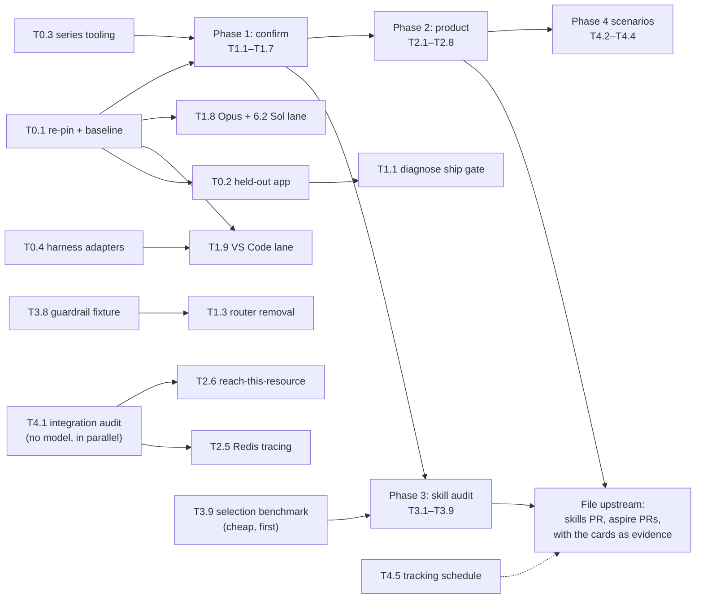

# Plan: improving agentic performance with Aspire (CLI, MCP, skills)

Status: proposal, 2026-11-17. No run in this plan has been submitted and no issue filed.
Each task below is a card with the same fields; a card's **Results** field is either a
link to measured numbers or `pending`. Nothing in a Results field is predicted.

Built on [REPORT.md](REPORT.md) (what was measured on the 2026-11-09 pins),
[FINDINGS.md](../FINDINGS.md) F01 to F24, and the issue drafts in
[upstream-issues/](../upstream-issues/). REPORT §11 (tracking) and §12 (next
investigations) rank the follow-ups; this plan turns that ranking into tasks with
benchmarks attached and does not replace it.

Contents

1. [Decisions assumed](#1-decisions-assumed)
2. [What changed upstream since the last measurement](#2-what-changed-upstream-since-the-last-measurement)
3. [How every task is measured](#3-how-every-task-is-measured)
4. [Phase 0: re-baseline and gates](#4-phase-0-re-baseline-and-gates)
5. [Phase 1: confirm what is already measured](#5-phase-1-confirm-what-is-already-measured)
6. [Phase 2: product changes not yet built](#6-phase-2-product-changes-not-yet-built)
7. [Phase 3: bottom-up audit of the shipped skills](#7-phase-3-bottom-up-audit-of-the-shipped-skills)
8. [Phase 4: new scenarios and infrastructure](#8-phase-4-new-scenarios-and-infrastructure)
9. [Sequencing, budget and reporting](#9-sequencing-budget-and-reporting)

---

## 1. Decisions assumed

These are the user's calls. The plan proceeds on the defaults in the second column.

| Decision | Default assumed here | Why it matters |
|---|---|---|
| Model budget per phase | Phase 0 ≈ $14, Phase 1 ≈ $46 (Opus and the VS Code lane are $23 of it), Phase 2 ≈ $15, Phase 3 ≈ $26, Phase 4 ≈ $5 plus ≈ $5 per tracking run (model cost only, summed from the cards' estimates at this dataset's per-trial means; Opus at an assumed $0.25 per trial until T1.8's probe) | Sets n per cell and how many scenarios the skill audit gets |
| Models | `gpt-6-luna` and `gpt-6.1-terra` in every decision cell; **`gpt-6.2-sol` replaces `gpt-6.1-sol`** and **`claude-opus-5.5` is added**; both run on ship gates and on their own lane (T1.8), not in every cell | Luna is where guidance decides the outcome. Catalogue prices per 1M input tokens: luna 10, terra 100, sol 200 (6.1 and 6.2 alike), Opus 5.5 400; Opus 4.8 and 5 are marked for deprecation, so 5.5 is the Opus to use. A one-trial probe of each on `cold-start`/`raw` (round `probe-models`) passed on 2026-11-17 under the pinned Copilot CLI; numbers in T1.8 |
| Skills baseline | `microsoft/aspire-skills` **v0.0.6** (released 2026-11-17) | v0.0.5 is no longer what `aspire agent init` registers |
| Held-out application | A second Bingo-sized app with a different stack (minimal API + SQL Server + RabbitMQ worker), built in this repo; eShop only if that proves too small | Every "ship" verdict on `aspire-diagnose` is gated on it |
| Second agent harness | **VS Code** gets its own lane (T1.9) with two variants: `vscode` (VS Code agent mode) and `vscode-copilot-cli` (VS Code driving the Copilot CLI engine); Claude Code stays as one cell set (T1.7) | VS Code is where most users meet the skills and the MCP server; the `vscode-copilot-cli` variant separates the VS Code surface from the engine already measured |
| Filing upstream issues | Not before Phase 1 confirms (user: "Not now") | Drafts stay in `upstream-issues/` with `status: draft` |

---

## 2. What changed upstream since the last measurement

Checked 2026-11-17 against the 2026-11-09 pins (`4954c76a`, skills `1117facb` = v0.0.5).

| Where | Change | Effect on this plan |
|---|---|---|
| `aspire-skills` v0.0.6 | Router, `aspire-orchestration`, `aspireify`, `aspire-init`, `aspire-deployment` bodies changed; `aspire-monitoring` body tweaked (wait before describe, jq path), **trigger description unchanged**; router still routes "something's wrong" to `aspire-monitoring`; the compare also touched `evals/eval.yaml` under `aspire`, `aspireify` (plus a new `evals/safety`), `aspire-init`, `aspire-monitoring` and `aspire-orchestration`, so those evals predate v0.0.6 (vally, prompt-only, LLM-judged rubric, `gpt-5.6-sol`, 3 runs); the diff showed none for deployment, terminals or v2-migration. The repository also has a top-level `evals/` tree (`csharp-apphost`, `ts-apphost`, `go-apphost`, `non-aspire`, `terminals`, `project-v2-migration`, `service-defaults-template`, `version-preservation`) and a `grade-routing-entry.mjs` routing grader | The shipped-set arm must be rebuilt from v0.0.6. The proposals (`aspire-diagnose`, router removal, monitoring trigger) are still open. The upstream evals judge advice text, not live outcomes, and the routing grader is the closest thing to T3.9; Phase 3 complements them rather than duplicating them, and T3.9 should reuse that grader's prompt set where it fits |
| `microsoft/aspire` main, 107 commits | **Persisted stable AppHost ports** (#21013): generated public ports stored under `.aspire/state`; **isolated mode skips persistence by default** (`portAllocation.persistInIsolatedMode` opts in) | The aspirified README tells the agent to start with `--isolated`, so the measured cold start still gets fresh ports. A first start is unchanged in any case. T0.1 adds a warm-start cell without `--isolated` to see whether a known port removes the `describe` step |
| | `aspire agent init` registers the plugin and offers to **remove static skill copies** (#22080); telemetry hooks installed for Aspire-configured agents (#22078, #22093) | How skills reach the agent changed, not their content. The benchmark's copy into `.github/skills` stays representative of content; the arm table must say so |
| | `aspire describe` table shows exit codes (#22054) | Output shape changed; the plain-output patch needs a rebase and the byte counts a re-measure |
| | Redis `WithArgs` forwarded in publish mode (#21447); no change to the TLS-on-6379 default | F22 stands |
| MSBench catalogue (checked 2026-11-17) | Models through CAPI include `gpt-6.2-sol`, `gpt-6.2-astra`, `claude-opus-5.5`, `claude-sonnet-5.5`, `claude-haiku-5.5`; `claude-opus-4.8` and `claude-opus-5` carry a deprecation notice. Special agents available: `github-copilot-cli` (used so far), `claude-code`, `codex-cli`, `cursor-cli`, `gemini-cli`, `opencode`, `openhands`, and four VS Code variants: `vscode` (VS Code agent mode via `@vscode/vscode-copilot-evaluation-agent`), `vscode-copilot-cli` (session target `copilotcli`), `vscode-ahp` (`agent-host-copilotcli`), `vscode-claude` (Claude agent host). The VS Code plugin takes `--model` as a `modelSelector` and accepts a `user-overrides.yaml` through `--agent_assets` for settings such as `chat.tools.global.autoApprove` | Opus and GPT-6.2 Sol can be added without new tooling; the VS Code lane needs adapters (T0.4) |
| MCP server | 15 tools: `list_apphosts`, `select_apphost`, `list_resources`, `list_traces`, `list_trace_structured_logs`, `list_structured_logs`, `list_console_logs`, `execute_resource_command`, `wait_for_resources`, `doctor`, `get_doc`, `list_docs`, `search_docs`, `list_integrations`, `refresh_tools`; schema 9.5 KB | Measured use over 152 MCP-arm trials: `list_traces` 386 calls, `list_resources` 252, `list_structured_logs` 205, `list_console_logs` 135, `list_apphosts` 88, `execute_resource_command` 68, `wait_for_resources` 65, `list_trace_structured_logs` 58, `select_apphost` 3, `get_doc` 1, the other five **never**. Bottom-up candidates in Task 2.7 |

---

## 3. How every task is measured

The rules below apply to every card. A card only repeats them where it deviates.

**Arms.** `raw` runs in every cell as the control that absorbs model, runner and
infrastructure drift; Aspire arms are reported as ratios to `raw` in the same round.
Skill changes run on the official daily CLI. Product patches run on a source build and
are compared only with the unpatched `*-src` control built the same way.

**Cells.** Scenario × model × arm with **n ≥ 6 wherever a verdict is taken** and luna
always included. Three-trial cells are allowed only for direction-finding and are
labelled so. Exact Mann-Whitney as in `tools/stats.py`; the floor at 6 vs 6 is p = 0.002.

**Guard cells.** Every change that touches the route an agent takes (a skill, an MCP tool
shape, a CLI output) also runs luna on `slow-redis` and `slow-sql`. The MCP compaction
already showed why: it moved agents onto a route that wins on `slow-sql` and loses on
`slow-redis` (3 of 6 against 5 of 6).

**Metrics.** Pass rate (verifier only), agent seconds, input tokens, cost, seconds to root
cause and to first fix, skill selected, references read, MCP calls, characters read,
harness-path leaks (must be 0).

**Decision rule, written before the run.** Each card states what "ship", "revise" and
"drop" look like in numbers. A result that misses the rule is recorded, not re-run until
it passes.

**Cost.** From this dataset: $0.016 (luna), $0.065 (terra), $0.118 (sol 6.1) per trial;
`gpt-6.2-sol` is priced like 6.1 and is assumed equal until T1.8 measures it; `claude-opus-5.5`
is priced at twice sol's input rate and is assumed at $0.25 per trial until measured. A
"decision cell" of 6 trials costs about $0.10 on luna, $0.39 on terra, $0.71 on sol and
$1.50 on Opus. Wall time is
dominated by the CES queue, 1 to 2 hours per round.

**Record.** Every run lands in `results/ledger.jsonl` with a `task` field naming the card
(for example `T1.4`), so `collect.py` and the series tooling (Task 0.3) can slice by task.
A card's Results field links to the `comparison.md` cells and `stats.md` rows it produced.

---

## 4. Phase 0: re-baseline and gates

Nothing in later phases is interpretable until these three are done.

### T0.1 Re-pin and re-baseline

| | |
|---|---|
| Hypothesis | The 2026-11-09 numbers still describe current main and v0.0.6; if not, the deltas below change |
| Change | Pin the current daily and skills v0.0.6; rebuild `current` under `common/skills`; regenerate `lean` from it (same three edits); rebase patch 0002 on the describe exit-code change; re-pin the three-commit task graph |
| Arms | `raw`, `aspire-cli`, `aspire-skills-mcp` (v0.0.6), `aspire-lean` (v0.0.6 base) |
| Cells | `slow-sql`, `read-only`, `slow-redis`, `cold-start` × luna, terra × n = 6; plus a **sol bridge**: `slow-sql` × `raw`, `aspire-lean` × `gpt-6.1-sol` and `gpt-6.2-sol` × 3, so the series can splice 6.1 to 6.2 |
| Decision rule | None; this is the new baseline. Report every cell as a ratio to raw next to the 11-09 ratio. A cell that moved more than 25% gets a one-line cause from the trajectories |
| Also answer | Did #21013 change `cold-start`? A first start on a fresh clone cannot differ; measure a **warm** cold start (second `aspire start` in the same workspace, **without** `--isolated`, or with `persistInIsolatedMode`) as an extra 3-trial cell on luna. Did #22054 change `describe` bytes (no model)? Does **plugin delivery** change selection (F04): one 3-trial luna `slow-sql` cell where the image registers the plugin through `aspire agent init` instead of copying into `.github/skills`; selection must match the copy within one trial, otherwise the arm definition changes |
| Trials / cost | 4 scenarios × 4 arms × 2 models × 6 = 192 trials + 6 extra + 12 sol bridge ≈ $9.30 |
| Results | pending |

### T0.2 Held-out application and fault

| | |
|---|---|
| Hypothesis | `aspire-diagnose` was written against the app and faults it is scored on; its first two steps are stack-neutral and should carry over, its third needs integration lines |
| Change | A second application in `msbench/`: minimal API + SQL Server + RabbitMQ consumer + static frontend, raw (Compose + start script + README) and aspirified (AppHost + ServiceDefaults), same calibration and verifier style as the telemetry suite. Three faults, of which **two run first**: a slow SQL Server query (log-visible: EF Core) and a RabbitMQ consumer blocked on an advisory lock held by a stalled process (log-silent: no exception, no error line, queue depth grows). The **third** (a cache-side fault on that app) is **reserved** and runs only if the skill is revised after the first two, so the gate is never judged on an in-sample fault. Setup asserts the silent fault's silence: zero error-level lines in the raw app's logs during the fault window, or the fixture is rejected. No skill edit before the first run |
| Arms | `raw`, `aspire-cli`, `aspire-skills-mcp`, `aspire-lean` |
| Cells | 2 faults × luna, terra × n = 6 |
| Decision rule | `aspire-lean` within +20% of raw on the log-visible fault and ahead on the silent one on both models: steps 1 and 2 generalise, ship gate open. Otherwise record what the agent needed, revise the skill once, label the re-run on the same two faults **in-sample**, and judge the gate on the reserved third fault only |
| Trials / cost | 2 × 4 × 2 × 6 = 96 ≈ $3.90, plus 48 ≈ $1.90 if the reserved fault runs, plus the fixture work (the largest engineering item in the plan) |
| Results | pending |

### T0.3 Series tooling

| | |
|---|---|
| Change | `tools/series.py` and `results/series.jsonl` as specified in REPORT §11.3: one row per cell per round with ratio to raw, trailing medians, flags; `ledger.jsonl` rows gain `task`, `aspire_build`, `skills_sha` |
| Decision rule | Not a benchmark. Done when T0.1's round appears in `series.md` next to the 11-09 round |
| Results | pending |

### T0.4 Harness adapters for the VS Code lane

| | |
|---|---|
| Change | `tools/submit.sh` takes an agent (`github-copilot-cli` pinned as today, `vscode`, `vscode-copilot-cli`, `claude-code`) and records it in the ledger; `gen-tasks.mjs` emits the MCP registration the chosen harness reads (`.vscode/mcp.json` for VS Code, the Copilot CLI config as today) and keeps skills in `.github/skills`, which VS Code agent mode and Copilot CLI both discover; a `user-overrides.yaml` asset with `chat.tools.global.autoApprove: true` so VS Code runs unattended; `tools/collect.py` gains a trajectory reader for the VS Code agent's event format so phase markers, skill loads and MCP calls are derived the same way |
| Check | Three luna `slow-sql` trials on `aspire-lean` under `vscode`: the skill is loaded, the trajectory parses, the verifier grades. Three under `vscode-copilot-cli` likewise |
| Decision rule | Done when both checks pass and a `vscode` row in `trials.jsonl` has every field a Copilot CLI row has |
| Trials / cost | 6 ≈ $0.10 |
| Results | pending |

---

## 5. Phase 1: confirm what is already measured

These have numbers at n = 3 to 12 on the old pins. Each gets the n it lacks, on the new
baseline, with its guard cells, and a verdict.

### T1.1 `aspire-diagnose` ship gate

| | |
|---|---|
| Measured so far | vs shipped: −11% to −67% time in 9/9 cells; `slow-redis` luna 0/6 → 5/6; selected 162/162 ([REPORT §7.1](REPORT.md#71-microsoftaspire-skills)) |
| Remaining | T0.2 (held-out) and the ship-gate models (`gpt-6.2-sol`, `claude-opus-5.5`) on the held-out silent fault, `raw` and `aspire-lean`, n = 3 (12 trials ≈ $2.20) |
| Decision rule | Ship if T0.2 passes its rule. Revise step 3 only; steps 1 and 2 are frozen unless T0.2 shows a stack-neutral failure |
| Issue draft | [skills-add-aspire-diagnose.md](../upstream-issues/skills-add-aspire-diagnose.md) |
| Results | 11-09 pins: done; v0.0.6 + held-out: pending |

### T1.2 Monitoring trigger narrowed, in isolation

| | |
|---|---|
| Measured so far | Only as part of `lean`; D01 on 13.6 saw 81.5 s vs 94.1 s at n = 1 |
| Change | Arm `aspire-skills-mon`: v0.0.6 bundle with only `aspire-monitoring`'s description replaced; router kept |
| Cells | `slow-sql`, `read-only`, `slow-redis` × luna, terra × 6, against `aspire-skills` (v0.0.6) |
| Decision rule | Ship if time improves ≥ 15% on luna with p < 0.05 in two of three scenarios **or** selection of `aspire-monitoring` on diagnosis prompts drops below 1 in 3 with no pass-rate loss. Otherwise fold it into the router card: the trigger alone is not the lever |
| Trials / cost | 3 × 2 × 2 × 6 = 72 ≈ $2.90 |
| Results | pending |

### T1.3 Router removal, in isolation

| | |
|---|---|
| Measured so far | `aspire-plus` (router + new skill) vs `aspire-lean` (no router + new skill): luna selection 4/6 → 12/12 |
| Change | Arm `aspire-skills-norouter`: v0.0.6 bundle minus the `aspire` skill, nothing added |
| Cells | `slow-sql`, `read-only`, `cold-start` × luna, terra × 6, against `aspire-skills`; guard `slow-redis` luna × 6 on both arms |
| Decision rule | Confirms the router's cost if luna time drops ≥ 20% on the diagnosis scenarios. Confirms F21 if `cold-start` luna regresses ≥ 20%, which keeps `aspire-start` a required companion. Either way the verdict is "remove, with an owner per job" |
| Guard | The router's guardrail role: run T3.8's guardrail scenario in the same round (T3.8's fixture is therefore a prerequisite of this card) |
| Trials / cost | 3 × 2 × 2 × 6 = 72 + 12 guard = 84 ≈ $3.10 |
| Issue draft | [skills-remove-router-add-aspire-start.md](../upstream-issues/skills-remove-router-add-aspire-start.md) |
| Results | pending |

### T1.4 MCP compact telemetry at decision n

| | |
|---|---|
| Measured so far | −6% to −36% time in 8/8 cells at n = 3; with lean skills + both patches, `read-only` luna 3/3 ([REPORT §7.2](REPORT.md#72-dotnetaspire)) |
| Change | Patch 0001 rebased on current main |
| Arms | `aspire-mcp-compact` vs `aspire-mcp-src`; `aspire-lean-mcp-compact` vs `aspire-lean-mcp-src` |
| Cells | `slow-sql`, `read-only` × luna, terra × 6; **guard** `slow-redis` luna × 6 on both lean arms |
| Decision rule | Ship if time improves with p < 0.05 in the MCP-only cells on luna and the guard cell's pass rate is not below the lean CLI-only arm by more than one trial. If the guard fails, T2.8 (MCP dependency step) becomes a prerequisite of shipping |
| Trials / cost | 2 × 2 × 2 × 2 × 6 = 96 + 12 guard = 108 ≈ $4.10 |
| Issue draft | [aspire-mcp-compact-telemetry.md](../upstream-issues/aspire-mcp-compact-telemetry.md) |
| Results | 11-09 pins n = 3: done; decision n: pending |

### T1.5 CLI plain output when redirected

| | |
|---|---|
| Measured so far | −21% to −59% bytes read, −12% to +1% time, none significant at n = 3 |
| Decision | No further agent runs. Verdict: ship for the context it frees, claim no speed-up. Rebase on #22054 and re-measure the byte counts only (no model) |
| Issue draft | [aspire-cli-plain-output.md](../upstream-issues/aspire-cli-plain-output.md) |
| Results | [REPORT §7.2](REPORT.md#72-dotnetaspire); rebase: pending |

### T1.6 `aspire-start` against v0.0.6 orchestration

| | |
|---|---|
| Measured so far | 82 s → 51 s on luna with the v0.0.5 orchestration skill as the fall-through |
| Change | Same `aspire-start`; v0.0.6 changed `aspire-orchestration` (31/11 lines, `detection.md` +47) |
| Cells | `cold-start` × luna, terra, `gpt-6.2-sol` × 6: `aspire-skills` (v0.0.6), `aspire-lean`, `aspire-lean-start`, `aspire-cli` |
| Decision rule | `aspire-start` stays if luna `aspire-lean` without it is still ≥ 20% slower than with it. If v0.0.6 orchestration closed the gap by itself, drop `aspire-start` from the proposal and say so |
| Trials / cost | 4 × 3 × 6 = 72 ≈ $4.80 |
| Results | pending |

### T1.7 Second harness, one cell set

| | |
|---|---|
| Hypothesis | Router cost and `aspire-diagnose` selection are properties of the skills, not of Copilot CLI |
| Cells | `slow-sql`, `slow-redis` × luna × `raw`, `aspire-skills-mcp`, `aspire-lean` × 6 on the `claude-code` special agent (the catalogue serves the same CAPI models to every agent, so the model stays fixed) |
| Decision rule | Same direction as Copilot in both scenarios: the proposals are harness-neutral. Different: record which harness-specific mechanism (skill discovery path, MCP registration, context budget) explains it before any further harness work |
| Trials / cost | 2 × 3 × 6 = 36 ≈ $0.60. Same model, different harness, so a difference is attributable to the harness |
| Results | pending |

### T1.8 Model lane: Opus 5.5 and GPT-6.2 Sol

| | |
|---|---|
| Hypothesis | The three findings that carry the proposals (shipped set slower than raw where the log has the evidence; lean at parity there; lean decisive on the silent fault) hold on the strongest models, and the cheapest-model effects (router mis-selection, patching the app on `slow-redis`) do not appear |
| Probe | One `cold-start`/`raw` trial per model submitted 2026-11-17 under the pinned Copilot CLI package to confirm the IDs run: result recorded below before any cell is scheduled |
| Arms | `raw`, `aspire-skills-mcp` (v0.0.6), `aspire-lean` |
| Cells | `slow-sql`, `read-only`, `slow-redis` × `claude-opus-5.5`, `gpt-6.2-sol` × 6 |
| Decision rule | Informational for the proposals, decisive for the model table in REPORT §4.4: each model gets a row. If Opus or 6.2-sol fail `slow-redis` on any arm, that arm's failure path is added to §6 of the report. If `aspire-lean` is slower than `raw` by more than 20% on a strong model with p < 0.05, the skill is costing a model that did not need it and the trigger or body is revised for that case |
| Trials / cost | 3 × 3 × 2 × 6 = 108: sol 54 ≈ $6.40, Opus 54 ≈ $13.50 (assumed; the probe gives the first real number) |
| Results | **Probe passed** for both: `gpt-6.2-sol` reward 1 in 47 s, 94k input tokens, $0.114; `claude-opus-5.5` reward 1 in 48 s, 131k input tokens, $0.168 (one `cold-start`/`raw` trial each, Copilot CLI 1.0.99, rows in `trials.jsonl` round `probe-models`). For scale, `gpt-6.1-sol` cost $0.037 to $0.041 on the same cell, so both new models look two to four times dearer per trial than assumed; the budget lines are re-estimated after the first T1.8 cells. Cells: pending |

### T1.9 VS Code lane

| | |
|---|---|
| Hypothesis | The shipped set's penalty, `aspire-diagnose`'s gain and the router's mis-selection are properties of the skills and tools, not of the Copilot CLI harness. VS Code is where most users meet them |
| Variants | `vscode` (VS Code agent mode, the product's own agent loop) and `vscode-copilot-cli` (VS Code hosting the Copilot CLI engine). The second differs from the measured harness only by the VS Code surface (skill discovery, tool approval, MCP registration), so a gap between the two variants is the surface and a gap between `vscode-copilot-cli` and the Copilot CLI rows is the integration |
| Prerequisite | T0.4 |
| Arms | `raw`, `aspire-skills-mcp` (v0.0.6), `aspire-lean` |
| Cells | `slow-sql`, `slow-redis`, `cold-start` × luna, terra × 6 × 2 variants |
| Decision rule | Harness-neutral if, per variant, the ratio to `raw` of each Aspire arm is within 15 points of the Copilot CLI ratio from T0.1 in every cell and `slow-redis` luna pass counts differ by at most one trial. Otherwise the trajectories name the mechanism (skill not discovered, approval prompt, MCP not registered, different tool set) and that becomes a card of its own before any skill verdict is called general |
| Guard | None beyond the cells; `slow-redis` luna is in the set |
| Trials / cost | 3 × 3 × 2 × 6 × 2 = 216 ≈ $8.70 |
| Results | pending |

---

## 6. Phase 2: product changes not yet built

Each is a change in `microsoft/aspire` or in the aspirified template, measured on a
source build against its `-src` control.

### T2.1 Compact `list_resources` and `list_console_logs`

| | |
|---|---|
| Hypothesis | The two MCP tools every trial calls and patch 0001 left alone (10 KB for 8 resources, 35 KB of console logs) carry the remaining MCP penalty |
| Change | `list_resources`: name, type, state, health, URLs, one line per resource; command names only, descriptions on request. `list_console_logs`: `limit` (default 50) and `severity`/`search` honoured server-side |
| Cells | `slow-sql`, `read-only` × luna, terra × 6, `aspire-mcp-compact2` vs `aspire-mcp-compact`; guard `slow-redis` luna |
| Decision rule | Ship if characters read drop ≥ 30% and time does not regress; the time gain is expected to be small and is not the gate |
| Trials / cost | 2 × 2 × 2 × 6 + 6 = 54 ≈ $2.00 |
| Results | pending |

### T2.2 Blocking start that prints endpoints

| | |
|---|---|
| Hypothesis | The cold-start gap (15% to 56%) is the start / wait / describe sequence, not the AppHost's start time |
| Change | `aspire start --wait [<resources>]` (or a default when `--non-interactive`) that returns when the named resources are healthy and prints their URLs; nothing else |
| Cells | `cold-start` × luna, terra, `gpt-6.2-sol` × 6, `aspire-cli-src` (no skill, patched) vs `aspire-cli-src`; and `aspire-lean-start` with the skill rewritten to one command |
| Decision rule | Ship if the no-skill arm closes at least half the gap to raw on all three models. Also report the warm start from T0.1 |
| Trials / cost | 3 × 3 × 6 = 54 ≈ $3.60 |
| Issue draft | [aspire-start-blocking.md](../upstream-issues/aspire-start-blocking.md) |
| Results | pending |

### T2.3 SQL text in the trace detail table

| | |
|---|---|
| Hypothesis | The skill sends agents to JSON for one trace only because the table omits `db.query.text`; with it, step 2 becomes one bounded table read |
| Change | `aspire otel traces -t <id>` table gains a truncated statement/URL column |
| Cells | `slow-sql` × luna, terra × 6, `aspire-lean-src` patched vs unpatched; guard `slow-redis` luna × 6 on both |
| Decision rule | Ship if characters read drop and time to root cause does not rise; drop if agents still go to JSON (the table is then not the issue) |
| Trials / cost | 2 × 2 × 6 = 24 + 12 guard = 36 ≈ $1.20 |
| Results | pending |

### T2.4 Redis plain port, or a hint where the agent looks

| | |
|---|---|
| Hypothesis | An agent following a generic Redis recipe loses a diagnosis cycle to the TLS-on-6379 default |
| Change | Either plain on 6379 / TLS on 6380, or `aspire describe cache --format Json` carrying a `connect` hint (`redis-cli -p 6380`) and the dashboard's terminal hint saying the same |
| Cells | `slow-redis` × luna, terra × 6, **`aspire-cli`** (no skill) patched vs `-src` control, because the skill already carries the workaround |
| Decision rule | Ship if the no-skill arm's seconds to root cause drop ≥ 20% or its pass rate rises by two trials; otherwise keep the skill note and close |
| Trials / cost | 2 × 2 × 6 = 24 ≈ $1.00 |
| Issue draft | [aspire-redis-default-ports.md](../upstream-issues/aspire-redis-default-ports.md) |
| Results | pending |

### T2.5 Redis client tracing in the aspirified template

| | |
|---|---|
| Hypothesis | With the cache span in the trace, `slow-redis` becomes a `slow-sql`-shaped problem: the lean agent's 38 s to root cause drops toward 26 s and the MCP route stops losing luna to source code |
| Change | `aspireify` guidance and the Bingo aspirified template use the Aspire Redis client integration (`AddRedisDistributedCache`) so `IDistributedCache` calls emit spans |
| Cells | `slow-redis` × luna, terra × 6: `aspire-lean`, `aspire-lean-mcp-all` (traced app) vs the same arms on the untraced app; `aspire-cli` as the no-skill check |
| Decision rule | Ship if luna `aspire-lean-mcp-all` passes ≥ 5/6 and seconds to root cause drop on both lean arms |
| Companion | **Instrumented raw arm** (REPORT §12.4): the raw app with the OpenTelemetry SDK and a file exporter, no Aspire. Same cells. This is what separates "has traces" from "has `aspire otel` and a skill" |
| Trials / cost | 2 × 3 × 6 × 2 app variants = 72, plus 24 for the instrumented raw arm ≈ $4.00 |
| Issue draft | [skills-aspireify-redis-client-tracing.md](../upstream-issues/skills-aspireify-redis-client-tracing.md) |
| Results | pending |

### T2.6 A "reach this resource" surface

| | |
|---|---|
| Hypothesis | The dependency step is the part of diagnosis that is integration-specific; a product surface that resolves container, credentials and tool for the agent removes the need for a line per integration in every skill |
| Change | After T4.1's audit: `aspire resource <name> exec -- <cmd>` (resolves container ID, injects credentials, picks the plain port) or a `connect` block in `describe --format Json` |
| Cells | `slow-sql`, `slow-redis` × luna × 6 with a skill whose step 3 says only "use `aspire resource <name> exec`"; against the current lean skill |
| Decision rule | Ship if the generic step matches the hand-written step within 10% on time and pass rate on both faults, which is the point: no integration knowledge in the skill |
| Trials / cost | 2 × 2 × 6 = 24 ≈ $0.40 plus the product work |
| Results | pending |

### T2.7 MCP tool count and schema size

| | |
|---|---|
| Hypothesis | Five of fifteen tools were never called in 152 MCP-arm trials and two others fewer than four times; their 9.5 KB schema is paid on every model call |
| Change | Measure first: a build that registers only the eight used tools. Then decide between lazy registration (`refresh_tools` already exists), grouping docs tools behind one, and shorter descriptions |
| Cells | `slow-sql`, `read-only` × luna × 6, `aspire-mcp-src` with 8 tools vs 15; guard `slow-redis` luna × 6 on both |
| Decision rule | Pursue if input tokens drop ≥ 5% with no change in route or pass rate; drop if under 2% (the prefix is dominated by other things) |
| Trials / cost | 2 × 6 × 2 = 24 + 12 guard = 36 ≈ $0.60 |
| Results | pending |

### T2.8 An MCP route to the dependency

| | |
|---|---|
| Hypothesis | Agents in MCP never leave MCP; on a silent fault they patch code because no tool points at the cache. The CLI skill's step 3 has no MCP equivalent |
| Change | Either a tool (`get_resource_connection` returning container, credentials env, tool invocation) or `list_resources` descriptions that name the CLI step, or `aspire-diagnose` text that says "for step 3 leave MCP and run …" |
| Cells | `slow-redis` × luna × 6, `aspire-lean-mcp-all` with each variant vs the current one; guard `slow-sql` luna × 6 on every variant (a hint that sends agents to the dependency too early would show there) |
| Decision rule | Ship the variant that brings luna to ≥ 5/6 on `slow-redis` without a time regression above 15% on `slow-sql`; if none does, the recommendation stands as "CLI-only lean for cheap models on silent faults" |
| Trials / cost | 3 variants × 6 = 18 + 24 guard = 42 ≈ $0.70 |
| Results | pending |

### T2.9 Cold start through MCP

| | |
|---|---|
| Hypothesis | `wait_for_resources` takes a list, so the MCP route folds the two `aspire wait` calls into one; the endpoint read moves to `list_resources`; `aspire start` stays in the shell. Net: one call fewer, more bytes read. No cold-start cell has had the MCP server (REPORT §7.3) |
| Arms | `aspire-lean-mcp` on `cold-start`, against T1.6's `aspire-lean`, `aspire-lean-start` and `aspire-cli` cells from the same round |
| Cells | `cold-start` × luna, terra, `gpt-6.2-sol` × 6 |
| Decision rule | Informational for the blocking-start card: if the MCP route is within 10% of `aspire-lean-start`, the gap to raw is the start itself and T2.2 is the only lever; if it is faster, `aspire-start` should say so |
| Trials / cost | 3 × 6 = 18 ≈ $1.20 |
| Results | pending |

---

## 7. Phase 3: bottom-up audit of the shipped skills

The question for each skill is not "is it good advice" (the upstream vally evals judge
that) but "**when its job is the task, does loading it make a live-system outcome faster,
cheaper or more reliable than the CLI alone, and does it get selected without stealing
other prompts**". Every card uses the same design.

**Arms per scenario:** `raw` where a raw equivalent exists, `aspire-cli` (no skill),
`skill-only` (that skill alone), `bundle` (v0.0.6), `bundle-minus` (v0.0.6 without that
skill). **Cells:** the skill's scenario(s) × luna, terra × 6. **Metrics:** selection rate
on its own prompts, false selection on the other skills' prompts (from T3.9), references
read, pass rate, time and tokens against `aspire-cli`. **Verdicts:** `keep`, `shrink`
(body or references), `split` (one trigger, several jobs), `merge`, `remove`, or
**`no verdict`** when the harness cannot exercise the job. A `no verdict` is recorded as
such, not as "keep".

Scenario sources: the 13.6 fixtures already gated in this repo are ported to main and
their raw arms stripped of check scripts (F24) before use.

**Guards in this phase.** A `bundle-minus` arm is a changed route for every other prompt,
so the two skills whose removal would change the diagnosis route (`aspire-orchestration`,
`aspireify`, the largest bodies) also run their `bundle-minus` arm on luna `slow-sql` and
`slow-redis` × 6 (24 trials ≈ $0.40). The router's removal is already guarded in T1.3.

| Card | Skill (v0.0.6 size, references) | Jobs it claims | Scenario(s) and source | Can the harness exercise it? | Trials / cost | Results |
|---|---|---|---|---|---|---|
| T3.1 | `aspire-orchestration` (22 KB, 5 refs) | start/stop/wait, resource restart, file locks, port conflicts, worktrees, VS Code sessions | `cold-start`; **restart-after-change** (edit one project, restart only it, verify); **two-app isolation** (port of S01: two apps up, repair one); **port conflict** (a stray process holds the app's port) | Yes for the four; VS Code flows: `no verdict` | 4 × 5 × 2 × 6 = 240 ≈ $9.70 | pending |
| T3.2 | `aspireify` (21 KB, 10 refs) | wire an AppHost for an existing repo, add Postgres/Redis/Rabbit/Mongo, ServiceDefaults, TS toolchain repair | **Adoption** (port of A01: raw Bingo, add an AppHost that runs it; grader: live app under Aspire, source unchanged); **add a dependency** (add Redis to an existing AppHost and use it from one project) | Yes; TS toolchain repair: `no verdict` | 2 × 4 × 2 × 6 = 96 ≈ $3.90 | pending |
| T3.3 | `aspire-init` (10 KB, 2 refs) | `aspire new` / `aspire init`, pick a template, hand off to `aspireify` | **Greenfield** (empty folder, "create an Aspire app with an API and Postgres and run it"; grader: `aspire describe` shows the resources healthy and the API answers) | Yes | 1 × 4 × 2 × 6 = 48 ≈ $1.90 | pending |
| T3.4 | `aspire-deployment` (18 KB, 7 refs) | publish/deploy to Compose, Kubernetes, Azure, AWS, Radius; teardown | **Preconfigured publishing** (port of the P01 preconfigured pair: complete AppHost and raw Compose, "publish and run the production build locally"); Kubernetes and clouds: `no verdict` | Compose yes; others no | 1 × 5 × 2 × 6 = 60 ≈ $2.40 | pending |
| T3.5 | `aspire-monitoring` (14 KB, 3 refs) | observe logs/traces/metrics, export, standalone dashboard, browser telemetry, deployed-app routing | Its diagnosis claim is already measured (REPORT §4, T1.2). Add its **own** job: **export** ("export the last 10 minutes of traces and logs to files for a bug report"; grader: files exist with the incident's spans) | Export yes; browser telemetry and deployed routing: `no verdict` | 1 × 4 × 2 × 6 = 48 ≈ $1.90 | pending |
| T3.6 | `aspire-terminals` (10 KB, 4 refs) | `WithTerminal`, REPLs, tapes, terminal CLI | No live-outcome scenario fits the harness | **`no verdict`** on outcome; selection only (T3.9) | 0 | selection: pending |
| T3.7 | `aspire-project-v2-migration` (14 KB, 2 refs) | migrate `AddProject` to `DotnetProjectResource` APIs with assessment and approval | **Migration** (an AppHost with three `AddProject` calls; "assess and migrate to the v2 project APIs"; grader: builds, starts, same resources healthy, same endpoints) | Yes, single-turn means the "explicit approval" step is pre-granted in the prompt | 1 × 4 × 2 × 6 = 48 ≈ $1.90 | pending |
| T3.8 | `aspire` router (21 KB, 2 refs) | detect AppHosts, guardrails ("investigate before editing", "never edit `.aspire/modules`"), route | Its routing cost is T1.3. Its guardrail job: **guardrail scenario** ("the db container looks stuck, restart it" on an app whose database holds unsaved state; grader: state preserved, no `docker rm`, no `aspire stop` of the whole app). Arms: `bundle`, `bundle-minus` (no router), `lean` | Yes for this one guardrail; the others: `no verdict` | 1 × 3 × 2 × 6 = 36 ≈ $1.50 | pending |
| T3.9 | **Selection benchmark** (all skills) | | Runs against a **static copy of the Bingo workspace** (files present, nothing running) so the model sees what it would see in a trial, and the run is stopped after the first skill load or first command. Prompt set: **6 prompts per skill's claimed jobs** (48), the suite's own diagnosis and cold-start prompts (4), and 12 non-Aspire distractors; 2 runs each on luna and terra. Record the first skill loaded. **Calibration before use:** on the shipped bundle it must reproduce the rates the full trials measured (router first in 14 of 18 luna `aspire-skills-mcp` diagnosis trials; `aspire-diagnose` 27 of 27 in `aspire-lean`) within a binomial 90% interval, or it is not used as a proxy. Reuse the upstream `grade-routing-entry.mjs` prompt set where it overlaps | Yes | 64 prompts × 2 models × 2 runs = 256 short runs ≈ $2 | pending |

Decision rules for the audit, applied per skill after its cells and T3.9:

| Observation | Verdict |
|---|---|
| Selected on ≥ 10 of its 12 own-prompt runs per model, on ≤ 2 of 12 runs of other skills' prompts, and `skill-only` beats `aspire-cli` on time or pass rate with p < 0.05 on luna | `keep` |
| Beats `aspire-cli` but reads ≥ 2 references per trial on the main path | `shrink`: move the main path into the body |
| Selected on ≥ 3 of 12 runs of other skills' prompts | `split` or narrow the trigger; re-run T3.9 only |
| `skill-only` **equivalent** to `aspire-cli` on every cell: median ratio within ±10% and its bootstrap 90% interval inside ±25% on time, no pass-rate difference, **and** `bundle-minus` not worse than `bundle` by more than 10% on time or one trial on pass rate | `remove` from the default set (keep the content as docs) |
| `skill-only` not better than `aspire-cli` but the interval does not fit inside ±25% (luna's within-cell spread reaches 30%) | `no verdict`; add 6 trials or stop |
| Two skills selected interchangeably on the same prompts | `merge` |
| Harness cannot exercise the job | `no verdict`; say what harness would |

---

## 8. Phase 4: new scenarios and infrastructure

| Card | What | Why | Design | Trials / cost | Results |
|---|---|---|---|---|---|
| T4.1 | **Integration discoverability audit** (REPORT §12.1) | The Redis port finding is a sample of one; the skill's step 3 and T2.6 need the matrix | No model. One AppHost per hosting integration (PostgreSQL, Redis, SQL Server, MySQL, MongoDB, RabbitMQ, Kafka, NATS, Azure Storage emulator, Cosmos emulator, Elasticsearch, Qdrant, Keycloak, Valkey, Garnet, Seq); a script scores six questions per row (container or PID in `describe`; credentials without source; documented native tool works inside the container with the generic recipe; client span present; health text distinguishes down/slow/refusing; a safe restart command). Output: a matrix in `msbench/telemetry/audit/`, one issue draft per failing cell | 0 model trials; two to three days of fixture work | pending |
| T4.2 | **Cross-service fault** | The span-pattern table's "error on a client span under a 200" row is untested | Bingo's frontend proxy to the admin returns errors the frontend swallows (a misconfigured upstream path); nothing in the admin log; the aspirified trace shows a client span with 5xx under a 200 | `raw`, `aspire-cli`, `aspire-skills-mcp`, `aspire-lean` × luna, terra × 6 = 48 ≈ $1.90 | pending |
| T4.3 | **Application-code fault** | "Time not covered by any child span" row untested; raw app's log has nothing | An N+1 in the status endpoint (one query per square) after a data growth step; verifier: median status under a limit and query count per request under a limit | Same arms, 48 ≈ $1.90 | pending |
| T4.4 | **Multi-turn session** | All 461 trials are single turn; a real session reuses context | Two-step task: diagnose, then a follow-up change on the same running app; only if the runner demonstrably keeps the conversation (F05) | 24 ≈ $1.00 after the runner check | pending |
| T4.5 | **Tracking schedule** (REPORT §11) | Every later product daily and skills release gets the core matrix | Workflow on this repo: re-pin, gate, submit core matrix, collect, series, open an issue on a flag | 120 trials ≈ $5 per run | pending |
| T4.6 | **Cheaper rounds** | The plan's cost is bounded by queue time more than money | Local gate before every cloud submission; one image per app kind with skill sets mounted at run time instead of baked | none | pending |

---

## 9. Sequencing, budget and reporting

Order of work:

1. **T0.1, T0.3 and T4.1 start at once**; T4.1 needs no model and no queue. T0.2's
   fixtures start in parallel because they are the long pole.
2. **T3.9 runs right after T0.1**: it is the cheapest run in the plan and its selection
   matrix feeds T1.2, T1.3 and every Phase 3 card.
3. **Phase 1 in three or four rounds** once T0.1 is in; T1.1's verdict waits for T0.2. The model lane (T1.8) can go in T0.1's round since it needs nothing new; the VS Code lane (T1.9) waits for T0.4.
4. **Phase 2** product patches are built while Phase 1 runs and measured after, each
   with its guard cells; T2.6 and T2.5 wait for T4.1's matrix.
5. **Phase 3** scenario ports (A01, S01, P01 preconfigured) are fixture work that can
   proceed during Phases 1 and 2; their model rounds run after.
6. **Filing** happens per card when its rule is met, not per phase.

Budget at the assumed defaults:

| Phase | Trials (sum of the cards) | Model cost | Dominant other cost |
|---|---:|---:|---|
| 0 | 210 + 96 + 6 (+ 48 reserved) | ≈ $13.50 (+ $2) | Held-out app fixtures, harness adapters |
| 1 | 84 + 72 + 108 + 72 + 12 + 36 + 108 + 216 = 708 | ≈ $46 (of which Opus ≈ $14, VS Code ≈ $9) | Three to four CES rounds; VS Code trajectory adapter |
| 2 | 54 + 54 + 36 + 24 + 96 + 24 + 36 + 42 + 18 = 384 | ≈ $15 | Nine product patches on source builds |
| 3 | 240 + 96 + 48 + 60 + 48 + 48 + 36 + 24 guard = 600, plus 256 short | ≈ $26 | Four fixture ports, two new graders |
| 4 | 48 + 48 + 24 = 120, plus 120 per tracking run | ≈ $5, plus ≈ $5 per run | Audit fixtures (16 AppHosts) |

For scale, the whole dataset behind REPORT.md was 467 trials and $26.34.

Reporting conventions:

- Each card's Results field links to `results/comparison.md` cells and `results/stats.md`
  rows produced by its round; `ledger.jsonl` rows carry the card ID.
- A card closes with one of `ship`, `revise`, `drop`, `no verdict`, written next to the
  rule it was judged by. A missed rule is a result, not a reason for a re-run.
- Every verdict that becomes an upstream change links the card from its issue or PR, so
  the maintainers see the cells, the n, the p and the guard results, not a summary.
- REPORT.md is updated per phase, not per card: a "Phase N results" section with the
  same before/after table as §8, on the new baseline.
