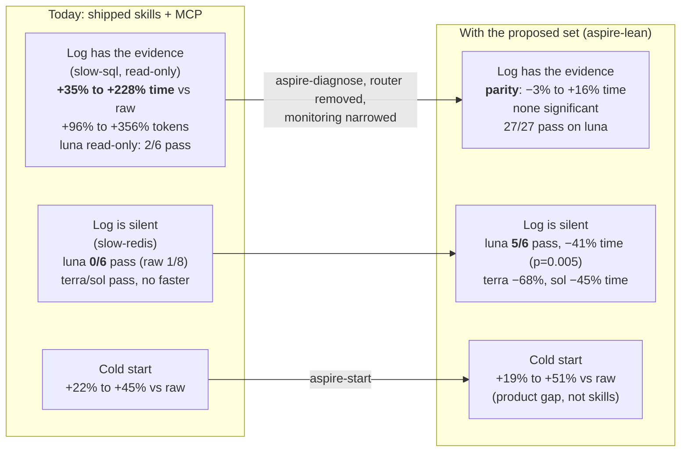
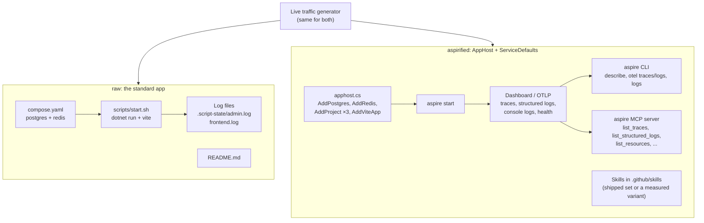
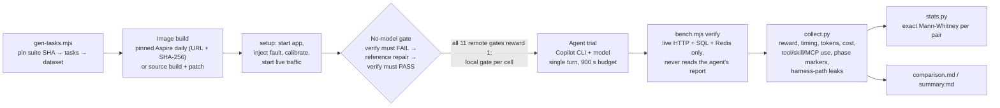
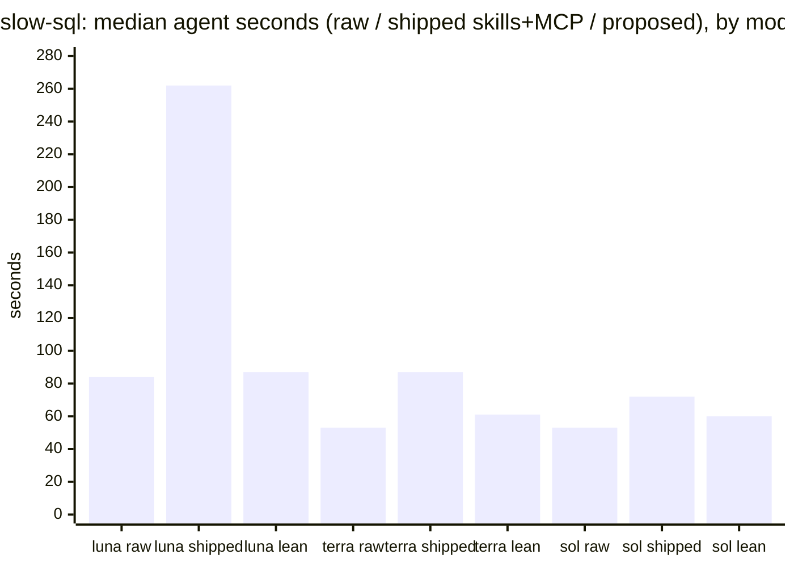
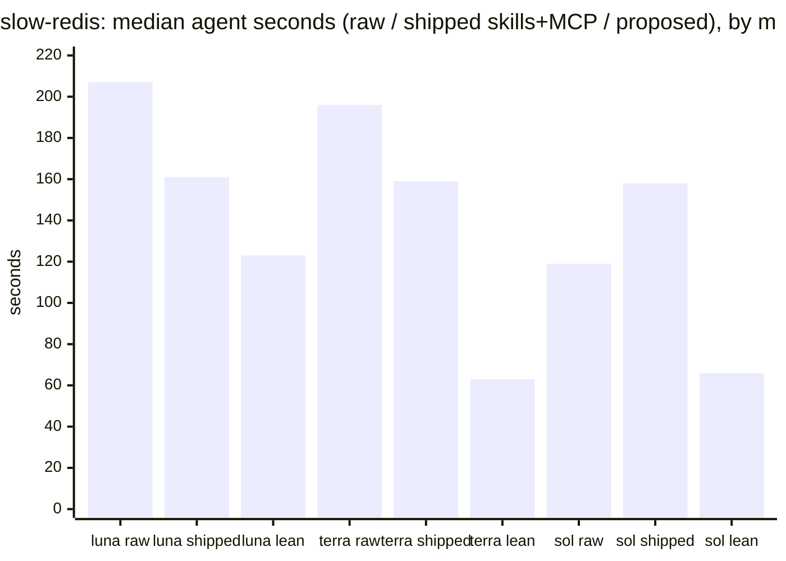
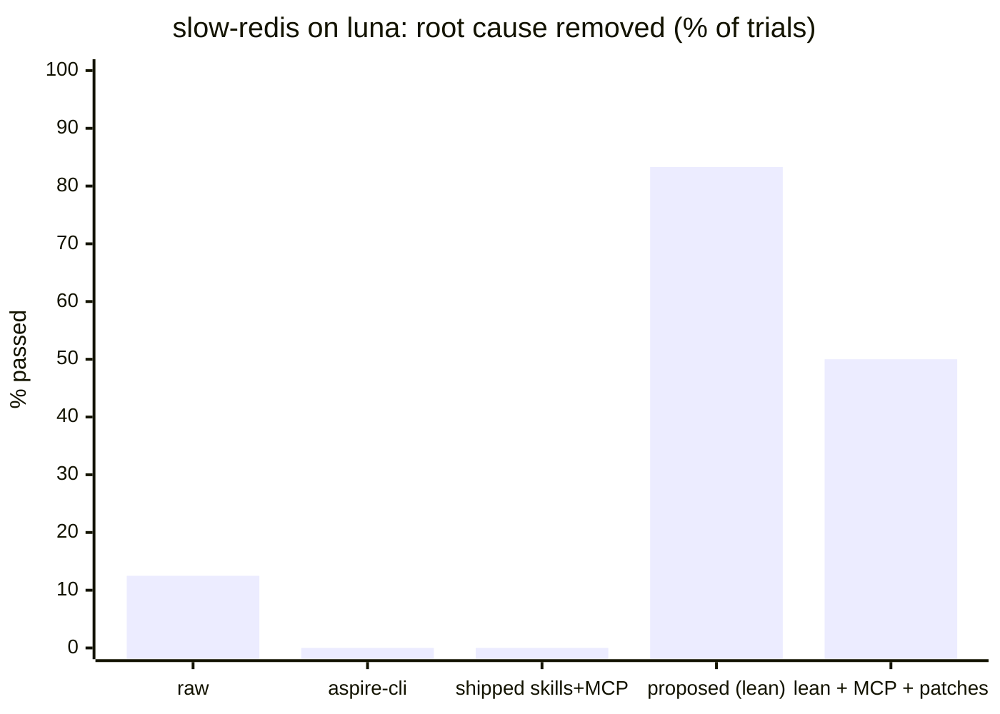
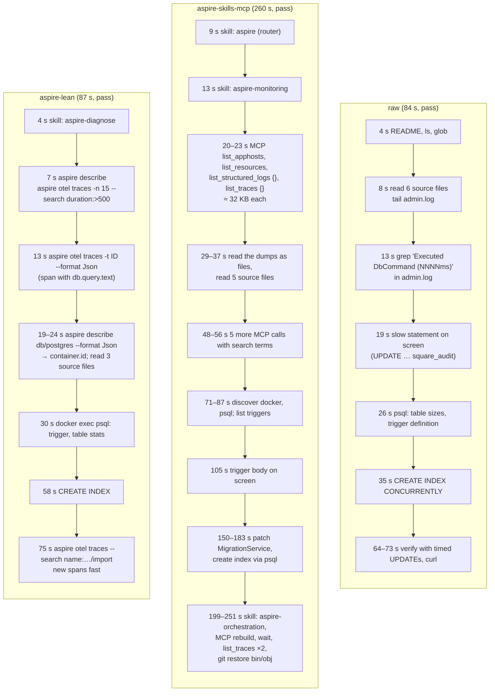
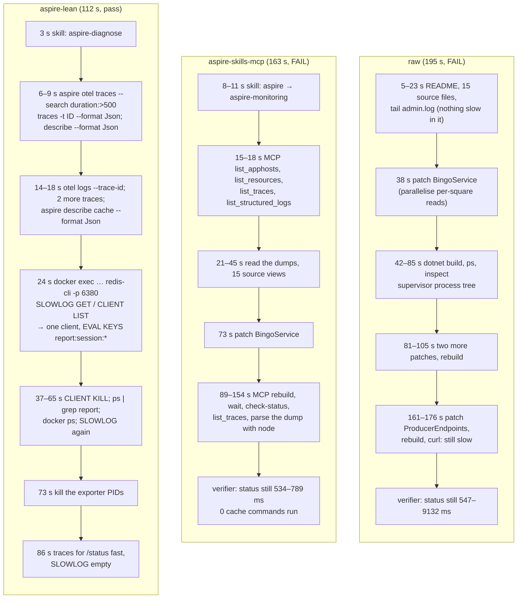

# Does Aspire help an agent fix a misbehaving app? Report, tracking proposal and next steps

Dataset: 467 model trials (461 graded) plus 11 remote no-model gates and a local gate per cell, run
2026-11-09 against Aspire `17.1.0-preview.1.26559.1+4954c76a` (daily build of
`microsoft/aspire` `main`) and `microsoft/aspire-skills` v0.0.5 (`1117facb`), with
Copilot CLI 1.0.99 driving `gpt-6-luna`, `gpt-6.1-terra` and `gpt-6.1-sol`. Model cost
of the whole dataset: USD 26.34.

This report consolidates [RESULTS.md](RESULTS.md), [SKILLS-PROPOSAL.md](SKILLS-PROPOSAL.md)
and findings F16 to F24 in [FINDINGS.md](../FINDINGS.md). Every number is a median over
the trials of a cell and traces back to [results/comparison.md](results/comparison.md)
(per cell), [results/stats.md](results/stats.md) (exact tests) and
[results/trials.jsonl](results/trials.jsonl) (per trial, with run IDs and artifact hashes).

Contents

1. [Summary](#1-summary)
2. [Goals](#2-goals)
3. [Methodology](#3-methodology)
4. [Results](#4-results)
5. [Resolution paths](#5-resolution-paths)
6. [Why trials failed, and what fixed it](#6-why-trials-failed-and-what-fixed-it)
7. [Suggested changes and their measured gains](#7-suggested-changes-and-their-measured-gains)
8. [Aspire versus the raw app, before and after](#8-aspire-versus-the-raw-app-before-and-after)
9. [Discoveries](#9-discoveries)
10. [Proposal: tracking the benchmark over time](#10-proposal-tracking-the-benchmark-over-time)
11. [Next investigations](#11-next-investigations)
12. [Limits](#12-limits)

---

## 1. Summary



1. **With the skills and MCP server that ship today, an aspirified app is slower and
   more expensive to diagnose than the same app without Aspire**, on all three models,
   whenever the fault leaves a line in the app's own log. Tokens and cost are worse with
   p ≤ 0.004 in all six scenario × model cells; time in five of six.
2. **A focused skill set removes the penalty.** One new 5 KB skill (`aspire-diagnose`),
   the 20.7 KB router skill removed, one trigger description narrowed: 11% to 67% faster
   and 35% to 83% fewer input tokens than the shipped set in all nine cells.
3. **Against the raw app it depends on where the evidence is.** When the log carries it,
   the proposed set reaches parity. When it does not (`slow-redis`), Aspire's telemetry
   plus the skill is the difference between fixing and not fixing on the cheapest model,
   and is 45% to 68% faster on the stronger ones.
4. **Two product changes help regardless of skills**: compact MCP telemetry output
   (−6% to −36% time in 8 of 8 cells) and plain CLI output when redirected (−21% to −59%
   bytes read, time unchanged). Neither is upstreamed.
5. **Cold start is slower with Aspire whatever the skills** (the agent runs start, wait,
   describe where the raw agent runs one script). A product change, not a skill, closes it.
6. **Benchmark lesson**: a "helpful" health script left in the raw baseline made the raw
   agent *slower* on luna. Baselines must ship what an ordinary app ships.

---

## 2. Goals

The question is narrow on purpose: **when a running application misbehaves, does the data
Aspire already collected (traces, structured logs, resource health) let a coding agent
fix it faster, cheaper or more often than the same application run the ordinary way?**
And if not, which part of the agent surface (skills, MCP tools, CLI output shape) is
responsible?

What this is not: a test of whether Aspire is a good development platform, a test of
model quality, or a benchmark of application-code bugs. The faults are operational
(database, cache, process), because that is where Aspire's telemetry has something the
source code does not.

Deliverables, all in this repository:

| Deliverable | Where |
|---|---|
| Measured proposal for the `aspire` skills plugin | [SKILLS-PROPOSAL.md](SKILLS-PROPOSAL.md), skill files under [common/skills](common/skills/PROVENANCE.md) |
| Two Aspire product patches, measured on source builds | [upstream/](upstream/) |
| Findings register with evidence and improvement candidates | [FINDINGS.md](../FINDINGS.md) F16 to F24 |
| Issue drafts for upstream, one per change | [upstream-issues/](../upstream-issues/) |
| Reproducible suite (tasks, gates, collection, statistics) | [README.md](README.md), [tools/](tools/) |

---

## 3. Methodology

### 3.1 One application, two packagings

Both arms run the same Bingo business code (Blazor/SignalR admin, a migration worker, a
Vue frontend, PostgreSQL, Redis; `msbench/bingo/common` at `baacba3`).



The aspirified variant also carries PostgreSQL client tracing (`Npgsql.OpenTelemetry`);
the standard app has no tracing, which is the ordinary state of a non-Aspire app. A win
for Aspire therefore combines instrumentation and tooling (see [Limits](#12-limits)).

### 3.2 Arms

| Arm | App | Skills | MCP | Role |
|---|---|---|---|---|
| `raw` | standard | none | no | **The product baseline**: start script, README, log files |
| `raw-check` | standard + `scripts/check.sh` | none | no | Rounds 1–5 baseline, kept apart (see F24) |
| `aspire-cli` | aspirified | none | no | Aspire with nothing but the CLI |
| `aspire-skills` | aspirified | shipped v0.0.5 | no | What `aspire agent init` gives you |
| `aspire-skills-mcp` | aspirified | shipped v0.0.5 | yes | **What ships today**, fully enabled |
| `aspire-mcp` | aspirified | none | yes | MCP alone |
| `aspire-plus` | aspirified | shipped + `aspire-diagnose` | no | Additive variant |
| `aspire-lean` | aspirified | shipped + `aspire-diagnose`, router removed, monitoring narrowed | no | **The proposed set** |
| `aspire-lean-mcp` | aspirified | lean | yes | Proposed set with MCP |
| `aspire-lean-start` | aspirified | lean + `aspire-start` | no | Cold start only |
| `*-src` | aspirified, CLI built from source at the daily's commit | none / lean | per arm | Controls for the patch arms |
| `aspire-mcp-compact`, `aspire-lean-mcp-compact` | source build + MCP patch | none / lean | yes | Product change 1 |
| `aspire-lean-plain` | source build + CLI patch | lean | no | Product change 2 |
| `aspire-lean-mcp-all` | source build + both patches | lean | yes | Everything together |

Skill sets are assembled by `compose.sh` from a byte-identical copy of v0.0.5, so each
set differs from `current` by exactly the files listed in
[PROVENANCE.md](common/skills/PROVENANCE.md).

### 3.3 Scenarios

Each scenario starts the app healthy, injects one runtime fault, and keeps live traffic
flowing before and during the agent so the incident is in the telemetry the way it would
be in production. Prompts are identical across arms, describe only the user-visible
symptom, and name no endpoint, tool or component; they are quoted in full in §3.4.

| Scenario | Fault | Evidence in the aspirified app | Evidence in the standard app |
|---|---|---|---|
| `slow-sql` | An audit trigger's duplicate check scans an unindexed JSON history grown to millions of rows. Square writes take seconds; nothing fails. | A trace span carrying the SQL text and its duration | EF Core's `Executed DbCommand (NNNN ms)` lines in `admin.log` |
| `read-only` | `default_transaction_read_only` left on at the database. Reads work, every write fails, health stays green. | Structured log with SQLSTATE 25006, failed trace | The exception in `admin.log` |
| `slow-redis` | A host-side "report exporter" runs a `KEYS`-based Lua count over a grown session keyspace in a loop. Single-threaded Redis spends its time there; every cache call the admin makes waits. Nothing fails. Same prompt as `slow-sql`. | Slow server spans whose database child spans are short; the cache is implicated by elimination | **Nothing**: request logging is off at `Microsoft.AspNetCore: Warning` and the Redis client logs no durations |
| `cold-start` | No fault. Nothing is running; bring the app up. | | |

`slow-sql` and `slow-redis` self-calibrate: they grow the data until one write or one
report query costs at least the target on the machine at hand, so the incident and its
repair are both far from the verifier's limits.

### 3.4 What the agent is told

The prompt is the whole task. There is no suite system prompt, no hint file and no
report template; the agent gets the instruction below, the workspace at `/app` with its
README, and whatever the arm adds (skills under `.github/skills`, the MCP server
registered with `aspire agent mcp`). The prompts are in
[tools/gen-tasks.mjs](tools/gen-tasks.mjs) and are written to each task's `instruction.md`.

`slow-sql` and `slow-redis` share one prompt on purpose: the same user-visible symptom
with two different causes, one that leaves a line in the standard app's log and one that
does not. An agent cannot tell from the prompt which it is facing.

```text
The Bingo application in /app is running and is serving live producer and player traffic.

Producers report that the application has recently become sluggish: some of their
operations now take several seconds. Nothing fails and no error is shown.

Find the root cause and fix it so that the affected operations are fast again.
Keep all existing data and all existing functionality, and leave the application
running. README.md describes this workspace. No report is required.
```

`read-only`:

```text
The Bingo application in /app is running and is serving live producer and player traffic.

Producers report that some of their operations recently started failing, although
every page still loads.

Find the root cause and fix it so that the affected operations work again, and keep
working after the application reconnects to its dependencies. Keep all existing data
and all existing functionality, and leave the application running. README.md
describes this workspace. No report is required.
```

`cold-start`:

```text
The Bingo application in /app is not running.

Start it so that the player page and the admin application are both serving, and
leave it running. README.md describes this workspace. No report is required.
```

Why they are written this way:

- **Symptom only.** "Sluggish", "several seconds", "failing although every page still
  loads" is what a producer would say. No endpoint, table, resource, tool or component
  is named, so the first tool call is the agent's choice and is part of what is measured.
- **The constraints are the grading rules in plain words.** "Keep all existing data"
  rules out truncating the audit history or flushing the cache; "all existing
  functionality" rules out dropping the trigger or disabling the feature; "leave the
  application running" rules out a fix that needs a restart the agent does not do;
  "keep working after the application reconnects to its dependencies" (`read-only`)
  is the sentence that fails a per-session workaround, because the verifier replaces
  every application session before its second write. An agent that reads the prompt
  carefully knows what the verifier will check without being told how.
- **"Find the root cause"** sets the bar above "make the symptom go away", which is what
  the `slow-redis` failures did (the request got faster in the agent's own test, the
  cache stayed blocked).
- **"No report is required"** keeps the trial from ending with a written summary the
  grader would never read, and removes a source of timing noise.
- **"README.md describes this workspace"** is the one pointer. It is also where the two
  app kinds differ, and that difference is part of the product comparison:

| | Standard app README | Aspirified app README |
|---|---|---|
| How to start | `CONTAINER_RUNTIME=docker bash scripts/start.sh` | `aspire start --apphost apphost.cs --non-interactive --isolated`, then `aspire wait boardadmin` / `bingoboard` |
| Where the app is | `http://localhost:$ADMIN_PORT`, `$FRONTEND_PORT` from the environment | "Endpoints are allocated dynamically; `aspire describe` lists them along with resource state and health" |
| Where to look when it misbehaves | "Process logs are in `.script-state/` (`startup.log`, `admin.log`, `frontend.log`); `docker compose ps` and `docker compose logs` cover the dependencies" | "The Aspire CLI also exposes each resource's console logs and the OpenTelemetry logs and traces collected from the running application" |
| Shared | The development API (`/api/demo/producer`: import, state, status), what the database and Redis store, the admin username, "the harness owns cleanup" | same |

Both READMEs are in [common/raw-overlay](common/raw-overlay/README.md) and
[common/aspire-overlay](common/aspire-overlay/README.md). Neither names the fault or the
component it lives in. The standard README's log pointer is what makes the raw agent
competitive on the two log-visible faults (it reads `admin.log` within 8 to 14 s in
every path in §5); the aspirified README's one sentence about telemetry is, without a
skill, what sends the `aspire-cli` agent on a 77 s search for the right command.

### 3.5 The run pipeline



- Tasks are Harbor-native MSBench tasks; `tools/submit.sh` queues repeats, `tools/wait.py`
  and `tools/await-rounds.sh` wait, `tools/collect.py` fetches artifacts and derives every
  row from the verifier result, Harbor's native result and the trajectory events. Nothing
  reads the agent's own claims.
- Changing anything under `common/` takes three commits (suite, tasks pinned to the suite
  SHA, dataset pinned to the task SHA) so remote builds fetch exact contents.

### 3.6 Grading

`verify` decides success from live behaviour only:

- `slow-sql`: five fresh 5-square imports and updates each with a median under 600 ms;
  every change still audited exactly once; history and original squares intact.
- `read-only`: a fresh write succeeds and reaches PostgreSQL; the read-only default is
  gone *at the database*; a second write succeeds after the verifier replaces every
  application session. "Application works" and "root cause removed" are recorded separately.
- `slow-redis`: eight status reads and eight square calls each with a median under 300 ms;
  no cache command over 100 ms during that window (`SLOWLOG`, threshold set by the
  verifier); session keyspace intact; square state still in the cache.
- `cold-start`: both origins respond; a fresh write, call and clear round-trip through PostgreSQL.

Dropping the trigger, truncating history, flushing or restarting the cache, swapping the
cache for memory, or a per-session workaround all fail.

### 3.7 Models, metrics, statistics

| | `gpt-6-luna` | `gpt-6.1-terra` | `gpt-6.1-sol` |
|---|---|---|---|
| Role in the study | cheapest; most sensitive to guidance | mid | strongest |
| Graded trials | 195 | 155 | 111 |
| Mean cost per trial | $0.016 | $0.065 | $0.118 |
| Median agent time, all cells | 119 s | 61 s | 59 s |

Metrics per trial: pass (verifier reward), agent seconds, input tokens (including cached),
output tokens, runner-reported cost, tool calls by tool, MCP calls by tool, skills loaded,
Aspire CLI commands run, characters returned by tools, **seconds to root cause on screen**
(first tool result matching the scenario's evidence pattern) and **seconds to first repair
command**.

Tests: exact two-sided Mann-Whitney on per-trial values for every headline pair. With 3
trials per arm the smallest attainable p is 0.10, with 6 vs 6 it is 0.002. Cells with 3
per arm are reported as direction and magnitude only.

Integrity: all 461 graded trials called only the requested model; 6 luna trials with
runner exceptions are excluded from every number; one trial in 467 read a harness file
(`/opt/benchmark/state.json`, a raw luna `slow-redis` failure) and is kept and flagged;
no trial read the verifier or reference repair.

---

## 4. Results

### 4.1 Before any change: what ships today versus the raw app

`aspire-skills-mcp` is the aspirified app with the shipped skills and the MCP server, the
state a user gets from `aspire agent init`. Percentages are against `raw`.

| Scenario / model | `raw` | Shipped (`aspire-skills-mcp`) |
|---|---|---|
| `slow-sql` / luna | 84 s · 343k tok · $0.011 · 8/9 | **262 s (+210%)** · 1.49M tok (+336%) · $0.033 · 6/6 |
| `slow-sql` / terra | 53 s · 173k tok · $0.054 · 6/6 | 87 s (+65%) · 556k tok (+221%) · $0.100 · 6/6 |
| `slow-sql` / sol | 53 s · 155k tok · $0.099 · 6/6 | 72 s (+35%) · 362k tok (+134%) · $0.149 · 6/6 |
| `read-only` / luna | 77 s · 333k tok · $0.011 · 9/9 | **254 s (+228%)** · 1.52M tok (+356%) · $0.033 · **2/6** |
| `read-only` / terra | 51 s · 198k tok · $0.058 · 6/6 | 72 s (+42%) · 449k tok (+127%) · $0.088 · 6/6 |
| `read-only` / sol | 55 s · 176k tok · $0.118 · 6/6 | 63 s (+14%) · 345k tok (+96%) · $0.151 · 6/6 |
| `slow-redis` / luna | 207 s · 691k tok · $0.021 · **1/8** | 161 s (−22%) · 1.09M tok (+57%) · $0.025 · **0/6** |
| `slow-redis` / terra | 196 s · 461k tok · $0.109 · 3/3 | 159 s (−19%) · 573k tok (+24%) · $0.119 · 3/3 |
| `slow-redis` / sol | 119 s · 337k tok · $0.159 · 3/3 | 158 s (+32%) · 689k tok (+105%) · $0.232 · 3/3 |

Significance (shipped vs raw, `slow-sql` and `read-only`): tokens and cost p ≤ 0.004 in
all six cells; time p ≤ 0.004 in five, sol `read-only` +14% at p = 0.31.

### 4.2 After the proposed changes: the lean set versus the raw app

| Scenario / model | `raw` | Proposed (`aspire-lean`) | vs shipped |
|---|---|---|---|
| `slow-sql` / luna | 84 s · 343k · $0.011 · 8/9 | 87 s (+3%) · 255k (−26%) · $0.009 (−22%) · 9/9 | −67% time, p < 0.001 |
| `slow-sql` / terra | 53 s · 173k · $0.054 | 61 s (+16%) · 215k (+24%) · $0.056 (+4%) · 6/6 | −29% time, p = 0.002 |
| `slow-sql` / sol | 53 s · 155k · $0.099 | 60 s (+11%) · 191k (+23%) · $0.099 (0%) · 6/6 | −18% time, p = 0.004 |
| `read-only` / luna | 77 s · 333k · $0.011 | 89 s (+15%) · 335k (+1%) · $0.011 (−3%) · 12/12 | −65% time, p < 0.001 |
| `read-only` / terra | 51 s · 198k · $0.058 | 52 s (+2%) · 202k (+2%) · $0.051 (−13%) · 6/6 | −29% time, p = 0.004 |
| `read-only` / sol | 55 s · 176k · $0.118 | 56 s (+2%) · 225k (+28%) · $0.125 (+7%) · 6/6 | −11% time, p = 0.49 |
| `slow-redis` / luna | 207 s · 691k · $0.021 · 1/8 | **123 s (−41%) · 517k (−25%) · $0.015 (−29%) · 5/6** | −23% time, p = 0.004 |
| `slow-redis` / terra | 196 s · 461k · $0.109 | **63 s (−68%) · 212k (−54%) · $0.057 (−48%)** · 3/3 | −60% time (3 vs 3) |
| `slow-redis` / sol | 119 s · 337k · $0.159 | **66 s (−45%) · 213k (−37%) · $0.113 (−29%)** · 3/3 | −58% time (3 vs 3) |

Against `raw` on `slow-sql` and `read-only`: time −3% to +16%, no cell significant
(p ≥ 0.13). The stronger models extract the same evidence from the log file about as
quickly as the lean agent reads it from a trace. On `slow-redis`, where the log says
nothing, luna goes from 1/8 to 5/6 at −41% time (p = 0.005).






### 4.3 Success rates

Every graded `slow-sql` and `read-only` trial passed except:

- `read-only` / luna with the shipped MCP server: `aspire-mcp` 1/3, `aspire-skills-mcp` 2/6.
  The agent patched the **application** to force its own sessions read-write instead of
  resetting the database. Verifier: "The read-only default must be removed, not worked
  around per session" and "Fresh write: HTTP 500".
- `slow-sql` / luna / `raw`: one of nine, a workaround that left writes at 2.4 s.

`slow-redis` on luna separates the arms completely:

| Arm (luna) | Saw the exporter | Looked at the cache | Patched the application | Root cause removed |
|---|---:|---:|---:|---:|
| `raw` | 5/8 | 3/8 | 7/8 | **1/8** |
| `aspire-cli` | 2/6 | 2/6 | 6/6 | **0/6** |
| `aspire-skills-mcp` | 0/6 | 0/6 | 6/6 | **0/6** |
| `aspire-lean` | 6/6 | 6/6 | 1/6 | **5/6** |
| `aspire-lean-mcp-all` | 4/6 | 4/6 | 4/6 | 3/6 |



On terra and sol every arm passed `slow-redis`; the difference there is time (raw 196 s
and 119 s, lean 63 s and 66 s). All 54 cold-start trials passed.

### 4.4 Model comparison

| | luna | terra | sol |
|---|---|---|---|
| Shipped set loads a skill on a diagnosis prompt | `aspire` router 14/18, `aspire-monitoring` 3/18, none 1/18 (`aspire-skills` alone: none in 4/6) | `aspire-monitoring` 21/21 | `aspire-monitoring` 23/27, router 4/27 |
| Proposed set loads `aspire-diagnose` | 27/27 | 15/15 | 15/15 |
| Penalty of the shipped set vs raw (time, `slow-sql` / `read-only`) | +210% / +228% | +65% / +42% | +35% / +14% |
| Proposed set vs raw (time) | +3% / +15% | +16% / +2% | +11% / +2% |
| `slow-redis` pass, raw → shipped → proposed | 1/8 → 0/6 → 5/6 | 3/3 → 3/3 → 3/3 | 3/3 → 3/3 → 3/3 |
| `slow-redis` time, raw → proposed | 207 → 123 s | 196 → 63 s | 119 → 66 s |
| Cold start, raw → best Aspire arm | 43 → 49 s | 36 → 51 s | 36 → 50 s |

Three things follow. The cheapest model is where guidance decides the outcome: it does
not load the shipped skills, or loads the router and follows it into `aspire-monitoring`,
and on `slow-redis` it patches code unless a recipe sends it to the cache. The stronger
models are robust to skills on the log-visible faults (they find `admin.log` or a trace
either way) but still pay 35% to 65% for the shipped set in extra reading, and still
spend 100 s reading source on `slow-redis` after `ps` has shown them the exporter. And
cost per trial scales the other way: a luna trial costs a sixth of a terra trial and a
seventh of a sol trial, so making the cheap model reliable is worth more than shaving
seconds off the expensive ones.

### 4.5 Where the time goes

Median seconds from the agent's first event, luna, `slow-sql`:

| Arm | Root cause on screen | First repair command | Done |
|---|---:|---:|---:|
| `raw` | 19 | 41 | 84 |
| `raw-check` (rounds 1–5) | 25 | 65 | 132 |
| `aspire-cli` | 77 | 128 | 191 |
| `aspire-skills` | 58 | 95 | 178 |
| `aspire-skills-mcp` | 105 | 161 | 262 |
| `aspire-lean` | 26 | 50 | 87 |

```mermaid
gantt
    title luna, slow-sql: median seconds to root cause / first fix / done
    dateFormat X
    axisFormat %M:%S
    section raw
    to root cause (19 s)      :a1, 0, 19
    to first fix (41 s)       :a2, 19, 41
    to done (84 s)            :a3, 41, 84
    section aspire-skills-mcp
    to root cause (105 s)     :b1, 0, 105
    to first fix (161 s)      :b2, 105, 161
    to done (262 s)           :b3, 161, 262
    section aspire-lean
    to root cause (26 s)      :c1, 0, 26
    to first fix (50 s)       :c2, 26, 50
    to done (87 s)            :c3, 50, 87
```



`slow-redis`, where the log is silent:

| Model | Arm | Root cause on screen | First repair command | Done |
|---|---|---:|---:|---:|
| luna | `raw` | 42 (5 of 8 ever) | 158 | 207 |
| luna | `aspire-skills-mcp` | never (0 of 6) | - | 161 |
| luna | `aspire-lean` | 38 (6 of 6) | 63 | 123 |
| terra | `raw` | 3 | 100 | 196 |
| terra | `aspire-skills-mcp` | 4 | 108 | 159 |
| terra | `aspire-lean` | 17 | 33 | 63 |
| sol | `raw` | 19 | 74 | 119 |
| sol | `aspire-skills-mcp` | 36 | 83 | 158 |
| sol | `aspire-lean` | 12 | 26 | 66 |

On terra the raw agent's first `ps` lists the exporter at 3 s, and it then reads source
for 100 s before acting on it. The lean agent sees it later, through `aspire describe
cache` and `SLOWLOG`, and acts within 15 to 25 s because the skill says what a slow cache
command from one client means.

What the agent reads (median characters returned by all tools, luna):

| Arm | `slow-sql` | `read-only` | `slow-redis` |
|---|---:|---:|---:|
| `raw` | 158 KB | 151 KB | 211 KB |
| `aspire-cli` | 259 KB | 192 KB | 233 KB |
| `aspire-skills-mcp` | **629 KB** | **507 KB** | **502 KB** |
| `aspire-lean` | 125 KB | 141 KB | 189 KB |
| `aspire-lean-mcp-all` | 130 KB | 226 KB | 294 KB |

The shipped MCP tools are the bulk of it: each `list_traces`, `list_structured_logs` or
`list_console_logs` call returns about 32 KB whatever the filter (F18).

---

## 5. Resolution paths

Condensed from the trial closest to each cell's median time; full trajectories are in
the run artifacts named in `trials.jsonl`. Times are seconds from the agent's first event.

### 5.1 `slow-sql`, luna



The shipped path spends its first 100 s on two skills (35 KB of reading before the first
Aspire command: the 20.7 KB router and the 14.2 KB monitoring skill), four unfiltered MCP
dumps, and the dumps re-read as files. The lean path's
first three commands are the skill's step 1 and 2; by 24 s it has the SQL text, the
resource and the container ID.

### 5.2 `slow-redis`, luna



The lean agent on terra does the same in 63 s and 18 tool calls: skill, describe,
traces, two trace JSONs, describe cache, two `redis-cli` commands (root cause at 18 s),
`ps`, read the exporter script, `kill -TERM` at 31 s, re-check traces and curl.

### 5.3 `read-only`, luna

| Step | `raw` (77 s, pass) | `aspire-skills-mcp` (180 s, FAIL) | `aspire-lean` (91 s, pass) |
|---|---|---|---|
| Orientation | README, 3 source files, `tail admin.log` (8 s): the 25006 exception is on screen | router → `aspire-monitoring` → `list_apphosts`, `list_resources`, 4 source files | `aspire-diagnose` → `otel traces --has-error`, `otel logs --severity Error`, `describe` (6 s): on screen |
| Confirm | `psql`: `current_setting('default_transaction_read_only')`, `pg_db_role_setting` (13–31 s) | `list_structured_logs` with three search terms, `list_console_logs` ×2, `list_traces`, 7 more source files (14–43 s) | trace JSON, `describe db --format Json` → container, `psql` on settings (12–40 s) |
| Fix | `ALTER DATABASE … RESET default_transaction_read_only` (41 s) | **patch `Program.cs`** to set sessions read-write, `dotnet build`, MCP rebuild, wait (85–126 s) | `ALTER DATABASE … RESET`, then `aspire resource boardadmin restart` so pooled connections pick it up (53–60 s) |
| Verify | `psql` setting, curl, POST a write (52–66 s) | `check-status`, `git restore bin/obj` | `describe`, `psql`, curl, `otel traces --search name:…/import` (65–81 s) |

### 5.4 `cold-start`, luna

| `raw` (43 s) | `aspire-lean` (82 s) | `aspire-lean-start` (51 s) |
|---|---|---|
| README, `scripts/start.sh`, env; run `start.sh`; wait; curl both origins (7 tool calls) | `aspire-orchestration` skill, then its references `app-commands.md` (16 KB), `detection.md` (13 KB), `safety-guardrails.md`; `git` detection; `aspire ps`; `aspire start --isolated`; `aspire wait` ×2; `aspire describe --format Json` read three times through temp files and `rg` to find the URLs; curl (18 calls) | `aspire-start` skill; `aspire start --isolated`; `describe`; `wait` ×2; `describe`; curl ×3 (12 calls) |

---

## 6. Why trials failed, and what fixed it

| Failure mode | Where | What the agent did | Root cause of the failure | Proven fix | Evidence |
|---|---|---|---|---|---|
| **Patched the application instead of the cache** | `slow-redis` luna: raw 7/8, `aspire-cli` 6/6, `aspire-skills-mcp` 6/6, lean-mcp-all 3/6 | Read `BingoService`, parallelised or cached the per-square reads, rebuilt and restarted the admin, declared it faster | Nothing in the log; the trace shows a slow request with a short database child, which names nothing. Without a recipe the model goes to the code it can see. The shipped skills never mention the cache | `aspire-diagnose` step 3 (cache paragraph: `SLOWLOG GET`, `CLIENT LIST`, "one client, one command: stop that client"): luna 5/6, every lean trial ran a cache command | F23; §4.3 table |
| **Found the exporter, then fixed the wrong thing** | `slow-redis` luna raw 4 of the 5 who saw it | `ps` showed `report-exporter`; agent still patched the app, then killed or restarted the wrong process | No model of what the exporter does to Redis; no `SLOWLOG` to connect it | Same skill step: `SLOWLOG` names the command and the client | §4.3 |
| **Per-session workaround instead of a database fix** | `read-only` luna: `aspire-mcp` 2/3, `aspire-skills-mcp` 4/6 | Patched `Program.cs` so the app's own sessions run read-write; rebuilt via MCP | 32 KB MCP dumps put the exception next to a lot of application context; the router's next skill is orchestration (rebuild), not the database | `aspire-diagnose` ("fix the root cause where it lives … a setting changed on a database applies to new sessions only: restart the consuming resource"): lean 12/12; and compact MCP output: `aspire-mcp-compact` 3/3 | F16, F18; §4.3 |
| **Workaround that left writes slow** | `slow-sql` luna raw 1/9 | Left the trigger, changed the application; writes still 2.4 s | No recipe; raw baseline | Not a target; raw is the control | §4.3 |
| **Wrong skill selected, or none** | shipped set on luna: none in 4/6 (`aspire-skills`), router 14/18 then `aspire-monitoring` (`aspire-skills-mcp`); `aspire-plus`: router or none in 2/6 | Read 20.7 KB router then a monitoring skill that has no diagnosis recipe | Router description claims every Aspire verb and competes with the focused skill; `aspire-monitoring` claims "slow, failing" | Remove the router, narrow monitoring, symptom-based trigger on `aspire-diagnose`: selected 162/162 | F17; §4.4 |
| **Cold-start regression after removing the router** | `cold-start` luna `aspire-lean` 82 s vs 52 s shipped | Loaded `aspire-orchestration`, followed 29 KB of references and a git detection sequence before `aspire start` | "Start the app" had no owner once the router left | `aspire-start` (2 KB): 51 s, selected 9/9 | F21 |
| **`redis-cli` I/O error inside the Redis container** | Local calibration; any agent following a generic Redis recipe | `docker exec <redis> redis-cli PING` fails | Aspire main's `AddRedis` serves TLS on 6379 and plain on 6380 | `-p 6380` in the skill (added before round 6); product issue drafted | F22 |
| **Raw baseline too slow** | rounds 1–5 raw luna | Ran the extra `scripts/check.sh`, waited on it, verified through it | A convenience script an ordinary app does not ship | Removed before round 7; raw re-run; old trials labelled `raw-check` | F24 |
| **Runner exceptions** | 6 luna trials, round 5 | `X_403_MODEL_CALL_FAILURE` ×5, package download reset ×1 | Infrastructure | Marked `infrastructure_failure`, excluded from every number | Integrity |
| **Scheduler wedge** | rounds 3–4 (111 runs), 6–7 (35 min) | Runs accepted but never started | CES staging queue | Cancelled and resubmitted unchanged as `r3b`/`r4b`; cancelled entries kept in the ledger | Integrity |

---

## 7. Suggested changes and their measured gains

Each change has an issue draft in [upstream-issues/](../upstream-issues/) with the full
ask, evidence links and the measured numbers. None is filed or merged yet; the drafts are
the tracking record until they are.

### 7.1 `microsoft/aspire-skills`

| Change | What | Measured gain | Confidence | Issue draft |
|---|---|---|---|---|
| **Add `aspire-diagnose`** | 5 KB skill: locate with a bounded filter (`otel traces --search duration:>500` / `--has-error`, `otel logs --severity Error`), explain one trace as JSON, confirm at the dependency (`describe <resource> --format Json` → `container.id` → `psql` / `redis-cli -p 6380`, `SLOWLOG`, `CLIENT LIST`), fix the cause, verify with the same filter | vs shipped: −11% to −67% time, −35% to −83% tokens in 9/9 cells; `slow-redis` luna 0/6 → 5/6; `read-only` luna 2/6 → 12/12 | High: p ≤ 0.004 in 7 of 9 cells; 162/162 selection | [skills-add-aspire-diagnose.md](../upstream-issues/skills-add-aspire-diagnose.md) |
| **Remove the `aspire` router** | Delete the 20.7 KB router; each skill is selected by its own description | With the router present (`aspire-plus`) luna picked the new skill 4/6 and took 167 s on `read-only`; without it 12/12 and 89 s | High on luna; the router's guardrail role was not exercised | [skills-remove-router-add-aspire-start.md](../upstream-issues/skills-remove-router-add-aspire-start.md) |
| **Add `aspire-start`** | 2 KB: `aspire start --non-interactive`, `describe`, `wait <resource>`, `describe`; recovery steps; "confirm with one real URL" | Repairs the cold-start regression the router's removal causes on luna: 82 s → 51 s (−38%), 249k → 116k tokens; selected 9/9; level with shipped skills and bare CLI | Medium: 3 trials per cell (p = 0.10 floor); it is a required companion, not a speed-up | same draft |
| **Narrow `aspire-monitoring`** | Trigger limited to export, standalone dashboard, browser telemetry, deployed routing; adds "DO NOT USE FOR: finding why a running local app is slow, failing or unhealthy"; body unchanged | Part of the lean set; with it, terra and sol stopped loading monitoring on every diagnosis prompt (21/21 and 23/27 before) | High as part of the set; not isolated | [skills-narrow-aspire-monitoring.md](../upstream-issues/skills-narrow-aspire-monitoring.md) |
| **`aspireify`: use the Aspire Redis client integration** | So `IDistributedCache` calls appear as spans | Not measured (see 7.3) | Hypothesis | [skills-aspireify-redis-client-tracing.md](../upstream-issues/skills-aspireify-redis-client-tracing.md) |

Design rules the measurements support (detail in [SKILLS-PROPOSAL.md](SKILLS-PROPOSAL.md#design-rules-that-the-measurements-support)):
one skill per task a user would name, commands in the body, every command bounded, say
what the output means, name the next tool at the dependency boundary, symptom-based
triggers that exclude what a neighbour owns, every job a router fronted needs an owner,
say where to look when the trace does not name the culprit.

### 7.2 `dotnet/aspire`

| Change | What | Measured gain | Confidence | Issue draft / patch |
|---|---|---|---|---|
| **Compact MCP telemetry** | `list_traces` returns one summary per trace (slowest child span with its statement, first failed span), takes `limit` and `traceId`; `list_structured_logs` takes `limit` and `severity`. 25 unit tests pass, 5 new | `list_traces {}` 31.8 KB → 9.0 KB; filtered 30.0 KB → 2.9 KB. Agent time −6% to −36% in 8/8 cells; tokens −8% to −62% when MCP is the main route; with lean skills + both patches, MCP becomes the agent's main route and `read-only` luna passes 3/3 | Medium: direction consistent in 8/8, 3 trials per cell | [aspire-mcp-compact-telemetry.md](../upstream-issues/aspire-mcp-compact-telemetry.md), [0001](upstream/0001-mcp-compact-telemetry.patch) |
| **Plain CLI output when redirected** | 13 lines: no table borders, no per-row dashboard links when stdout is not a TTY | `aspire describe` 4,244 → 1,086 bytes (−74%); slow-trace list −77%; characters read by the agent −21% to −59%; time −12% to +1%, no cell significant | High on bytes, none on time: a context saving | [aspire-cli-plain-output.md](../upstream-issues/aspire-cli-plain-output.md), [0002](upstream/0002-cli-plain-output.patch) |
| **A start that waits and prints endpoints** | One command that blocks until resources are healthy and prints their URLs | Would remove the `wait` ×2 and `describe` steps every Aspire cold-start trial ran; the gap to raw is 15% to 56% | Not measured (see 7.3) | [aspire-start-blocking.md](../upstream-issues/aspire-start-blocking.md) |
| **Redis plain port** | Plain on 6379 and TLS on 6380, or a hint wherever an agent would look | Removes a diagnosis cycle spent on the tool rather than the incident | Observed, not measured | [aspire-redis-default-ports.md](../upstream-issues/aspire-redis-default-ports.md) |

### 7.3 Changes whose impact is not confirmed yet

| Change | Expected effect | Why unconfirmed | How to confirm |
|---|---|---|---|
| Compact `list_resources` (10 KB for 8 resources, mostly command descriptions) and `list_console_logs` (35 KB) | Same as the telemetry compaction for the two tools every MCP trial calls | Not in patch 0001 | Extend the patch; re-run the four MCP cells at n = 6 |
| Blocking `aspire start` | Cold start within a few seconds of the raw script | Product change not written | Prototype on a source build; `cold-start` on 3 models, `aspire-cli` arm |
| Redis client tracing in the aspirified template | The `slow-redis` trace names the cache span instead of implicating it by elimination; the lean agent's 38 s to root cause should drop toward the `slow-sql` 26 s; the MCP route (3/6 on luna) should stop losing agents to source code | Neither app has Redis tracing today | Switch the template to the Aspire Redis client integration; re-run `slow-redis` lean and lean-mcp on luna at n = 6 |
| Redis plain port on 6379 | Fewer wasted cycles for any agent following a generic recipe | Only the skill-side workaround was measured | Measure an `aspire-cli` (no skills) arm on `slow-redis` before and after |
| The router's guardrail role | Unknown | No scenario exercises "checks before edits" | A scenario where the agent must not restart a resource with state |
| `aspire-diagnose` on a second application and on other integrations | Steps 1 and 2 are dependency-neutral; step 3 names PostgreSQL and Redis only | One application | Held-out app (see §11) |
| Multi-turn and other harnesses | Unknown | Single-turn Copilot CLI only | Same cells on Claude Code or Codex CLI |

---

## 8. Aspire versus the raw app, before and after

The product question, in one table. "Before" is what `aspire agent init` gives today
(`aspire-skills-mcp`); "after" is the proposed skill set on the official daily
(`aspire-lean`); "after + patches" adds both product patches and MCP (`aspire-lean-mcp-all`,
source build, 3 trials per cell). Values are the change of the median against `raw`.

| Scenario / model | Before: time · tokens · pass | After: time · tokens · pass | After + patches: time · tokens · pass |
|---|---|---|---|
| `slow-sql` / luna | +210% · +336% · 6/6 | **+3% · −26%** · 9/9 | +12% · −16% · 3/3 |
| `slow-sql` / terra | +65% · +221% · 6/6 | +16% · +24% · 6/6 | +17% · +27% · 3/3 |
| `slow-sql` / sol | +35% · +134% · 6/6 | +11% · +23% · 6/6 | +6% · +35% · 3/3 |
| `read-only` / luna | +228% · +356% · **2/6** | +15% · +1% · 12/12 | +15% · +46% · 3/3 |
| `read-only` / terra | +42% · +127% · 6/6 | +2% · +2% · 6/6 | −6% · +47% · 4/4 |
| `read-only` / sol | +14% · +96% · 6/6 | +2% · +28% · 6/6 | −26% · +34% · 3/3 |
| `slow-redis` / luna | −22% · +57% · **0/6** (raw 1/8) | **−41% · −25% · 5/6** | −20% · +13% · 3/6 |
| `slow-redis` / terra | −19% · +24% · 3/3 | **−68% · −54%** · 3/3 | −50% · −17% · 3/3 |
| `slow-redis` / sol | +32% · +105% · 3/3 | **−45% · −37%** · 3/3 | −60% · −22% · 3/3 |
| `cold-start` / luna | +22% (`aspire-skills`) | +94% (`aspire-lean`) / **+19%** (`aspire-lean-start`) | - |
| `cold-start` / terra | +45% | +41% / +50% | - |
| `cold-start` / sol | +42% | +56% / +51% | - |

Reading it:

- **Where the standard app's log already has the answer, Aspire's value for an agent is
  not speed.** After the changes it is at parity on time and within ±28% on tokens. What
  it adds there is the path: trace → statement → resource → container, with no
  credentials or ports to discover (the lean agent's dependency step is one `describe`
  and one `docker exec`).
- **Where the log is silent, Aspire is decisive**, but only with a recipe that takes the
  agent from the trace to the dependency. Telemetry alone (`aspire-cli`, 0/6 on luna)
  does not do it, and neither do the shipped skills.
- **MCP is a second route, not a faster one.** With compact output it is competitive and
  sometimes faster (sol `read-only` −26%), but on `slow-redis` it still loses the cheapest
  model to source code half the time. Until the cache is in the trace, the CLI-only lean
  set is the safer default for cheap models.
- **Cold start is a product gap**: four to eight CLI calls where the raw app needs one
  script. No skill recovers it; the blocking-start proposal would.

---

## 9. Discoveries

Short form of findings F16 to F24; each has evidence links, an improvement candidate and
limits in [FINDINGS.md](../FINDINGS.md).

| ID | Finding |
|---|---|
| F16 | On Aspire main, the shipped skills and MCP make diagnosis slower and costlier than the raw app whenever the log has the evidence |
| F17 | A focused diagnosis skill removes the penalty; removing the router makes selection reliable (162/162) |
| F18 | MCP telemetry tools fill an 8k-token budget on every call (≈32 KB each, filter or not); compaction cuts agent time in 8/8 cells |
| F19 | Table borders and dashboard links are most of what an agent reads from the CLI; dropping them when redirected saves bytes, not time |
| F20 | Phase timing (to root cause, to first fix, done) separates diagnosis from repair-style variance; judge skills on time-to-cause |
| F21 | Cold start is slower with Aspire whatever the skills; removing a router means every job it fronted needs an owner |
| F22 | Aspire main's Redis serves TLS on 6379 and plain on 6380, so the documented `redis-cli` recipe fails inside the container |
| F23 | When the log is silent, Aspire telemetry plus a focused skill is the difference between fixing and not fixing (luna 1/8 → 5/6) |
| F24 | A convenience health script in the raw baseline slowed the raw agent (luna −36% / −26% without it); baselines must ship what an ordinary app ships |

Two observations that cut across them. First, **bytes are not time**: the CLI patch cut
what the agent reads by up to 59% and moved time by at most 12%, because most input
tokens are the conversation prefix re-sent on every model call (cached prefix is 64% to
96% of input tokens across the graded trials, median 88%). Reading less helps when it removes *turns*,
as the MCP compaction and the skill do, not when it only shortens one result. Second,
**the cheapest model is the instrument**: terra and sol reach the answer with or without
guidance on the log-visible faults, so a skill's effect is only visible on luna, and a
tool's cost is visible on all three.

---

## 10. Proposal: tracking the benchmark over time

The suite exists; what is missing is a schedule, a fixed matrix, a stored series and a
rule for calling a regression. The proposal keeps everything in this repository and uses
the existing tools.

### 10.1 What to track

A **core matrix** small enough to run on every Aspire daily and every `aspire-skills`
release, and a **full matrix** for releases and for any change to the suite itself.

| | Core (per daily / skills release) | Full (per release, per suite change) |
|---|---|---|
| Scenarios | `slow-sql`, `slow-redis`, `cold-start` | all four |
| Arms | `raw`, `aspire-cli`, `aspire-skills-mcp` (current shipped), `aspire-lean` (proposed, until it ships and becomes `aspire-skills-mcp`) | core + `aspire-skills`, `aspire-mcp`, `aspire-lean-mcp` |
| Models | `gpt-6-luna`, `gpt-6.1-terra` | three |
| Trials per cell | 5 | 6 |
| Trials | 3 × 4 × 2 × 5 = 120 | 4 × 7 × 3 × 6 = 504 |
| Model cost (at this dataset's means) | ≈ $5 | ≈ $30 |
| Wall time on CES | 1 to 2 h including queue | half a day |

`raw` is in every run on purpose: it is the control that absorbs model drift, runner
drift and infrastructure drift. **Report every Aspire arm as a ratio to `raw` in the same
run**, never as an absolute against a past run.

### 10.2 Metrics and regression rule

Per cell, per run: pass rate, median agent seconds, median input tokens, median cost,
median seconds to root cause, skill selection rate (`aspire-diagnose` loaded, or whichever
skill the set names as the entry point), MCP calls per trial, characters read, and the
harness-leak counter (must be 0).

A **regression** is called when, against the trailing median of the last five runs of
the same cell:

| Metric | Threshold | Test |
|---|---|---|
| Pass rate | any drop of 2 or more trials out of 5 | binomial against the trailing pass rate |
| Ratio to `raw` on time | +25% or worse | Mann-Whitney of the run's trials against the pooled trailing trials, p < 0.05 |
| Ratio to `raw` on tokens | +25% or worse | same |
| Skill selection | below 4/5 | report |
| Harness leaks | above 0 | fail the run |

An **improvement** is the mirror image and is recorded the same way, so the series shows
what each product or skills change bought.

### 10.3 Mechanics


Concretely:

1. **Pins become inputs.** `gen-tasks.mjs` already takes the suite SHA; add the Aspire
   build string and the skills snapshot SHA to each `trials.jsonl` row (they are in the
   image at `/etc/aspire-version` and in `PROVENANCE.md`; recording them per row makes the
   series self-describing).
2. **A `series.py`** that groups `trials.jsonl` by (scenario, model, arm, round) and writes
   one row per cell per run with the metrics above and their ratio to `raw` in the same
   round, then flags against the trailing window. Output `results/series.jsonl` and a
   rendered `results/series.md` with one small table per scenario × model and a sparkline
   column (ratio to raw, last ten runs).
3. **A schedule.** A GitHub Actions workflow on this repository (or a cron on the machine
   that already has `msbench-cli` credentials) that runs on each new daily build tag and on
   each `aspire-skills` release: re-pin, gate, submit the core matrix, wait, collect,
   series, commit the results, open an issue on a flag. The gate step is what makes the
   run cheap when the daily is broken: a failed gate costs no model trials.
4. **Baseline refresh rule.** The trailing window only includes runs with the same suite
   SHA. A suite change (new scenario, changed prompt, changed verifier) starts a new
   window and runs the full matrix once to seed it. Old rows stay; they are labelled by
   suite SHA, the way `raw-check` is labelled today.
5. **Noise budget.** In this dataset the median absolute deviation of agent seconds
   within a cell (cells with 6 or more trials) is 2% to 17% of the median on terra and
   sol and 4% to 30% on luna. Five trials against a pooled trailing window of 25 is
   enough for the 25% threshold on terra and sol; on luna a flag at 25% should trigger a
   repeat of that cell before an issue is opened. The series page should show the spread,
   not only the median.
6. **Model drift.** When a model is retired or renamed, keep its series and start a new
   one; do not splice. Because every arm is reported against `raw` in the same run, the
   product series stays comparable across the splice even though absolutes move.

### 10.4 What the series answers

- Did this Aspire daily make the agent slower (CLI output changed shape, a new MCP tool
  dumps more, a resource takes longer to start)?
- Did a skills release change selection (a new skill's description now steals the
  diagnosis prompt)?
- Is the penalty of the shipped set closing as the proposals land?
- Did a model update change the picture (the `raw` series moves; the ratios should not)?

---

## 11. Next investigations

Ranked by expected impact on agentic performance with Aspire, with the reasoning and the
cheapest experiment that would settle each.

### 11.1 Validate every resource's discoverability and manageability for agents

The Redis findings are a sample of one. The skill's dependency step works for PostgreSQL
and Redis because someone wrote down the container ID property, the credential variable,
the port and the tool. Every other hosting integration is an unknown, and `slow-redis`
shows what an unknown costs: the agent that cannot reach the dependency patches the
application.

Proposed: an **integration discoverability audit**, one row per hosting integration
(PostgreSQL, Redis, SQL Server, MySQL, MongoDB, RabbitMQ, Kafka, NATS, Azure Storage
emulator, Cosmos emulator, Elasticsearch, Qdrant, Milvus, Keycloak, Valkey, Garnet,
Seq…), scored on what an agent can learn from `aspire describe <resource> --format Json`
and the environment alone:

| Question | Pass looks like |
|---|---|
| Can the agent find the container or process? | `container.id` or a PID in `describe` |
| Can it find credentials without reading source? | Named environment variables inside the container, or a connection string in `describe` |
| Does the documented native tool work inside the container? | `psql`, `redis-cli`, `mongosh`, `rabbitmqctl`, `kafka-topics.sh`: the generic recipe runs without an extra flag (Redis fails this today) |
| Is there a client-side trace for the dependency? | A child span with the statement, command or routing key |
| Is there a health report that names the symptom? | Health report text that distinguishes "down" from "slow" from "refusing writes" |
| Is there a resource command an agent can use safely? | Restart, and whatever the dependency's "describe my state" is |

The audit itself is cheap (one AppHost per integration, a script, no model). It yields a
matrix for the product team and, for each integration, the three lines the skill's step 3
needs. The product follow-up it points at is bigger: a **uniform "how to reach this
resource" surface** (`aspire describe` exposing the native tool invocation, or an
`aspire resource <name> exec -- <cmd>` that resolves container, credentials and port), so
no skill has to know the port of each database.

### 11.2 Put the dependency in the trace

The `slow-redis` lean agent needs 38 s to root cause on luna against 26 s on `slow-sql`,
and the MCP route loses half its luna trials, because the trace does not name the cache.
Redis client tracing in the aspirified template is one line; the audit above says how
many other integrations have the same hole. Measure `slow-redis` again with it.

### 11.3 A held-out application and application-code faults

One application and three operational faults support the conclusions here; they do not
support "ship this skill to everyone". A second application with a different stack (say
a minimal API with SQL Server and RabbitMQ, or a Python service) and two fault classes
this suite does not cover:

- a **cross-service fault** (a downstream HTTP dependency slow or returning errors the
  caller swallows), where the trace's span-pattern table (error on a client span under a
  200) is the hypothesis;
- an **application-code fault** (an N+1, a lock, an unbounded cache), where "time not
  covered by any child span" is the hypothesis and the raw app's log has nothing.

If `aspire-diagnose` generalises, steps 1 and 2 should carry over unchanged and only step
3 needs the integration lines from §11.1.

### 11.4 Separate instrumentation from tooling

A win for Aspire here combines two things: the app emits traces, and Aspire gives tools
to read them. An **instrumented raw arm** (OpenTelemetry SDK with console or file exporter,
no Aspire) says how much of the `slow-redis` result is "have traces" and how much is
"have `aspire otel traces` and a skill". This changes the pitch: if traces alone close
most of the gap, the story is "aspirify to get instrumented"; if not, the CLI and skill
are the product.

### 11.5 Finish the MCP shape

`list_resources` and `list_console_logs` are untouched by patch 0001 and still 10 KB and
35 KB. Every MCP trial calls both. The compaction of `list_traces` moved time by up to 36%;
the remaining two are likely worth another 10% and would make the MCP route safe for the
cheap model. Run the four MCP cells at n = 6 so the effect size is proven, not indicated.

### 11.6 Cold start as a product feature

Every Aspire cold start costs four to eight CLI calls against one script. A blocking
`aspire start` that prints endpoints is a small CLI change with a measured target (raw
36 to 43 s). It is also the first thing every agent does with Aspire, so it sets the tone
for the rest of the session.

### 11.7 Other harnesses and multi-turn sessions

All 461 trials are single-turn Copilot CLI. Skill discovery, MCP registration and context
limits differ in Claude Code and Codex CLI, and a real session is several turns on the
same app. Re-running the core matrix on one more harness tells whether the router's
cost and the skill's selection rate are harness-specific.

### 11.8 Cheaper to run, so it runs more

The tracking proposal depends on the matrix being cheap. Two things would halve it: the
no-model gate running locally before any cloud submission (already possible with
`local.sh`), and sharing one image build across the arms that differ only by skill set.

---

## 12. Limits

- One application (Bingo), three operational faults and a cold start. Two faults leave a
  signal in the raw app's log, one does not. Cross-service and application-code faults
  are not covered.
- The aspirified app has PostgreSQL client tracing and the raw app has none, so the
  product comparison combines instrumentation with tooling. Neither app traces Redis.
- n is 3 to 12 per cell: 6 or more for every `raw` / shipped / lean cell on `slow-sql`
  and `read-only` and on luna `slow-redis`; 3 for terra and sol `slow-redis`, for every
  cold-start cell and for every patch arm. Cells with 3 per arm cannot show significance
  and are reported as medians.
- `aspire-diagnose` names PostgreSQL and Redis at the dependency step; other integrations
  need their own lines (§11.1).
- The `slow-redis` cause is outside the application, which favours agents that look at
  dependencies over agents that read code; the shipped skills steer towards the latter.
- The source-built CLI arms are managed builds, not NativeAOT; they are only compared with
  each other.
- Fresh single-turn conversations, one harness (Copilot CLI 1.0.99), three models from
  one provider.
- The router's guardrail role ("checks before edits") was not exercised by any scenario.
- One trial in 467 read a harness file that names the fault; it failed and is flagged.
